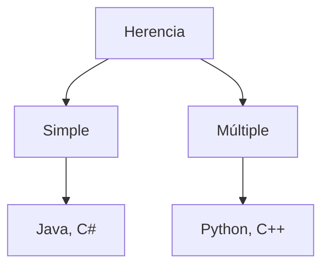

# Introducción a las Ciencias de la Computación - Herencia

## 5.2 Aspectos principales de la herencia

---

### 1. Conceptos Fundamentales

#### 1.1 Definición de Herencia

Mecanismo que permite a una clase (subclase) adquirir propiedades y comportamientos de otra clase (superclase):

$$ \text{Subclase} \equiv \text{Superclase} + \Delta\text{Atributos} + \Delta\text{Métodos} $$

#### 1.2 Relación "es-un"

Base conceptual de la herencia:

- `Perro` **es-un** `Animal`
- `Coche` **es-un** `Vehículo`
- `Profesor` **es-un** `Persona`

### 2. Tipos de Herencia

#### 2.1 Herencia Simple vs Múltiple



#### 2.2 Ejemplo de Herencia Simple (Java)

```java
// Superclase
public class Vehiculo {
    protected String marca;
    protected int velocidad;

    public void acelerar() {
        velocidad += 10;
    }
}

// Subclase
public class Coche extends Vehiculo {
    private int numPuertas;

    public void abrirMaletero() {
        System.out.println("Maletero abierto");
    }
}
```

#### 2.3 Ejemplo de Herencia Múltiple (Python)

```python
class Terrestre:
    def mover(self):
        print("Movimiento terrestre")

class Acuatico:
    def nadar(self):
        print("Nadando")

class Anfibio(Terrestre, Acuatico):  # Herencia múltiple
    pass
```

### 3. Modificadores de Acceso en Herencia

#### 3.1 Niveles de Visibilidad

| Modificador | Clase | Subclase | Paquete | Otros |
| ----------- | ----- | -------- | ------- | ----- |
| `public`    |       |          |         |       |
| `protected` |       |          |         |       |
| `private`   |       |          |         |       |

#### 3.2 Uso de `super`

```typescript
class Animal {
  constructor(public nombre: string) {}

  hacerSonido(): void {
    console.log('Sonido genérico');
  }
}

class Perro extends Animal {
  constructor(
    nombre: string,
    public raza: string,
  ) {
    super(nombre); // Llama al constructor padre
  }

  hacerSonido(): void {
    super.hacerSonido(); // Accede al método padre
    console.log('Guau guau');
  }
}
```

### 4. Sobrescritura y Sobrecarga

#### 4.1 Sobrescritura (Overriding)

Redefinición de métodos en la subclase:

```java
public class Figura {
    public double area() {
        return 0;
    }
}

public class Circulo extends Figura {
    private double radio;

    @Override
    public double area() {
        return Math.PI * radio * radio;
    }
}
```

#### 4.2 Sobrecarga (Overloading)

Múltiples métodos con mismo nombre pero diferentes parámetros:

```java
public class Calculadora {
    public int sumar(int a, int b) {
        return a + b;
    }

    public double sumar(double a, double b) {
        return a + b;
    }
}
```

### 5. Principio de Sustitución de Liskov (LSP)

#### 5.1 Definición

Las subclases deben ser sustituibles por sus superclases sin alterar el comportamiento del programa:

$$ \forall x \in T, \forall y \in S : y \text{ debe poder reemplazar } x $$

#### 5.2 Ejemplo de Violación

```java
public class Pato extends Ave {
    @Override
    public void volar() {
        throw new UnsupportedOperationException("Los patos no vuelan");
    }
}
```

### 6. Ejercicios Prácticos

1. Crea una jerarquía de empleados: `Empleado` → `Gerente` → `Desarrollador`
2. Implementa sobrescritura del método `calcularSalario()` en cada subclase
3. Explica por qué esta herencia es incorrecta: `Circulo extends Cuadrado`

### Ver también

- **5.1** Extensión de clases — mecanismos que se profundizan aquí.
- **5.3** Polimorfismo — construcción sobre la herencia.
- **5.4** Clases abstractas — restricciones especiales de herencia.

### Referencias

- Eckel, B. (2006). _Thinking in Java_ (4.ª ed.). Prentice Hall. Cap. 7.
- Bloch, J. (2018). _Effective Java_ (3.ª ed.). Addison-Wesley. Ítem 19.
