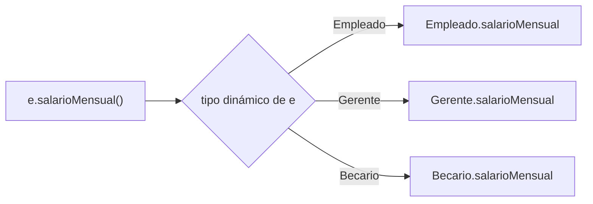

# Introducción a las Ciencias de la Computación - Herencia

## 5.3 Polimorfismo.

---

**Polimorfismo** significa "muchas formas": un mismo código funciona con objetos de tipos distintos, y cada objeto responde a un mensaje según su propia clase. Es lo que permite escribir `for (Empleado e : nomina) total += e.salarioMensual();` y que cada empleado calcule su salario a su manera, sin un solo `if` que pregunte de qué tipo es. El polimorfismo es la consecuencia más importante de la herencia y de las interfaces, y la razón por la que los programas orientados a objetos pueden extenderse con clases nuevas sin modificar el código existente.

### 1. Polimorfismo de subtipos

Una variable de tipo `Empleado` puede referirse a cualquier objeto cuya clase sea `Empleado` o una subclase. Al enviarle un mensaje, se ejecuta el método del **tipo dinámico**, el del objeto real:

```java
import java.util.List;

class Empleado {
    protected final String nombre;
    protected final double base;
    Empleado(String nombre, double base) { this.nombre = nombre; this.base = base; }
    double salarioMensual() { return base; }
    String descripcion() { return nombre + " (empleado)"; }
}

class Gerente extends Empleado {
    private final double bono;
    Gerente(String nombre, double base, double bono) { super(nombre, base); this.bono = bono; }
    @Override double salarioMensual() { return base + bono; }
    @Override String descripcion() { return nombre + " (gerente)"; }
}

class Becario extends Empleado {
    Becario(String nombre, double base) { super(nombre, base); }
    @Override double salarioMensual() { return base * 0.6; }
    @Override String descripcion() { return nombre + " (becario)"; }
}

public class Nomina {
    static double total(List<Empleado> empleados) {
        double suma = 0;
        for (Empleado e : empleados) {
            suma += e.salarioMensual();          // cada objeto usa su propia versión
        }
        return suma;
    }

    public static void main(String[] args) {
        List<Empleado> nomina = List.of(
                new Empleado("Ana", 20000),
                new Gerente("Luis", 30000, 8000),
                new Becario("Eva", 10000));
        for (Empleado e : nomina) {
            System.out.printf("%-18s %10.2f%n", e.descripcion(), e.salarioMensual());
        }
        System.out.printf("%-18s %10.2f%n", "Total", total(nomina));
    }
}
```

```text
Ana (empleado)       20000.00
Luis (gerente)       38000.00
Eva (becario)         6000.00
Total                64000.00
```

El método `total` fue escrito solo en términos de `Empleado`. Si mañana se agrega una clase `Contratista extends Empleado`, `total` funciona con ella **sin cambiar una línea**. Este es el principio **abierto-cerrado**: el código queda abierto a extensión y cerrado a modificación.

### 2. Enlace dinámico

Para decidir qué método ejecutar intervienen dos momentos:

- **Al compilar**, con el tipo estático, se verifica que el mensaje exista: `e.salarioMensual()` compila porque `Empleado` tiene ese método.
- **Al ejecutar**, con el tipo dinámico, se elige **cuál** versión correr. Esto se llama **enlace dinámico** o enlace tardío.



**Cómo se implementa.** Cada clase tiene una **tabla de métodos virtuales**: una tabla con la dirección del código de cada uno de sus métodos. La subclase copia la tabla de su superclase y reemplaza las entradas de los métodos que redefine. Cada objeto guarda una referencia a la tabla de su clase, así que una llamada polimórfica consiste en consultar la tabla del objeto y saltar a la dirección indicada: un costo pequeño y constante.

En Java, todos los métodos de instancia que no son `private`, `static` ni `final` se enlazan dinámicamente. Los métodos `static` y los atributos **no** son polimórficos: se resuelven con el tipo estático.

### 3. Reemplazar condicionales por polimorfismo

Sin polimorfismo, el código tiende a llenarse de preguntas sobre el tipo:

```java
// Frágil: hay que modificarlo cada vez que aparece un tipo nuevo de empleado
double salario(Empleado e) {
    if (e instanceof Gerente g) return g.getBase() + g.getBono();
    else if (e instanceof Becario b) return b.getBase() * 0.6;
    else return e.getBase();
}
```

Si este tipo de `if` aparece en varios lugares, agregar un tipo de empleado obliga a encontrarlos y modificarlos todos, y olvidar uno es un error silencioso. Con polimorfismo, cada clase sabe calcular su propio salario y el conocimiento queda en un solo lugar.

### 4. Otras formas de polimorfismo

**Polimorfismo paramétrico (genéricos).** Un mismo código funciona con cualquier tipo, indicado como parámetro:

```java
static <T extends Comparable<T>> T maximo(List<T> lista) {
    T mejor = lista.get(0);
    for (T x : lista) {
        if (x.compareTo(mejor) > 0) mejor = x;
    }
    return mejor;
}
// maximo(List.of(3, 9, 4)) es 9; maximo(List.of("pera", "uva", "kiwi")) es "uva"
```

El método funciona con cualquier tipo `T` cuyos objetos se puedan comparar. Las colecciones, como `List<T>`, son el ejemplo más común.

**Polimorfismo ad hoc (sobrecarga).** Varios métodos con el mismo nombre y distintos parámetros, como `println(int)`, `println(String)` y `println(Object)`. A diferencia del de subtipos, la versión se elige **al compilar**, con los tipos estáticos de los argumentos:

```java
static void mostrar(Object o)   { System.out.println("objeto"); }
static void mostrar(String s)   { System.out.println("cadena"); }

Object x = "hola";
mostrar(x);          // imprime "objeto": el tipo estático de x es Object
```

| Tipo de polimorfismo | Mecanismo en Java        | Se decide        |
| -------------------- | ------------------------ | ---------------- |
| De subtipos          | herencia e interfaces     | al ejecutar      |
| Paramétrico          | genéricos `<T>`           | al compilar      |
| Ad hoc               | sobrecarga de métodos     | al compilar      |

### 5. Polimorfismo con interfaces

El polimorfismo de subtipos no requiere herencia de clases: basta con que varias clases implementen la misma interfaz.

```java
interface Figura {
    double area();
}

record Circulo(double r) implements Figura {
    public double area() { return Math.PI * r * r; }
}

record Rectangulo(double base, double altura) implements Figura {
    public double area() { return base * altura; }
}

public class Figuras {
    public static void main(String[] args) {
        Figura[] figuras = { new Circulo(1), new Rectangulo(2, 3), new Circulo(0.5) };
        double total = 0;
        for (Figura f : figuras) total += f.area();
        System.out.printf("Área total: %.4f%n", total);    // 6 + 1.25 pi = 9.9270
    }
}
```

### 6. Errores frecuentes

- **Creer que se redefinió un método cuando se sobrecargó**, por cambiar el tipo de un parámetro. La anotación `@Override` lo evita.
- **Esperar polimorfismo de métodos `static`**: si `Gerente` declara un método `static` con el mismo nombre que uno de `Empleado`, la llamada a través de una variable `Empleado` ejecuta el de `Empleado`.
- **Llamar desde un constructor a un método redefinible**: se ejecuta la versión de la subclase antes de que la subclase haya inicializado sus atributos.

> **Conexión con CC.** Gran parte de las bibliotecas y marcos de trabajo funcionan gracias al polimorfismo: un algoritmo de ordenamiento recibe cualquier `Comparator`, un servidor web recibe cualquier manejador de peticiones, una interfaz gráfica dibuja cualquier componente que implemente su método de dibujo. El programador agrega comportamiento implementando interfaces o extendiendo clases, y el marco de trabajo lo invoca sin conocer las clases concretas.

### Ejercicios propuestos

1. Agregue a la nómina una clase `Contratista` cuyo salario sea horas trabajadas por pago por hora, y verifique que `total` funciona sin modificarse.
2. Prediga la salida y explíquela distinguiendo tipo estático y dinámico:

```java
Empleado e = new Gerente("Luis", 30000, 8000);
System.out.println(e.salarioMensual());
System.out.println(e.descripcion());
System.out.println(e instanceof Empleado);
System.out.println(e.getClass().getSimpleName());
```

3. Reescriba sin `instanceof` el siguiente código, agregando un método polimórfico a la jerarquía:

```java
String sonido(Animal a) {
    if (a instanceof Perro) return "guau";
    if (a instanceof Gato) return "miau";
    return "...";
}
```

4. Escriba un método genérico `<T> void intercambiar(T[] arr, int i, int j)` y úselo con un arreglo de cadenas y uno de enteros.
5. Agregue a las figuras un `Triangulo` y un método `perimetro()` en la interfaz. ¿Qué clases hubo que modificar y cuáles no?

### Ver también

- **3.4** Distintos tipos de métodos — `toString` y otros métodos redefinibles.
- **4.1** Interfaces — contratos con varias implementaciones.
- **5.1 y 5.2** Extensión de clases y aspectos de la herencia — sobrescritura y conversiones.
- **5.4** Clases abstractas — superclases diseñadas para el polimorfismo.
- **5.5** Uso de interfaces — `Comparable`, `Comparator` y expresiones lambda.
- **Lenguajes de Programación** (Sem. 5) — sistemas de tipos y polimorfismo.

### Referencias

- Cardelli, L., & Wegner, P. (1985). On understanding types, data abstraction, and polymorphism. _ACM Computing Surveys_, 17(4), 471-523.
- Eckel, B. (2006). _Thinking in Java_ (4.ª ed.). Prentice Hall. Cap. 8.
- Fowler, M. (2018). _Refactoring_ (2.ª ed.). Addison-Wesley. "Replace Conditional with Polymorphism".
