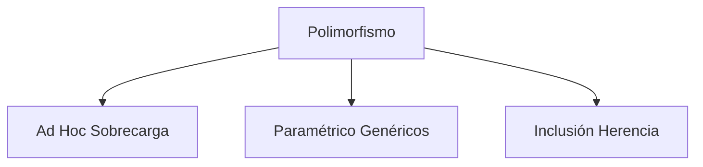
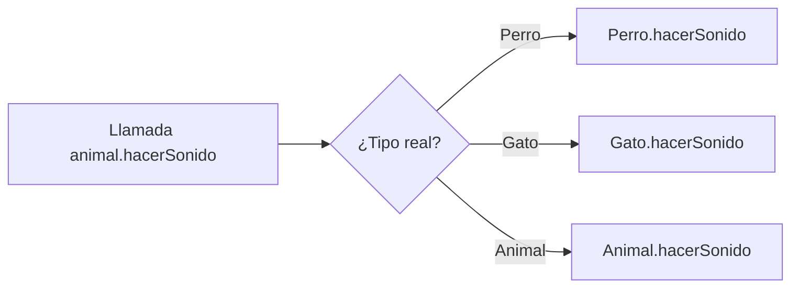

# Introducción a las Ciencias de la Computación - Herencia

## 5.3 Polimorfismo

---

### 1. Concepto Fundamental

#### 1.1 Definición

Capacidad de objetos de diferentes clases de responder al mismo mensaje (método) de manera específica:

$$ \text{Polimorfismo} = \frac{\text{Número de implementaciones}}{\text{Número de interfaces}} $$

#### 1.2 Tipos de Polimorfismo



### 2. Polimorfismo por Herencia

#### 2.1 Ejemplo en Java

```java
// Superclase
public class Animal {
    public void hacerSonido() {
        System.out.println("Sonido genérico");
    }
}

// Subclases
public class Perro extends Animal {
    @Override
    public void hacerSonido() {
        System.out.println("Guau guau");
    }
}

public class Gato extends Animal {
    @Override
    public void hacerSonido() {
        System.out.println("Miau");
    }
}
```

#### 2.2 Uso Polimórfico

```java
public class Veterinaria {
    public void examinarAnimal(Animal animal) {
        animal.hacerSonido();  // Comportamiento polimórfico
    }
}

// Uso
Veterinaria vet = new Veterinaria();
vet.examinarAnimal(new Perro());  // "Guau guau"
vet.examinarAnimal(new Gato());   // "Miau"
```

### 3. Enlace Tardío (Late Binding)

#### 3.1 Mecanismo de Ejecución

La versión del método a ejecutar se decide en tiempo de ejecución, no de compilación:

$$ \text{Enlace}(m) = \begin{cases} \text{Temprano} & \text{si } \text{decidido en compilación} \\\ \text{Tardío} & \text{si } \text{decidido en ejecución} \end{cases} $$

#### 3.2 Diagrama de Despacho



### 4. Polimorfismo con Interfaces

#### 4.1 Ejemplo en TypeScript

```typescript
interface Forma {
  area(): number;
}

class Circulo implements Forma {
  constructor(private radio: number) {}

  area(): number {
    return Math.PI * this.radio ** 2;
  }
}

class Cuadrado implements Forma {
  constructor(private lado: number) {}

  area(): number {
    return this.lado * this.lado;
  }
}

function calcularAreaTotal(formas: Forma[]): number {
  return formas.reduce((sum, forma) => sum + forma.area(), 0);
}
```

### 5. Métodos Abstractos y Polimorfismo

#### 5.1 Clases Abstractas

```java
public abstract class Empleado {
    private String nombre;

    public abstract double calcularSalario();  // Método abstracto

    public String getNombre() {
        return nombre;
    }
}

public class Gerente extends Empleado {
    @Override
    public double calcularSalario() {
        return 5000.0;
    }
}

public class Desarrollador extends Empleado {
    @Override
    public double calcularSalario() {
        return 3000.0;
    }
}
```

### 6. Ejercicios Prácticos

1. Crea una jerarquía de figuras geométricas con método `area()` polimórfico
2. Implementa una función que reciba un array de `Empleado` y calcule la nómina total
3. Explica la diferencia entre:

```java
Animal a1 = new Animal();     // No polimórfico
Animal a2 = new Perro();      // Polimórfico
```

### Ver también

- **5.1–5.2** Extensión y herencia — el polimorfismo requiere herencia.
- **5.4** Clases abstractas — habilitan el polimorfismo declarativo.
- **5.5** Interfaces — el polimorfismo sin herencia de implementación.

### Referencias

- Eckel, B. (2006). _Thinking in Java_ (4.ª ed.). Prentice Hall. Cap. 8.
- Gamma, E. et al. (1994). _Design Patterns_. Addison-Wesley. Cap. 1.
