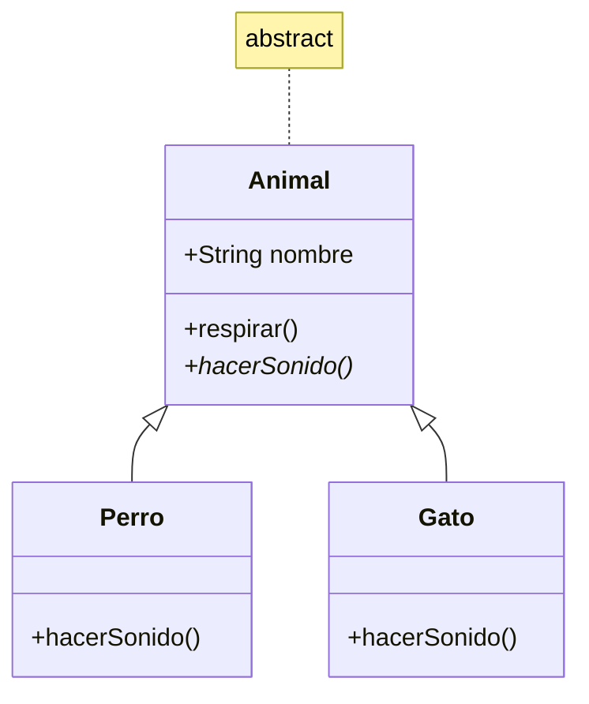

# Introducción a las Ciencias de la Computación - Herencia

## 5.4 Clases abstractas.

---

### 1. Concepto y Definición

#### 1.1 ¿Qué es una Clase Abstracta?

Clase que no puede ser instanciada directamente y que sirve como plantilla para subclases:

$$ \text{ClaseAbstracta} = \{ \text{Atributos} + \text{MétodosConcretos} + \text{MétodosAbstractos} \} $$

#### 1.2 Propiedades Clave

- **No instanciable**: No se puede crear objetos directamente
- **Puede contener métodos abstractos**: Sin implementación
- **Puede contener métodos concretos**: Con implementación
- **Define un contrato**: Las subclases deben implementar los métodos abstractos

### 2. Sintaxis y Uso

#### 2.1 Ejemplo en Java

```java
// Clase abstracta
public abstract class Animal {
    protected String nombre;

    // Método concreto
    public void respirar() {
        System.out.println(nombre + " está respirando");
    }

    // Método abstracto (sin implementación)
    public abstract void hacerSonido();
}

// Subclase concreta
public class Perro extends Animal {
    public Perro(String nombre) {
        this.nombre = nombre;
    }

    @Override
    public void hacerSonido() {
        System.out.println("Guau guau");
    }
}
```

#### 2.2 Ejemplo en Python

```python
from abc import ABC, abstractmethod

class Animal(ABC):  # Clase abstracta
    def __init__(self, nombre):
        self.nombre = nombre

    @abstractmethod
    def hacer_sonido(self):
        pass  # Sin implementación

    def respirar(self):  # Método concreto
        print(f"{self.nombre} está respirando")

class Gato(Animal):
    def hacer_sonido(self):  # Implementación obligatoria
        print("Miau")
```

### 3. Diagrama UML



### 4. Métodos Abstractos vs Concretos

#### 4.1 Comparativa

| Tipo Método   | Implementación | Obligatorio en subclases   |
| ------------- | -------------- | -------------------------- |
| **Abstracto** | No             | Sí                         |
| **Concreto**  | Sí             | No (puede sobreescribirse) |

#### 4.2 Uso de Métodos Concretos

```typescript
abstract class Empleado {
  constructor(
    protected nombre: string,
    protected salarioBase: number,
  ) {}

  // Método abstracto
  abstract calcularSalario(): number;

  // Método concreto
  getInfo(): string {
    return `Empleado: ${this.nombre}`;
  }
}

class Gerente extends Empleado {
  calcularSalario(): number {
    return this.salarioBase * 1.5;
  }
}
```

### 5. Ventajas y Aplicaciones

#### 5.1 Beneficios

1. **Imposición de contrato**: Garantiza que las subclases implementen ciertos métodos
2. **Reutilización de código**: Métodos concretos se heredan
3. **Flexibilidad**: Permite variaciones en las implementaciones

#### 5.2 Casos de Uso Comunes

- Frameworks de aplicación
- Bibliotecas de componentes
- Sistemas de plugins

### 6. Ejercicios Prácticos

1. Crea una clase abstracta `FiguraGeometrica` con método abstracto `calcularArea()`
2. Implementa subclases `Circulo` y `Cuadrado` que hereden de la clase abstracta
3. Explica por qué este código produce error:

```java
Animal a = new Animal();  // Intento de instanciar clase abstracta
```

### Ver también

- **5.1** Extensión — las clases abstractas son la generalización de las clases.
- **5.5** Interfaces — distinción clave: clase abstracta vs. interfaz.
- **5.3** Polimorfismo — las clases abstractas son el contrato del polimorfismo.

### Referencias

- Eckel, B. (2006). _Thinking in Java_ (4.ª ed.). Prentice Hall. Cap. 9.
- Bloch, J. (2018). _Effective Java_ (3.ª ed.). Addison-Wesley. Ítem 20.
