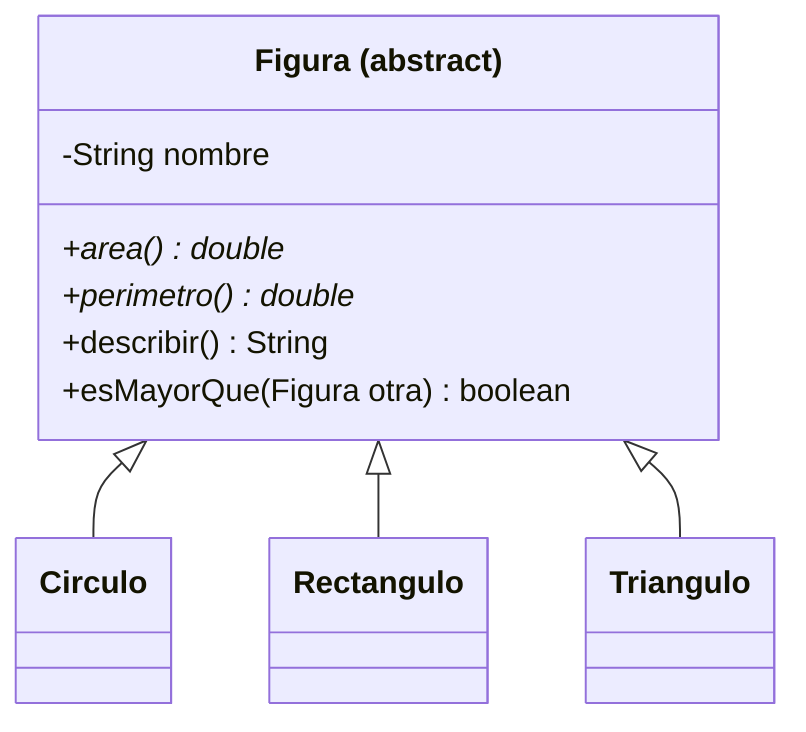

# Introducción a las Ciencias de la Computación - Herencia

## 5.4 Clases abstractas.

---

Algunas clases representan conceptos demasiado generales para tener instancias propias. No existe "una figura" que no sea un círculo, un rectángulo o un triángulo; no existe "una cuenta" que no sea de algún tipo concreto. Una **clase abstracta** captura lo que comparten todas las variantes de un concepto, el estado y el comportamiento comunes, y deja **declarado pero sin implementar** lo que cada variante resuelve a su manera. No se pueden crear objetos de ella: existe para ser extendida.

### 1. Definición

Una clase se declara abstracta con `abstract`. Puede tener:

- atributos y constructores, como cualquier clase;
- métodos **concretos**, con implementación, que heredan las subclases;
- métodos **abstractos**, declarados con `abstract` y sin cuerpo, que toda subclase concreta **debe** implementar.

```java
public abstract class Figura {
    private final String nombre;

    protected Figura(String nombre) {           // constructor para las subclases
        this.nombre = nombre;
    }

    public abstract double area();               // cada figura la calcula a su manera
    public abstract double perimetro();

    public String getNombre() { return nombre; }

    /** Método concreto que usa los abstractos. */
    public String describir() {
        return String.format("%s: área %.2f, perímetro %.2f", nombre, area(), perimetro());
    }

    public boolean esMayorQue(Figura otra) {
        return area() > otra.area();
    }
}
```

```java
class Circulo extends Figura {
    private final double radio;
    Circulo(double radio) { super("Círculo"); this.radio = radio; }
    @Override public double area() { return Math.PI * radio * radio; }
    @Override public double perimetro() { return 2 * Math.PI * radio; }
}

class Rectangulo extends Figura {
    private final double base, altura;
    Rectangulo(double base, double altura) { super("Rectángulo"); this.base = base; this.altura = altura; }
    @Override public double area() { return base * altura; }
    @Override public double perimetro() { return 2 * (base + altura); }
}

class Triangulo extends Figura {
    private final double a, b, c;
    Triangulo(double a, double b, double c) {
        super("Triángulo");
        if (a + b <= c || a + c <= b || b + c <= a) throw new IllegalArgumentException("No es un triángulo");
        this.a = a; this.b = b; this.c = c;
    }
    @Override public double perimetro() { return a + b + c; }
    @Override public double area() {                     // fórmula de Herón
        double s = perimetro() / 2;
        return Math.sqrt(s * (s - a) * (s - b) * (s - c));
    }
}

public class PruebaFiguras {
    public static void main(String[] args) {
        Figura[] figuras = { new Circulo(1), new Rectangulo(3, 2), new Triangulo(3, 4, 5) };
        for (Figura f : figuras) System.out.println(f.describir());
        System.out.println(figuras[1].esMayorQue(figuras[2]));   // false: ambas áreas valen 6
        // Figura f = new Figura("x");   error: Figura es abstracta
    }
}
```

```text
Círculo: área 3.14, perímetro 6.28
Rectángulo: área 6.00, perímetro 10.00
Triángulo: área 6.00, perímetro 12.00
false
```

El rectángulo de $3 \times 2$ y el triángulo de lados 3, 4 y 5 tienen la misma área, 6, así que `esMayorQue` regresa `false`.



En UML, el estereotipo `(abstract)` o el nombre en cursivas indican una clase abstracta, y el asterisco, un método abstracto.

### 2. Reglas

- No se pueden crear objetos de una clase abstracta: `new Figura(...)` no compila. Sí se pueden declarar variables y parámetros de su tipo, que es precisamente lo útil.
- Una clase con al menos un método abstracto **debe** declararse abstracta.
- Una subclase que no implementa todos los métodos abstractos heredados también debe ser abstracta.
- Una clase abstracta puede no tener ningún método abstracto, si simplemente no tiene sentido instanciarla.
- Sus constructores se usan desde las subclases con `super(...)`; por eso suelen ser `protected`.
- Un método no puede ser `abstract` y `private`, ni `abstract` y `final`, ni `abstract` y `static`: en los tres casos sería imposible implementarlo en una subclase.

### 3. El patrón método plantilla

El método `describir` ilustra un uso muy común de las clases abstractas: un método concreto define el **esqueleto** de un algoritmo y delega algunos pasos en métodos abstractos que cada subclase completa. Es el patrón de diseño **método plantilla**.

```java
abstract class Reporte {
    /** El algoritmo fijo: no se puede redefinir. */
    public final String generar() {
        return encabezado() + "\n" + cuerpo() + "\n" + pie();
    }
    protected String encabezado() { return "=== " + titulo() + " ==="; }
    protected String pie() { return "--- fin ---"; }
    protected abstract String titulo();
    protected abstract String cuerpo();
}

class ReporteVentas extends Reporte {
    protected String titulo() { return "Ventas de marzo"; }
    protected String cuerpo() { return "Total: 125 000 pesos"; }
}
```

Las subclases solo escriben lo que varía; el orden de los pasos queda garantizado por la clase abstracta, y `final` impide que una subclase lo altere.

### 4. Implementaciones parciales

Las clases abstractas también sirven para ofrecer una **implementación parcial** de una interfaz grande. Por ejemplo, la biblioteca de Java tiene la clase abstracta `AbstractList`: basta con implementar `get(int)` y `size()` para obtener una lista completa, con iteradores, `contains`, `indexOf`, `toString` y muchos otros métodos ya implementados en términos de esos dos.

```java
import java.util.AbstractList;

/** Una lista de solo lectura con los cuadrados 0, 1, 4, 9, ..., (n-1)^2, sin guardarlos. */
class Cuadrados extends AbstractList<Integer> {
    private final int n;
    Cuadrados(int n) { this.n = n; }
    @Override public Integer get(int i) {
        if (i < 0 || i >= n) throw new IndexOutOfBoundsException(i);
        return i * i;
    }
    @Override public int size() { return n; }
}
// new Cuadrados(5) se imprime como [0, 1, 4, 9, 16] y admite contains, indexOf, etc.
```

### 5. Clases abstractas e interfaces

| Aspecto                      | Clase abstracta                         | Interfaz                                         |
| ---------------------------- | --------------------------------------- | ------------------------------------------------ |
| Atributos de instancia       | sí                                      | no, solo constantes                              |
| Constructores                | sí                                      | no                                               |
| Métodos con implementación   | sí                                      | solo `default` y `static`                        |
| Herencia múltiple            | no: una clase extiende una sola         | sí: una clase implementa varias                  |
| Relación que expresa         | "es un" tipo de, con estado compartido  | "puede hacer", un rol o capacidad                |

Una regla práctica: usar una **interfaz** para definir un tipo o una capacidad, como `Comparable` o `Figura`, y una **clase abstracta** cuando además hay estado o implementación que compartir entre varias subclases. Es común combinarlas: una interfaz `Figura` y una clase abstracta `FiguraBase` que la implementa parcialmente.

> **Conexión con CC.** El patrón método plantilla es la forma en que muchos marcos de trabajo dejan que el programador personalice su comportamiento: el marco define el ciclo de vida de una aplicación o de una prueba, y el programador redefine solo los pasos que le interesan. JUnit, por ejemplo, ejecuta preparación, prueba y limpieza en un orden fijo que el programador completa.

### Ejercicios propuestos

1. Agregue a la jerarquía de figuras un `Cuadrado` y un `Hexagono` regular. ¿Debe `Cuadrado` extender `Rectangulo`? Recuerde el principio de sustitución del subtema 5.2.
2. Escriba un método estático que reciba un arreglo de `Figura` y regrese la de mayor perímetro.
3. Convierta la clase `Empleado` de los subtemas anteriores en abstracta, con un método abstracto `salarioMensual()`, y explique qué cambia para `Gerente` y `Becario`.
4. Diseñe una clase abstracta `Juego` con un método plantilla `jugar()` que repita `turno()` hasta que `terminado()` sea verdadero y luego llame a `anunciarGanador()`. Impleméntela para un juego sencillo, como adivinar un número.
5. ¿Por qué no compila la declaración `private abstract void calcular();`? ¿Y `abstract static double area();`?

### Ver también

- **4.1** Interfaces — contratos sin estado.
- **5.1 y 5.2** Extensión de clases y aspectos de la herencia.
- **5.3** Polimorfismo — las clases abstractas existen para ser usadas polimórficamente.
- **5.5** Uso de interfaces — la otra forma de definir tipos abstractos.
- **Modelado y Programación** (Sem. 3) — patrones de diseño.

### Referencias

- Gamma, E., Helm, R., Johnson, R., & Vlissides, J. (1994). _Design Patterns_. Addison-Wesley. "Template Method".
- Bloch, J. (2018). _Effective Java_ (3.ª ed.). Addison-Wesley. Ítems 20 y 23.
- Oracle. _The Java Tutorials: Abstract Methods and Classes_.
