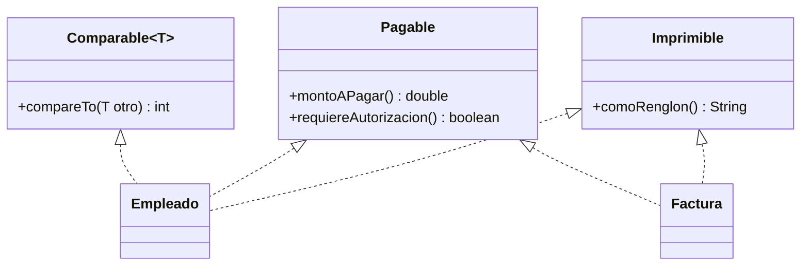

# Introducción a las Ciencias de la Computación - Herencia

## 5.5 Uso de interfaces.

---

En el subtema 4.1 se presentaron las interfaces como contratos de las estructuras de datos. En el contexto de la herencia cumplen un papel adicional: como en Java una clase solo puede extender a **una** superclase, las interfaces son el mecanismo para que una clase pertenezca a **varios** tipos a la vez. Un `Empleado` puede ser, al mismo tiempo, algo que se compara, algo que se imprime en un reporte y algo que se guarda en un archivo. Este subtema muestra cómo combinar herencia e interfaces, y las interfaces más usadas de la biblioteca estándar.

### 1. Implementar varias interfaces

```java
interface Imprimible {
    String comoRenglon();
}

interface Pagable {
    double montoAPagar();
    default boolean requiereAutorizacion() { return montoAPagar() > 50_000; }
}

class Empleado implements Imprimible, Pagable, Comparable<Empleado> {
    private final String nombre;
    private final double salario;

    Empleado(String nombre, double salario) { this.nombre = nombre; this.salario = salario; }

    public String comoRenglon() { return String.format("%-10s %10.2f", nombre, salario); }
    public double montoAPagar() { return salario; }
    public int compareTo(Empleado otro) { return Double.compare(salario, otro.salario); }
    public String getNombre() { return nombre; }
}

class Factura implements Imprimible, Pagable {
    private final String proveedor;
    private final double total;
    Factura(String proveedor, double total) { this.proveedor = proveedor; this.total = total; }
    public String comoRenglon() { return String.format("%-10s %10.2f (factura)", proveedor, total); }
    public double montoAPagar() { return total; }
}
```

Un `Empleado` y una `Factura` no tienen nada que ver en una jerarquía de clases, pero ambos son `Pagable`. Un sistema de tesorería puede tratarlos de manera uniforme:

```java
import java.util.List;

public class Tesoreria {
    static double totalAPagar(List<? extends Pagable> pagos) {
        double total = 0;
        for (Pagable p : pagos) total += p.montoAPagar();
        return total;
    }

    public static void main(String[] args) {
        List<Pagable> pagos = List.of(new Empleado("Ana", 20000),
                                      new Factura("Papelería", 3500),
                                      new Factura("Servidores", 62000));
        for (Pagable p : pagos) {
            System.out.println(((Imprimible) p).comoRenglon()
                    + (p.requiereAutorizacion() ? "  requiere autorización" : ""));
        }
        System.out.println("Total: " + totalAPagar(pagos));   // Total: 85500.0
    }
}
```



### 2. Interfaces de la biblioteca estándar

**`Comparable<T>`: el orden natural.** Una clase que implementa `Comparable` define cómo se ordenan sus objetos. El método `compareTo` regresa un número negativo si el objeto va antes que el otro, cero si son equivalentes y positivo si va después. Con eso, `Collections.sort`, `Arrays.sort` y `TreeSet` saben ordenarlos:

```java
List<Empleado> lista = new java.util.ArrayList<>(List.of(
        new Empleado("Luis", 38000), new Empleado("Ana", 20000), new Empleado("Eva", 6000)));
java.util.Collections.sort(lista);           // por salario, según compareTo
```

El orden debe ser consistente: si `a.compareTo(b) < 0` entonces `b.compareTo(a) > 0`, y debe ser transitivo, es decir, debe definir un orden en el sentido de Estructuras Discretas (subtema 4.4).

**`Comparator<T>`: órdenes adicionales.** Para ordenar de otras formas sin modificar la clase se usa un comparador externo. Desde Java 8 se construyen de forma concisa:

```java
import java.util.Comparator;

lista.sort(Comparator.comparing(Empleado::getNombre));                     // por nombre
lista.sort(Comparator.comparingDouble(Empleado::montoAPagar).reversed());  // de mayor a menor salario
```

**`Iterable<T>`.** Una clase que lo implementa puede recorrerse con el `for` mejorado. Es lo que permite escribir `for (String s : lista)`.

**`Runnable`.** Representa una tarea que puede ejecutarse, por ejemplo en otro hilo (tema 9).

**`AutoCloseable`.** Los recursos que lo implementan, como archivos, se cierran automáticamente al usarlos en un `try` con recursos (tema 7).

### 3. Interfaces funcionales y expresiones lambda

Una interfaz con **un solo método abstracto** se llama **funcional**. Sus implementaciones pueden escribirse como **expresiones lambda**, funciones anónimas breves:

```java
import java.util.function.Predicate;

Predicate<Empleado> ganaMucho = e -> e.montoAPagar() > 30000;
Comparator<String> porLongitud = (a, b) -> Integer.compare(a.length(), b.length());
Runnable saludo = () -> System.out.println("Hola desde una tarea");

lista.removeIf(ganaMucho);                    // elimina a quienes ganan más de 30 000
```

Las lambdas permiten pasar comportamiento como argumento de forma tan sencilla como se pasan datos, y son la base de la programación funcional en Java con flujos (`Stream`).

### 4. Métodos por omisión y conflictos

Los métodos `default` permiten agregar operaciones a una interfaz sin obligar a modificar todas las clases que ya la implementan. Si una clase hereda dos métodos `default` con la misma firma de dos interfaces distintas, el compilador exige que la clase lo redefina y decida:

```java
interface A { default String hola() { return "A"; } }
interface B { default String hola() { return "B"; } }

class C implements A, B {
    @Override public String hola() { return A.super.hola() + B.super.hola(); }   // "AB"
}
```

Así Java evita la ambigüedad del "problema del diamante" que aparece en lenguajes con herencia múltiple de clases. Además, si una clase hereda un método de una superclase y otro igual por omisión de una interfaz, gana el de la superclase.

### 5. Diseñar con interfaces

- **Programar contra la interfaz:** declarar parámetros, atributos y valores de regreso con el tipo de la interfaz más general que baste, como `List`, `Pagable` o `Comparable`.
- **Interfaces pequeñas:** es mejor varias interfaces con pocos métodos, como `Imprimible` y `Pagable`, que una enorme que obligue a las clases a implementar métodos que no usan. Es el principio de **segregación de interfaces**.
- **Depender de abstracciones:** una clase que recibe en su constructor un objeto de tipo interfaz, en lugar de crear ella misma una implementación concreta, es más fácil de probar y de reutilizar.

```java
interface Notificador { void enviar(String destinatario, String mensaje); }

class ServicioDeCobro {
    private final Notificador notificador;
    ServicioDeCobro(Notificador notificador) { this.notificador = notificador; }
    void cobrar(String cliente, double monto) {
        // ... lógica de cobro ...
        notificador.enviar(cliente, "Se cobraron " + monto + " pesos");
    }
}
// En producción se le pasa un notificador por correo; en las pruebas, uno que solo guarda los mensajes.
```

> **Conexión con CC.** La técnica de recibir las dependencias como interfaces, llamada **inyección de dependencias**, es la base de marcos de trabajo como Spring en Java y Angular en TypeScript. En Angular, por ejemplo, los servicios se declaran y el marco los "inyecta" en los componentes que los necesitan, lo que permite reemplazarlos por versiones simuladas en las pruebas.

### Ejercicios propuestos

1. Haga que la clase `Reloj` del subtema 3.4 implemente `Comparable<Reloj>` y ordene una lista de relojes.
2. Ordene una lista de cadenas: (a) alfabéticamente; (b) por longitud; (c) por longitud y, en caso de empate, alfabéticamente, usando `Comparator.comparing(...).thenComparing(...)`.
3. Agregue a `Pagable` un método `default` llamado `iva()` que regrese el 16 % del monto. ¿Qué clases hubo que modificar?
4. Escriba una implementación de `Notificador` que guarde los mensajes en una lista, y úsela para verificar que `ServicioDeCobro` envía el mensaje correcto.
5. Use `Predicate`, `removeIf` y `Comparator` para, a partir de una lista de empleados, eliminar a los que ganan menos de 10 000 y ordenar a los restantes de mayor a menor salario.
6. Explique por qué Java permite implementar varias interfaces pero no extender varias clases.

### Ver también

- **4.1** Interfaces — contratos y tipos de datos abstractos.
- **5.3** Polimorfismo — polimorfismo de subtipos con interfaces.
- **5.4** Clases abstractas — comparación con las interfaces.
- **7.3** Detección y manejo de errores — `AutoCloseable` y `try` con recursos.
- **9.2** Mecanismos del lenguaje para hilos — `Runnable`.
- **Estructuras Discretas 4.4** — relaciones de orden, el fundamento de `Comparable`.

### Referencias

- Bloch, J. (2018). _Effective Java_ (3.ª ed.). Addison-Wesley. Ítems 14, 20, 21, 42 y 64.
- Oracle. _The Java Tutorials: Interfaces and Inheritance_ y _Lambda Expressions_.
- Martin, R. C. (2017). _Clean Architecture_. Prentice Hall. Cap. 10 y 11.
