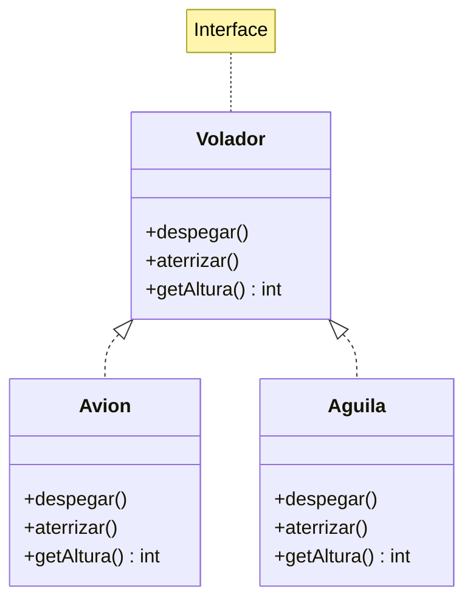

# Introducción a las Ciencias de la Computación - Herencia

## 5.5 Uso de interfaces.

---

### 1. Concepto y Definición

#### 1.1 ¿Qué es una Interfaz?

Contrato que define un conjunto de métodos que una clase debe implementar, sin proporcionar implementación:

$$ \text{Interfaz} = \{ \text{método}_1, \text{método}_2, \dots, \text{método}_n \} $$

#### 1.2 Propiedades Clave

- **Solo declaraciones**: Sin implementación de métodos
- **Múltiple implementación**: Una clase puede implementar varias interfaces
- **Polimorfismo**: Permite tratar objetos de diferentes clases de manera uniforme

### 2. Sintaxis y Uso

#### 2.1 Ejemplo en Java

```java
// Definición de interfaz
public interface Volador {
    void despegar();
    void aterrizar();
    int getAltura();
}

// Implementación en clase
public class Avion implements Volador {
    private int altura;

    @Override
    public void despegar() {
        System.out.println("Avión despegando");
        altura = 1000;
    }

    @Override
    public void aterrizar() {
        System.out.println("Avión aterrizando");
        altura = 0;
    }

    @Override
    public int getAltura() {
        return altura;
    }
}
```

#### 2.2 Ejemplo en TypeScript

```typescript
// Interfaz para formas geométricas
interface Forma {
  area(): number;
  perimetro(): number;
}

// Implementación
class Circulo implements Forma {
  constructor(private radio: number) {}

  area(): number {
    return Math.PI * this.radio ** 2;
  }

  perimetro(): number {
    return 2 * Math.PI * this.radio;
  }
}
```

### 3. Diagrama UML



### 4. Interfaces vs Clases Abstractas

#### 4.1 Comparativa

| Característica        | Interfaz                | Clase Abstracta                |
| --------------------- | ----------------------- | ------------------------------ |
| **Implementación**    | Solo métodos abstractos | Métodos abstractos y concretos |
| **Herencia múltiple** | Sí                      | No                             |
| **Campos**            | Solo constantes         | Campos de instancia            |
| **Constructor**       | No                      | Sí                             |

#### 4.2 Uso Conjunto

```java
public abstract class Animal {
    protected String nombre;

    public Animal(String nombre) {
        this.nombre = nombre;
    }

    public abstract void comer();
}

public interface Nadador {
    void nadar();
}

public class Pato extends Animal implements Nadador {
    public Pato(String nombre) {
        super(nombre);
    }

    @Override
    public void comer() {
        System.out.println(nombre + " está comiendo");
    }

    @Override
    public void nadar() {
        System.out.println(nombre + " está nadando");
    }
}
```

### 5. Interfaces Funcionales (Java)

#### 5.1 Concepto

Interfaz con un solo método abstracto, usable con expresiones lambda:

$$ \text{InterfazFuncional} = \{ \text{un único método abstracto} \} $$

#### 5.2 Ejemplo

```java
@FunctionalInterface
interface Calculadora {
    int operar(int a, int b);
}

// Uso con lambda
Calculadora suma = (a, b) -> a + b;
Calculadora resta = (a, b) -> a - b;

System.out.println(suma.operar(5, 3));  // 8
```

### 6. Ejercicios Prácticos

1. Crea una interfaz `Reproducible` para medios audiovisuales con métodos `play()`, `pause()`, `stop()`
2. Implementa la interfaz en clases `Cancion` y `Video`
3. Explica por qué las interfaces permiten mayor flexibilidad que la herencia múltiple de clases

### Ver también

- **4.1** Interfaces como contratos — definición formal.
- **5.4** Clases abstractas — comparación con interfaces.
- **5.3** Polimorfismo — programar hacia interfaces para lograr polimorfismo flexible.

### Referencias

- Eckel, B. (2006). _Thinking in Java_ (4.ª ed.). Prentice Hall. Cap. 9.
- Bloch, J. (2018). _Effective Java_ (3.ª ed.). Addison-Wesley. Ítem 20, 64.
