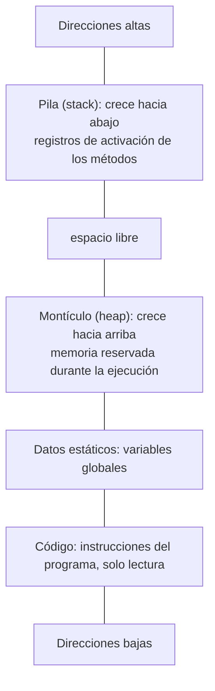
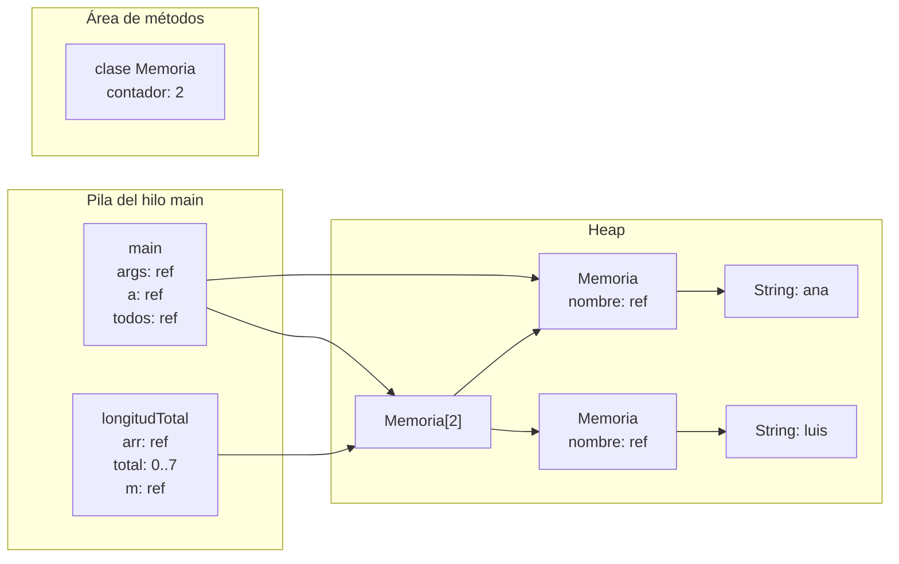

# Introducción a las Ciencias de la Computación - Administración de memoria durante ejecución

## 6.1 La memoria durante la ejecución de aplicaciones.

---

Mientras un programa se ejecuta, todo lo que maneja vive en memoria: sus instrucciones, sus variables, sus objetos, el registro de qué método llamó a cuál. Esa memoria no es un bloque indiferenciado: el sistema operativo y el entorno de ejecución la organizan en **zonas** con reglas distintas sobre cuándo se reserva y cuándo se libera el espacio. Entender esa organización explica errores como `StackOverflowError` y `OutOfMemoryError`, el comportamiento de las referencias y por qué unos programas son más rápidos que otros.

### 1. El espacio de direcciones de un proceso

Cuando el sistema operativo ejecuta un programa crea un **proceso**, y le asigna un **espacio de direcciones virtual**: una sucesión de direcciones que el proceso ve como propia, aunque físicamente esté repartida en la memoria RAM y en el disco. Un programa compilado, como uno escrito en C, organiza ese espacio así:



| Zona         | Contenido                                       | Se reserva                      | Se libera                            |
| ------------ | ----------------------------------------------- | ------------------------------- | ------------------------------------ |
| Código       | instrucciones en lenguaje de máquina            | al cargar el programa           | al terminar el proceso               |
| Datos estáticos | variables globales y estáticas               | al cargar el programa           | al terminar el proceso               |
| Pila         | parámetros y variables locales de cada llamada  | al llamar a una función         | automáticamente al regresar de ella  |
| Heap         | estructuras creadas dinámicamente               | a petición del programa         | explícitamente, o por el recolector de basura |

La pila y el heap crecen uno hacia el otro desde extremos opuestos del espacio libre, de modo que ambos pueden usar el espacio disponible según lo necesiten.

### 2. La memoria en la máquina virtual de Java

Un programa Java no corre directamente sobre el sistema operativo sino sobre la **JVM**, que es a su vez un proceso. Dentro de su espacio de direcciones, la JVM organiza las **áreas de datos de ejecución**:

- **Heap:** todos los objetos y arreglos creados con `new`. Es compartido por todos los hilos del programa y lo administra el recolector de basura.
- **Área de métodos (metaspace):** la información de cada clase cargada: su código compilado a bytecode, sus métodos, sus constantes y sus **variables `static`**.
- **Una pila por hilo:** cada hilo de ejecución tiene su propia pila con un **registro de activación** por cada método en curso, que contiene sus parámetros y variables locales.
- **Registro PC por hilo:** la instrucción de bytecode que el hilo está ejecutando.

### 3. Dónde vive cada cosa

```java
public class Memoria {
    static int contador = 0;                      // área de métodos: una sola copia

    private final String nombre;                  // dentro de cada objeto, en el heap

    Memoria(String nombre) { this.nombre = nombre; contador++; }

    static int longitudTotal(Memoria[] arr) {     // arr: referencia en la pila de esta llamada
        int total = 0;                            // total: primitivo en la pila
        for (Memoria m : arr) total += m.nombre.length();
        return total;
    }

    public static void main(String[] args) {
        Memoria a = new Memoria("ana");           // a: referencia en la pila de main
        Memoria[] todos = { a, new Memoria("luis") };   // el arreglo y los objetos, en el heap
        System.out.println(longitudTotal(todos) + " " + contador);   // 7 2
    }
}
```

Justo cuando se ejecuta `longitudTotal`, la memoria se ve así:



La regla general en Java:

- Las **variables locales y los parámetros** viven en la pila. Si son de tipo primitivo, ahí está el valor; si son de tipo objeto, ahí está solo la referencia.
- **Todos los objetos y arreglos** viven en el heap, incluidos sus atributos, aunque sean primitivos.
- Las **variables `static`** viven con la clase, en el área de métodos.

### 4. Vida útil de los datos

- Una variable local nace cuando se ejecuta su declaración y muere cuando termina su bloque. Su espacio en la pila se recupera automáticamente y sin costo al regresar del método.
- Un objeto nace con `new` y vive mientras sea **alcanzable** desde alguna variable del programa. Cuando deja de serlo, el recolector de basura recupera su espacio en algún momento posterior (subtema 6.2).
- Una variable `static` vive mientras la clase esté cargada, normalmente durante todo el programa.

Por eso un método puede regresar un objeto creado dentro de él: el objeto está en el heap y sobrevive a la llamada; lo que desaparece es solo la variable local que lo referenciaba.

### 5. Límites y errores

Ambas zonas tienen un tamaño máximo, configurable al iniciar la JVM:

| Error                  | Causa típica                                                      | Opción de la JVM |
| ---------------------- | ----------------------------------------------------------------- | ---------------- |
| `StackOverflowError`   | recursión demasiado profunda, por ejemplo sin caso base alcanzable | `-Xss` tamaño de cada pila |
| `OutOfMemoryError`     | demasiados objetos vivos, o una fuga que los mantiene alcanzables  | `-Xmx` tamaño máximo del heap |

```java
public class Uso {
    public static void main(String[] args) {
        Runtime rt = Runtime.getRuntime();
        long mb = 1024 * 1024;
        System.out.println("Procesadores: " + rt.availableProcessors());
        System.out.println("Heap máximo: " + rt.maxMemory() / mb + " MB");
        System.out.println("Heap reservado: " + rt.totalMemory() / mb + " MB");
        System.out.println("Heap libre: " + rt.freeMemory() / mb + " MB");
    }
}
```

```bash
java -Xmx512m -Xss2m Uso     # heap máximo de 512 MB y pilas de 2 MB
```

### 6. Memoria virtual

Las direcciones que usa un proceso son **virtuales**: el hardware y el sistema operativo las traducen a direcciones físicas usando tablas de páginas. Esto permite que cada proceso tenga un espacio de direcciones propio y aislado, que un proceso no pueda leer la memoria de otro, y que la suma de la memoria de todos los procesos supere la memoria física, guardando en disco las páginas que no se usan. El detalle se estudia en Sistemas Operativos y en Organización y Arquitectura de Computadoras.

> **Conexión con CC.** El costo de acceder a la memoria varía enormemente: un registro del procesador se lee en menos de un nanosegundo, la memoria RAM en unos cien, y una página que fue enviada a disco en millones. Las estructuras de datos que mantienen sus datos juntos, como los arreglos, aprovechan mejor la memoria caché que las que los dispersan por el heap, como las listas ligadas. Diseñar pensando en la jerarquía de memoria es parte importante de la programación de alto rendimiento.

### Ejercicios propuestos

1. Para el siguiente fragmento, indique en qué zona de memoria vive cada variable y cada objeto, y dibuje la memoria justo antes de que `crear` regrese:

```java
static int creados;
static int[] crear(int n) {
    int[] datos = new int[n];
    for (int i = 0; i < n; i++) datos[i] = i * i;
    creados++;
    return datos;
}
public static void main(String[] args) {
    int[] cuadrados = crear(4);
}
```

2. Explique por qué es válido que `crear` regrese el arreglo `datos` aunque `datos` sea una variable local.
3. Ejecute la clase `Uso` con distintos valores de `-Xmx` y observe cómo cambian los números.
4. Escriba un programa que provoque un `OutOfMemoryError` agregando arreglos grandes a una lista, ejecútelo con `-Xmx64m` y observe cuántos alcanza a crear.
5. ¿Por qué cada hilo necesita su propia pila pero todos pueden compartir el heap? Relacione la respuesta con los problemas de sincronización del tema 9.

### Ver también

- **1.2** Arquitectura de Von Neumann — la memoria como arreglo de celdas.
- **3.3** Variables y referencias — qué guarda una variable de tipo objeto.
- **6.2** El heap y la recolección de basura.
- **6.3** La pila de ejecución y los registros de activación.
- **Sistemas Operativos** (Sem. 6) y **Organización y Arquitectura de Computadoras 9.6** (Sem. 4) — memoria virtual.

### Referencias

- Lindholm, T., et al. _The Java Virtual Machine Specification_, Java SE Edition. Sección 2.5: Run-Time Data Areas.
- Bryant, R. E., & O'Hallaron, D. R. (2015). _Computer Systems: A Programmer's Perspective_ (3.ª ed.). Pearson. Cap. 9.
- Silberschatz, A., Galvin, P. B., & Gagne, G. (2018). _Operating System Concepts_ (10.ª ed.). Wiley. Cap. 9.
