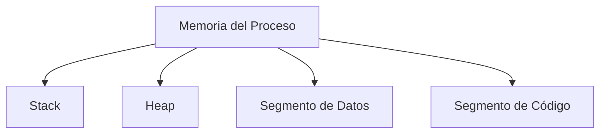
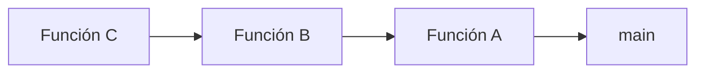
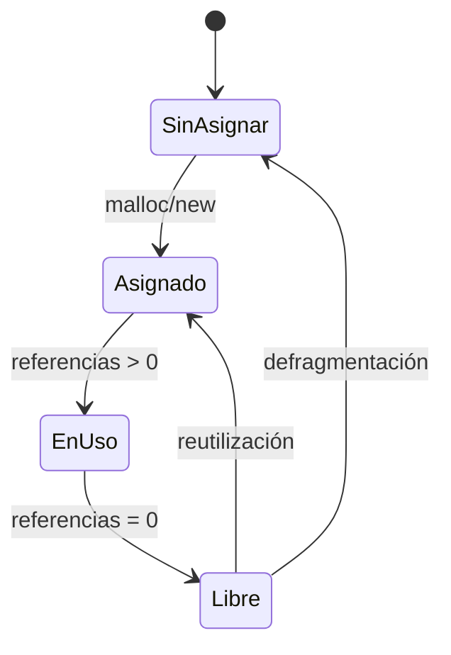

# Introducción a las Ciencias de la Computación - Administración de memoria durante ejecución

## 6.1 La memoria durante la ejecución de aplicaciones.

---

### 1. Estructura de Memoria en Ejecución

#### 1.1 Segmentos de Memoria

Durante la ejecución, la memoria de un proceso se divide en:

$$ \text{MemoriaProceso} = \text{Stack} + \text{Heap} + \text{Datos} + \text{Código} $$



#### 1.2 Descripción de Segmentos

| Segmento   | Contenido                                                    | Direccionamiento |
| ---------- | ------------------------------------------------------------ | ---------------- |
| **Stack**  | Variables locales, llamadas a funciones                      | LIFO             |
| **Heap**   | Objetos dinámicos, memoria solicitada en tiempo de ejecución | Aleatorio        |
| **Datos**  | Variables globales y estáticas                               | Estático         |
| **Código** | Instrucciones del programa                                   | Solo lectura     |

### 2. Stack (Pila de Ejecución)

#### 2.1 Funcionamiento

Almacena:

- Variables locales
- Parámetros de funciones
- Dirección de retorno

**Ejemplo de crecimiento:**



#### 2.2 Ejemplo en C

```c
void funcionB() {
    int localB = 20;  // Almacenado en stack
}

void funcionA() {
    int localA = 10;  // Almacenado en stack
    funcionB();
}

int main() {
    funcionA();
    return 0;
}
```

### 3. Heap (Memoria Dinámica)

#### 3.1 Asignación Dinámica

Memoria solicitada explícitamente durante la ejecución:

**Java:**

```java
// Asignación en heap
String texto = new String("Hola");
int[] numeros = new int[100];
```

**C++:**

```cpp
// Asignación manual
int* array = new int[50];
// Liberación explícita
delete[] array;
```

#### 3.2 Gestión de Heap

- **Java**: Garbage Collector automático
- **C/C++**: Gestión manual con `new`/`delete` o `malloc`/`free`

### 4. Garbage Collection (Recolección de Basura)

#### 4.1 Algoritmo Básico

$$ \text{ObjetoRecolectable} \iff \text{Referencias} = 0 $$

#### 4.2 Ejemplo de Referencias

```java
public class EjemploGC {
    public static void main(String[] args) {
        Object obj1 = new Object();  // Referencia 1
        Object obj2 = obj1;          // Mismo objeto, referencia 2
        obj1 = null;                 // Referencia 1 eliminada
        // Objeto aún accesible por obj2
        obj2 = null;                 // Ahora sí recolectable
    }
}
```

### 5. Diagrama de Estados de Memoria



### 6. Ejercicios Prácticos

1. Dibuja el estado del stack durante la ejecución de:

```java
void metodo1(int x) {
    int y = x + 1;
    metodo2(y);
}
void metodo2(int z) {
    System.out.println(z);
}
```

2. Explica por qué este código causa memory leak en C++:

```cpp
void leak() {
    int* ptr = new int[100];
    // Falta delete[] ptr;
}
```

3. Calcula el tamaño aproximado en memoria de:

   `int[1000]` en Java (considerando overhead)

### Ver también

- **4.2** Objetos y referencias — los objetos viven en el heap.
- **6.2** Heap y recolección de basura — gestión del heap en detalle.
- **6.3** Pila de ejecución — la otra área de memoria del programa.

### Referencias

- Jones, R., Hosking, A., & Moss, E. (2011). _The Garbage Collection Handbook_. CRC Press.
- Tanenbaum, A. S. (2013). _Structured Computer Organization_ (6.ª ed.). Pearson.
