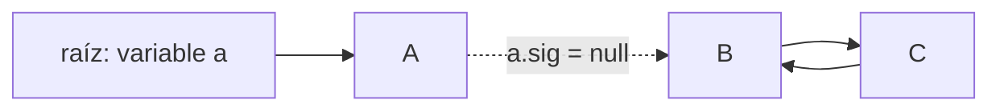

# Introducción a las Ciencias de la Computación - Administración de memoria durante ejecución

## 6.2 El heap y la recolección de basura.

---

El **heap** o montículo es la zona de memoria donde viven los objetos. A diferencia de la pila, cuyo espacio se libera solo al regresar de cada método, en el heap los objetos pueden sobrevivir a quien los creó y compartirse entre muchas partes del programa, así que no hay un momento obvio en que liberarlos. En lenguajes como C la responsabilidad es del programador; en Java, Python o C# la asume un **recolector de basura** que detecta automáticamente los objetos que ya no pueden usarse. Este subtema explica cómo funciona y por qué, aun con él, un programa puede quedarse sin memoria.

### 1. Reservar memoria en el heap

Cada `new` pide al heap espacio para un objeto: sus atributos más un pequeño **encabezado** que guarda, entre otras cosas, una referencia a su clase. En la JVM la reserva es muy rápida: cada hilo tiene una región propia del heap y avanza un apuntador hasta el siguiente espacio libre, de modo que crear un objeto pequeño cuesta apenas unas instrucciones.

El precio de esa rapidez es que **liberar** se pospone: el espacio de los objetos que ya no se usan se recupera de golpe en cada ciclo de recolección.

### 2. ¿Qué es basura? Alcanzabilidad

Un objeto es **basura** si el programa ya no tiene forma de llegar a él. Formalmente, el recolector parte de un conjunto de **raíces**:

- las variables locales y los parámetros de todos los registros de activación de todas las pilas;
- las variables `static` de las clases cargadas;
- otras referencias internas de la JVM, como los hilos activos.

Un objeto es **alcanzable** si existe un camino de referencias desde alguna raíz hasta él. Todo objeto no alcanzable puede liberarse, porque ningún código podrá volver a usarlo.

```java
class Nodo {
    String dato;
    Nodo sig;
    Nodo(String dato) { this.dato = dato; }
}

public class Alcanzabilidad {
    public static void main(String[] args) {
        Nodo a = new Nodo("A");
        Nodo b = new Nodo("B");
        Nodo c = new Nodo("C");
        a.sig = b;
        b.sig = c;
        c.sig = b;          // b y c forman un ciclo
        b = null;
        c = null;           // B y C siguen siendo alcanzables a través de a
        a.sig = null;       // ahora B y C son basura, aunque se refieran entre sí
    }
}
```



Tras la última línea, B y C se refieren mutuamente, pero ninguna raíz llega a ellos: son basura.

### 3. Marcar y barrer

El algoritmo básico de recolección tiene dos fases:

1. **Marcar:** se recorre el grafo de objetos desde las raíces, como un recorrido de una gráfica, y se marca cada objeto alcanzado.
2. **Barrer:** se recorre el heap completo y se libera el espacio de todo objeto no marcado.


**Fragmentación y compactación.** Después de barrer, el espacio libre queda repartido en huecos entre los objetos vivos. Puede haber mucha memoria libre en total y, aun así, ningún hueco lo bastante grande para un arreglo grande. Por eso muchos recolectores **compactan**: mueven los objetos vivos para dejarlos contiguos y actualizan todas las referencias a ellos. En Java el programador nunca ve direcciones de memoria reales, lo que hace posible mover los objetos.

### 4. Recolección generacional

Las mediciones en programas reales muestran la **hipótesis generacional**: la mayoría de los objetos mueren jóvenes. Los objetos temporales de un cálculo, las cadenas intermedias o los iteradores de un ciclo dejan de usarse casi de inmediato.

La JVM aprovecha esto dividiendo el heap:

- **Generación joven:** donde se crean los objetos. Se recolecta con frecuencia y rápido, porque casi todo lo que hay ahí ya es basura y solo hay que copiar los pocos sobrevivientes.
- **Generación vieja:** los objetos que sobreviven varias recolecciones jóvenes se promueven aquí. Se recolecta con menos frecuencia.

Así, la mayor parte del trabajo se concentra en una región pequeña donde la recolección es barata.

**Pausas.** Durante algunas fases el programa se detiene. Los recolectores modernos de la JVM, como G1, que es el predeterminado, y ZGC, hacen casi todo el trabajo en paralelo con el programa y logran pausas de pocos milisegundos o menos, incluso con heaps de muchos gigabytes.

| Recolector  | Idea principal                                      | Adecuado para                     |
| ----------- | --------------------------------------------------- | --------------------------------- |
| Serial      | un solo hilo recolecta                               | programas pequeños                |
| Parallel    | varios hilos, maximiza el trabajo útil total         | procesamiento por lotes           |
| G1          | heap dividido en regiones, pausas acotadas           | uso general                       |
| ZGC         | casi todo concurrente, pausas muy cortas             | heaps grandes y baja latencia     |

### 5. Otras estrategias de administración de memoria

**Administración manual.** En C, el programador pide memoria con `malloc` y la devuelve con `free`. Es eficiente y predecible, pero propensa a errores graves:

- **fuga de memoria:** olvidar `free`, y la memoria nunca se recupera;
- **referencia colgante:** usar un bloque después de liberarlo, con resultados impredecibles;
- **doble liberación:** liberar dos veces el mismo bloque, que corrompe las estructuras del asignador.

Estos errores son una de las principales fuentes de vulnerabilidades de seguridad.

**Conteo de referencias.** Cada objeto lleva la cuenta de cuántas referencias apuntan a él y se libera cuando la cuenta llega a cero. Libera la memoria de inmediato y sin pausas, pero no puede liberar **ciclos** como el de B y C, cuya cuenta nunca baja a cero. Python lo usa, complementado con un recolector de ciclos, y Swift lo usa con referencias débiles que el programador marca para romper los ciclos.

### 6. Fugas de memoria en Java

El recolector libera lo que es **inalcanzable**, no lo que el programa ya **no necesita**. Si un objeto sigue siendo alcanzable por descuido, nunca se libera. Las causas típicas son:

- colecciones `static` a las que se agregan objetos que nunca se quitan;
- cachés sin límite de tamaño;
- objetos que se registran como "escuchas" de eventos y nunca se desregistran.

```java
import java.util.ArrayList;
import java.util.List;

public class Historial {
    private static final List<String> registro = new ArrayList<>();   // vive todo el programa

    static void procesar(String peticion) {
        registro.add(peticion);           // cada petición queda referenciada para siempre
        // ... procesamiento ...
    }

    public static void main(String[] args) {
        for (int i = 0; i < 1_000_000; i++) {
            procesar("petición número " + i);
        }
        System.out.println(registro.size() + " peticiones retenidas en memoria");
    }
}
```

En un servidor que atiende peticiones durante semanas, esta lista crece hasta agotar el heap. Las soluciones son conservar solo lo necesario, por ejemplo las últimas mil peticiones, o usar estructuras que no impiden la recolección, como `WeakHashMap`, cuyas entradas desaparecen cuando sus llaves dejan de usarse en otra parte.

**Ayudar al recolector.** No hace falta, y en general no conviene, asignar `null` a las variables locales al terminar de usarlas ni llamar a `System.gc()`. Sí conviene eliminar referencias en estructuras de larga vida, como al implementar una pila con un arreglo:

```java
public Object desapilar() {
    Object x = elementos[--tamanio];
    elementos[tamanio] = null;      // sin esto, el arreglo retiene el objeto aunque ya no esté en la pila
    return x;
}
```

> **Conexión con CC.** La recolección de basura es un problema de recorrido de gráficas, con las técnicas de Gráficas y Juegos y Estructuras de Datos, resuelto bajo restricciones severas de tiempo y memoria. Lenguajes recientes como Rust adoptan un tercer camino: un sistema de tipos de **propiedad** que permite al compilador saber exactamente cuándo liberar cada objeto, sin recolector y sin los errores de la administración manual.

### Ejercicios propuestos

1. Dibuje el grafo de objetos y diga cuáles son basura al final del siguiente fragmento:

```java
Nodo x = new Nodo("X");
Nodo y = new Nodo("Y");
Nodo z = new Nodo("Z");
x.sig = y; y.sig = z; z.sig = x;
y = null;
x.sig = z;
z = null;
```

2. Explique por qué el conteo de referencias no puede liberar ciclos y por qué el algoritmo de marcar y barrer sí puede.
3. Ejecute `Historial` con `-Xmx32m` y con `-Xmx256m`. Modifíquelo para que solo retenga las últimas 1000 peticiones y verifique que ya no se agota la memoria.
4. Explique qué problema resuelve la compactación y por qué es posible en Java pero no en C.
5. Investigue qué hace la opción `-Xlog:gc` de la JVM y úsela para observar cuántas recolecciones jóvenes ocurren al ejecutar un programa que crea muchos objetos temporales.

### Ver también

- **4.2** Objetos y referencias — redes de objetos y ciclos.
- **6.1** La memoria durante la ejecución — las zonas de memoria.
- **6.3** La pila de ejecución — las variables locales como raíces.
- **Gráficas y Juegos 1.7** (Sem. 2) — caminos y alcanzabilidad.
- **Lenguajes de Programación** (Sem. 5) — modelos de administración de memoria.

### Referencias

- Jones, R., Hosking, A., & Moss, E. (2023). _The Garbage Collection Handbook_ (2.ª ed.). CRC Press. Cap. 1 a 3.
- Bloch, J. (2018). _Effective Java_ (3.ª ed.). Addison-Wesley. Ítem 7: "Eliminate obsolete object references".
- Oracle. _HotSpot Virtual Machine Garbage Collection Tuning Guide_.
