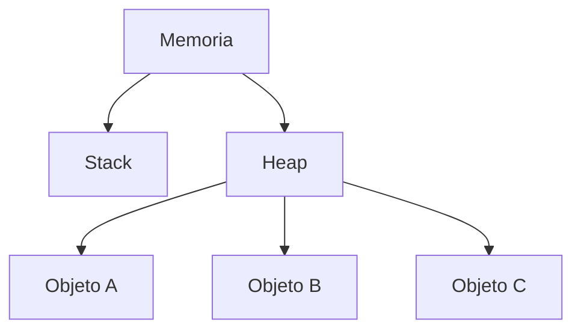
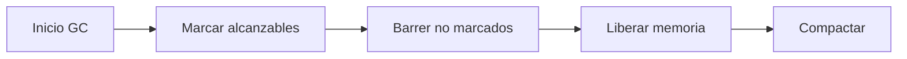

# Introducción a las Ciencias de la Computación - Administración de memoria durante ejecución

## 6.2 El heap y la recolección de basura

---

### 1. El Heap (Montículo)

#### 1.1 Definición

Área de memoria dinámica donde se almacenan objetos y datos cuyo tamaño o vida útil se determina en tiempo de ejecución:

$$ \text{Heap} = \{ \text{objeto}_1, \text{objeto}_2, \dots, \text{objeto}_n \} $$

#### 1.2 Características

- **Asignación dinámica**: Memoria solicitada durante la ejecución
- **Tamaño variable**: Crece según las necesidades del programa
- **Acceso aleatorio**: Sin orden específico de almacenamiento

**Diagrama de memoria:**



### 2. Asignación de Memoria en el Heap

#### 2.1 Operaciones Básicas

- **Allocate**: Reservar memoria (`new`, `malloc`)
- **Deallocate**: Liberar memoria (`delete`, `free`, GC)

#### 2.2 Ejemplos Multi-lenguaje

**Java:**

```java
// Asignación en heap
String mensaje = new String("Hola Mundo");
int[] numeros = new int[100];
```

**C++:**

```cpp
// Asignación manual
int* array = new int[50];
// Liberación explícita
delete[] array;
```

**Python:**

```python
# Asignación automática
lista = [1, 2, 3]
diccionario = {"clave": "valor"}
```

### 3. Recolección de Basura (Garbage Collection)

#### 3.1 Concepto Fundamental

Proceso automático que identifica y libera memoria de objetos no accesibles:

$$ \text{ObjetoRecolectable} \iff \nexists \text{ camino de acceso desde raíces} $$

#### 3.2 Algoritmos Principales

##### 3.2.1 Mark and Sweep



##### 3.2.2 Generational GC

- **Hipótesis generacional**: La mayoría de objetos mueren jóvenes
- **Divisiones**: Young Generation, Old Generation

### 4. Raíces de Acceso (GC Roots)

#### 4.1 Puntos de Partida

Objetos siempre accesibles que evitan la recolección:

- Variables locales en stack
- Variables estáticas
- Hilos activos
- Referencias JNI

#### 4.2 Ejemplo de Ciclo de Vida

```java
public class EjemploGC {
    public static void main(String[] args) {
        // Objeto creado en heap
        Object obj = new Object();

        // obj es alcanzable (referenciado desde stack)
        System.out.println(obj.toString());

        // obj deja de ser alcanzable (candidato a GC)
        obj = null;
    }
}
```

### 5. Tipos de Recolectores

#### 5.1 Comparativa

| Tipo            | Estrategia           | Ventajas         |
| --------------- | -------------------- | ---------------- |
| **Serial GC**   | Un solo hilo         | Bajo consumo     |
| **Parallel GC** | Múltiples hilos      | Mayor throughput |
| **G1 GC**       | División en regiones | Bajas pausas     |

#### 5.2 Configuración en JVM

```bash
# Ejemplo de parámetros JVM
java -Xms512m -Xmx2g -XX:+UseG1GC MiAplicacion
```

### 6. Memory Leaks en Entornos con GC

#### 6.1 Causas Comunes

- Colecciones estáticas que acumulan objetos
- Listeners no removidos
- Caches sin límite de tamaño

#### 6.2 Ejemplo de Leak

```java
public class MemoryLeak {
    private static final List<Object> LEAK = new ArrayList<>();

    public void leakMemory() {
        for (int i = 0; i < 1000; i++) {
            LEAK.add(new byte[1024]); // 1KB por iteración
        }
    }
}
```

### 7. Ejercicios Prácticos

1. Dibuja el grafo de referencias de:

```java
   Object a = new Object();
   Object b = new Object();
   a.ref = b;
   b.ref = a;
   a = null;
   b = null;
```

2. Explica por qué los algoritmos generacionales son más eficientes
3. Calcula el overhead de memoria de un objeto Java típico (header + campos)

### Ver también

- **6.1** La memoria durante la ejecución — visión global de la memoria.
- **3.3** Variables y referencias — qué se guarda en el heap.
- **6.4** Implementación de la recursividad — interacción entre heap y pila.

### Referencias

- Jones, R., Hosking, A., & Moss, E. (2011). _The Garbage Collection Handbook_. CRC Press.
- Wilson, P. R. (1992). Uniprocessor garbage collection techniques. _LNCS_, 637.
