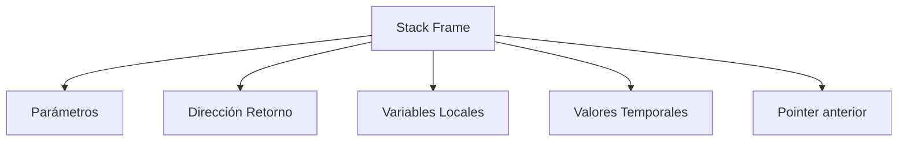
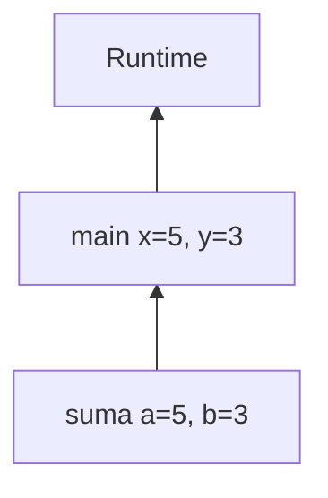
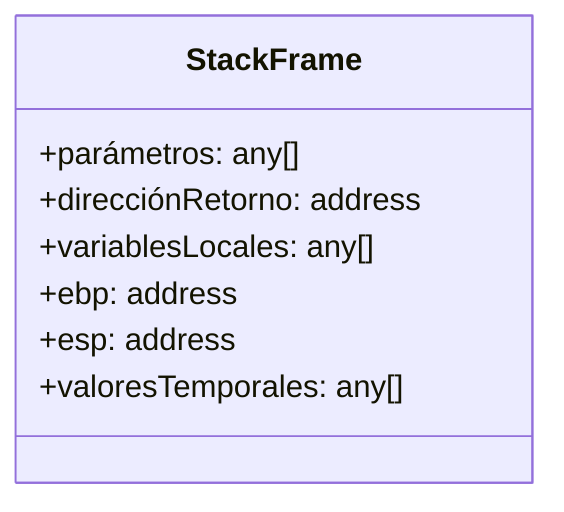

# Introducción a las Ciencias de la Computación - Administración de memoria durante ejecución

## 6.3 La pila de ejecución y los registros de activación por proceso.

---

### 1. Pila de Ejecución (Call Stack)

#### 1.1 Definición

Estructura LIFO (Last-In, First-Out) que almacena información de ejecución de funciones:

$$ \text{CallStack} = \langle \text{Marco}_1, \text{Marco}_2, \dots, \text{Marco}_n \rangle $$

#### 1.2 Propiedades

- **Crecimiento dinámico**: Se expande con cada llamada a función
- **Gestión automática**: El sistema operativo controla su tamaño
- **Acceso rápido**: Operaciones push/pop en $O(1)$

### 2. Registro de Activación (Stack Frame)

#### 2.1 Estructura Básica

Cada marco contiene:

$$ \text{StackFrame} = \left\lbrace \begin{array}{ll} \text{Parámetros} & \\\ \text{Dirección de retorno} & \\\ \text{Variables locales} & \\\ \text{Valores temporales} & \end{array} \right\rbrace $$

#### 2.2 Diagrama de Marco



### 3. Ejemplo de Ejecución

#### 3.1 Código de Ejemplo

```c
int suma(int a, int b) {
    int resultado = a + b;
    return resultado;
}

int main() {
    int x = 5;
    int y = 3;
    int total = suma(x, y);
    return 0;
}
```

#### 3.2 Estado del Stack



### 4. Componentes Detallados del Stack Frame

#### 4.1 Estructura Completa



#### 4.2 Registros Críticos

- **EIP/RIP**: Instruction Pointer
- **EBP/RBP**: Base Pointer (marco actual)
- **ESP/RSP**: Stack Pointer (cima del stack)

### 5. Gestión de Memoria en el Stack

#### 5.1 Asignación Automática

Las variables locales se almacenan en tiempo de compilación:

$$ \text{Offset} = \text{EBP} - \text{desplazamiento} $$

#### 5.2 Ejemplo Ensamblador

```nasm
suma:
    push ebp           ; Guardar EBP anterior
    mov ebp, esp       ; Nuevo base pointer
    sub esp, 4         ; Espacio para variable local
    mov eax, [ebp+8]   ; Acceso a parámetro a
    add eax, [ebp+12]  ; Sumar parámetro b
    mov [ebp-4], eax   ; Almacenar en resultado
    mov eax, [ebp-4]   ; Valor de retorno
    mov esp, ebp       ; Restaurar stack pointer
    pop ebp            ; Restaurar base pointer
    ret                ; Retorno
```

### 6. Recursión y Stack Overflow

#### 6.1 Límite de Profundidad

Cada llamada recursiva consume stack frame:

$$ \text{StackDepth}_{\text{máx}} = \frac{\text{StackSize}}{\text{FrameSize}} $$

#### 6.2 Ejemplo de Overflow

```python
def recursion_infinita(n):
    return recursion_infinita(n + 1)  # ¡Stack Overflow!

recursion_infinita(0)
```

### 7. Ejercicios Prácticos

1. Dibuja el stack tras 3 llamadas recursivas de factorial(3)
2. Calcula el tamaño aproximado del stack frame para:

```c
   void funcion(int a, double b, char c) {
       int x[10];
       float y;
   }
```

3. Explica por qué las variables locales no se inicializan automáticamente en C

### 8. Recursos Adicionales

- **Libro:** "Computer Systems: A Programmer's Perspective" (Cap. 3)
- **Herramienta:** GDB para debug de stack

#### Ver también

- **6.1–6.2** Memoria global — la pila como complemento del heap.
- **4.6** Funciones y recursión — cada llamada crea un registro de activación en la pila.
- **6.4** Implementación de la recursividad — profundización en el uso de la pila.

#### Referencias

- Patterson, D., & Hennessy, J. (2014). _Computer Organization and Design_ (5.ª ed.). Morgan Kaufmann. Cap. 2.
- Aho, A. V. et al. (2007). _Compilers_ (2.ª ed.). Pearson. Cap. 7.
