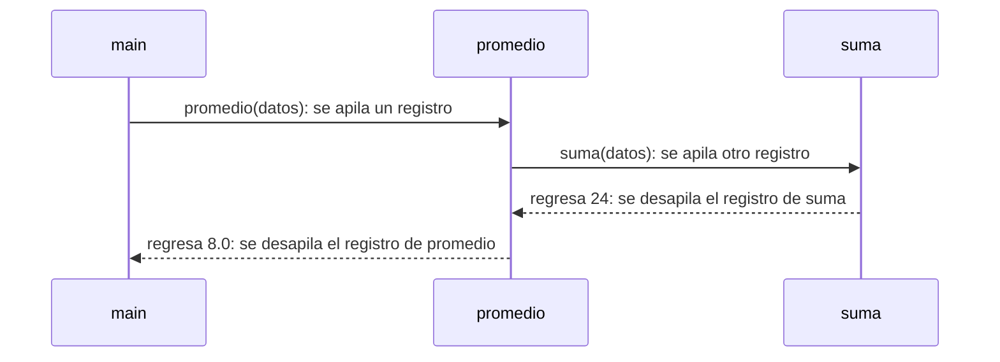
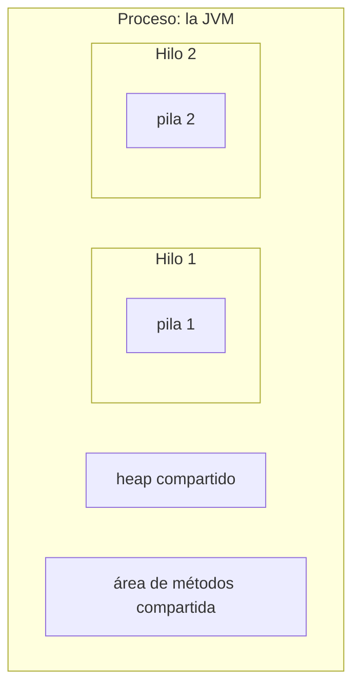

# Introducción a las Ciencias de la Computación - Administración de memoria durante ejecución

## 6.3 La pila de ejecución y los registros de activación por proceso.

---

Cuando un método llama a otro, el primero queda en espera: hay que recordar en qué instrucción se quedó, cuánto valían sus variables locales y a dónde regresar el resultado. Esa información se guarda en un **registro de activación** (también llamado marco o *stack frame*), y los registros de los métodos en curso se apilan en la **pila de ejecución**: el último método llamado es el primero en terminar. Este mecanismo, que funciona igual en casi todos los lenguajes, es lo que hace posible llamar métodos, anidarlos y usar recursión.

### 1. El registro de activación

Cada vez que se invoca un método se crea un registro de activación con:

- los **parámetros**, con los valores de los argumentos;
- las **variables locales** del método;
- la **dirección de regreso**: la instrucción del método que llamó donde debe continuar la ejecución;
- espacio para **valores temporales** de las expresiones que se están evaluando;
- en la JVM, una referencia a las constantes de la clase del método.

Su tamaño se conoce al compilar, porque el compilador sabe cuántas variables locales y parámetros tiene cada método. Por eso crearlo y destruirlo es muy barato: basta con mover el apuntador al tope de la pila.

### 2. Llamar y regresar



El protocolo es siempre el mismo:

1. **Al llamar:** se evalúan los argumentos, se crea el registro del método llamado en el tope de la pila, se copian los argumentos en sus parámetros, se guarda la dirección de regreso y se salta al inicio del método.
2. **Al regresar:** se toma el valor de regreso, se destruye el registro del método que terminó y la ejecución continúa en la dirección de regreso, dentro del registro que ahora queda en el tope.

### 3. Un ejemplo paso a paso

```java
public class Pila {
    static int suma(int[] arr) {
        int s = 0;
        for (int x : arr) s += x;
        return s;
    }

    static double promedio(int[] arr) {
        int total = suma(arr);
        return (double) total / arr.length;
    }

    public static void main(String[] args) {
        int[] datos = {6, 8, 10};
        double p = promedio(datos);
        System.out.println(p);      // 8.0
    }
}
```

| Momento                          | Pila, del tope hacia abajo                                        |
| -------------------------------- | ----------------------------------------------------------------- |
| inicio de `main`                 | `main { args, datos = ref, p = ? }`                               |
| dentro de `promedio`             | `promedio { arr = ref, total = ? }`, `main { ... }`               |
| dentro de `suma`, al final del ciclo | `suma { arr = ref, s = 24, x = 10 }`, `promedio { ... }`, `main { ... }` |
| de vuelta en `promedio`          | `promedio { arr = ref, total = 24 }`, `main { ... }`              |
| de vuelta en `main`              | `main { args, datos = ref, p = 8.0 }`                             |

Observe que `arr` en `suma` y en `promedio` son variables distintas, en registros distintos, que contienen copias de la misma referencia al arreglo, que vive en el heap. Al regresar de `suma`, su variable `s` desaparece, pero su valor ya se copió a `total`.

### 4. La pila y las excepciones: la traza de la pila

Cuando ocurre una excepción que no se atrapa, la JVM imprime la **traza de la pila** (*stack trace*): la lista de registros de activación activos en ese momento, del más reciente al más antiguo. Es la herramienta principal para encontrar el origen de un error.

```java
public class Traza {
    static int dividir(int a, int b) { return a / b; }
    static int calcular(int x) { return dividir(100, x - 5); }
    public static void main(String[] args) { System.out.println(calcular(5)); }
}
```

```text
Exception in thread "main" java.lang.ArithmeticException: / by zero
	at Traza.dividir(Traza.java:2)
	at Traza.calcular(Traza.java:3)
	at Traza.main(Traza.java:4)
```

Se lee de arriba hacia abajo: el error ocurrió en `dividir`, línea 2, que fue llamado por `calcular`, línea 3, que fue llamado por `main`, línea 4. Al propagarse una excepción, la JVM va **desapilando** registros hasta encontrar uno con un `try` que la atrape (tema 7).

### 5. Una pila por hilo

Cada **hilo** de ejecución tiene su propia pila, porque cada uno sigue su propia secuencia de llamadas. Un **proceso** puede tener varios hilos: todos comparten el heap y el área de métodos, pero cada uno tiene su pila con sus registros de activación. Por eso las variables locales nunca son compartidas entre hilos, mientras que los objetos del heap sí pueden serlo, lo que origina los problemas de sincronización del tema 9.



### 6. La pila en una máquina real

En un programa compilado a código de máquina, la pila está en memoria y el procesador tiene registros dedicados a manejarla. En la arquitectura x86 de 32 bits:

- `esp` apunta al tope de la pila;
- `ebp` apunta a la base del registro de activación actual, y las variables se acceden con desplazamientos respecto a él;
- la instrucción `call` apila la dirección de regreso y salta; `ret` la desapila y regresa.

Para la función de C `int suma(int a, int b) { int r = a + b; return r; }`, un compilador puede generar:

```nasm
suma:
    push ebp            ; guarda la base del registro de quien llamó
    mov  ebp, esp       ; la base del nuevo registro es el tope actual
    sub  esp, 4         ; reserva 4 bytes para la variable local r
    mov  eax, [ebp+8]   ; primer parámetro, a (lo apiló quien llamó)
    add  eax, [ebp+12]  ; segundo parámetro, b
    mov  [ebp-4], eax   ; r = a + b
    mov  eax, [ebp-4]   ; el valor de regreso va en eax
    mov  esp, ebp       ; libera las variables locales
    pop  ebp            ; restaura la base del registro anterior
    ret                 ; regresa a la dirección guardada por call
```

Los parámetros quedan "arriba" de `ebp`, porque los apiló quien llamó, y las variables locales "abajo". Esta organización explica una vulnerabilidad clásica: si un programa en C escribe más datos de los que caben en un arreglo local, puede sobrescribir la dirección de regreso y desviar la ejecución, lo que se conoce como **desbordamiento de búfer**. Java no permite ese error porque verifica los límites de los arreglos.

### 7. El límite de la pila

La pila de cada hilo tiene un tamaño fijo, típicamente de 512 KB a unos pocos MB, que se configura en Java con `-Xss`. Si la cadena de llamadas pendientes es demasiado larga, el espacio se agota y se lanza un `StackOverflowError`. La profundidad máxima depende del tamaño de cada registro: un método con muchas variables locales permite menos llamadas anidadas.

```java
public class Profundidad {
    static int nivel = 0;
    static void bajar() { nivel++; bajar(); }

    public static void main(String[] args) {
        try {
            bajar();
        } catch (StackOverflowError e) {
            System.out.println("Profundidad alcanzada: " + nivel);
        }
    }
}
```

> **Conexión con CC.** La pila de ejecución es una implementación directa del tipo de dato abstracto **pila** que se estudia en Estructuras de Datos: las únicas operaciones son apilar al llamar y desapilar al regresar. Los compiladores deciden la forma exacta de los registros de activación, lo que se estudia en Compiladores, y los sistemas operativos crean una pila por cada hilo que se lanza.

### Ejercicios propuestos

1. Dibuje la pila en cada llamada y regreso al ejecutar el siguiente programa, indicando el valor de cada variable local:

```java
static int cuadrado(int n) { return n * n; }
static int sumaDeCuadrados(int a, int b) { return cuadrado(a) + cuadrado(b); }
public static void main(String[] args) { int r = sumaDeCuadrados(3, 4); }
```

2. ¿Cuántos registros de activación hay en la pila como máximo durante la ejecución del ejercicio 1? ¿Y si `main` llamara a `sumaDeCuadrados` dentro de un ciclo de 100 iteraciones?
3. Provoque un `NullPointerException` dentro de un método llamado desde otros dos y explique cada línea de la traza de la pila.
4. Ejecute `Profundidad` con `-Xss256k`, con el valor por omisión y con `-Xss8m`. Agregue cinco variables locales de tipo `long` a `bajar` y compare.
5. Explique por qué las variables locales de un método no pueden compartirse entre dos hilos y los atributos de un objeto sí.

### Ver también

- **4.6** Funciones y recursión — llamadas recursivas.
- **6.1** La memoria durante la ejecución — las zonas de memoria de un proceso.
- **6.4** Implementación de la recursividad — la pila durante una recursión.
- **7.3** Detección y manejo de errores de ejecución — propagación de excepciones.
- **Estructuras de Datos 7** (Sem. 2) — el TDA pila.
- **Compiladores** (Sem. 7) — diseño de los registros de activación.

### Referencias

- Bryant, R. E., & O'Hallaron, D. R. (2015). _Computer Systems: A Programmer's Perspective_ (3.ª ed.). Pearson. Sección 3.7.
- Aho, A. V., Lam, M. S., Sethi, R., & Ullman, J. D. (2006). _Compilers: Principles, Techniques, and Tools_ (2.ª ed.). Pearson. Sección 7.2.
- Lindholm, T., et al. _The Java Virtual Machine Specification_. Sección 2.6: Frames.
