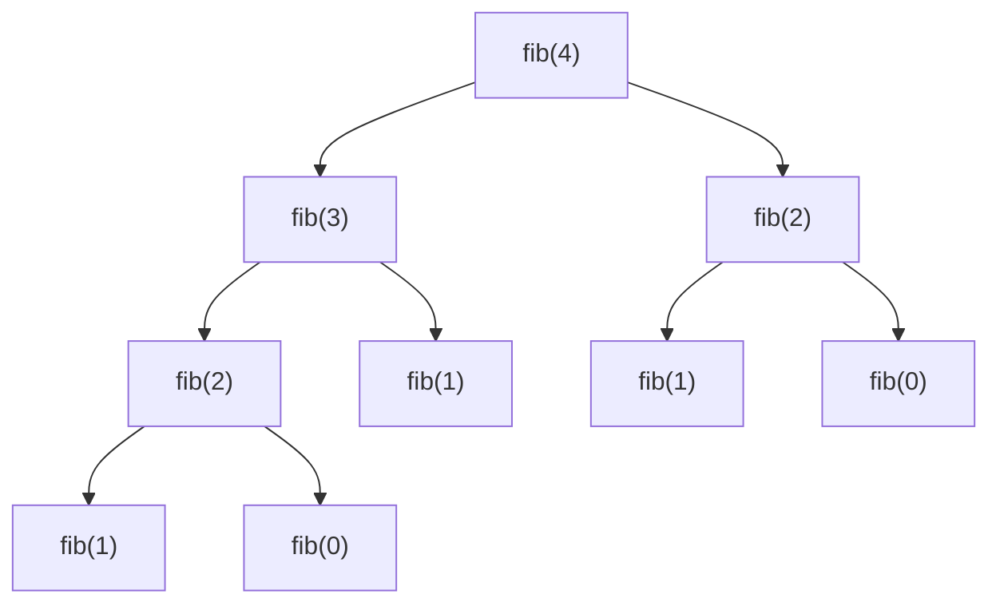

# Introducción a las Ciencias de la Computación - Administración de memoria durante ejecución

## 6.4 Implementación de la recursividad.

---

En el subtema 4.6 se estudió cómo **diseñar** funciones recursivas. Aquí se estudia cómo las **ejecuta** la máquina. No hay ningún mecanismo especial para la recursión: una llamada recursiva es una llamada como cualquier otra, que crea su propio registro de activación en la pila del subtema 6.3. Precisamente porque cada llamada tiene su propio registro, con sus propias variables locales, una misma función puede estar "a medio ejecutar" muchas veces al mismo tiempo sin que unas activaciones interfieran con otras. Entender esto explica cuánta memoria usa una recursión, por qué puede desbordarse la pila y cómo transformar una recursión en un ciclo.

### 1. Cada llamada, un registro

```java
static int factorial(int n) {
    if (n == 0) return 1;
    int resto = factorial(n - 1);
    return n * resto;
}
```

Al calcular `factorial(3)` hay un momento en que coexisten cuatro activaciones, cada una con **su propio** `n` y **su propio** `resto`:

| Paso | Evento                            | Pila, del tope hacia abajo                                            |
| ---- | --------------------------------- | --------------------------------------------------------------------- |
| 1    | llamada `factorial(3)`            | `f{n=3, resto=?}`                                                     |
| 2    | llamada `factorial(2)`            | `f{n=2, resto=?}`, `f{n=3, resto=?}`                                  |
| 3    | llamada `factorial(1)`            | `f{n=1, resto=?}`, `f{n=2, resto=?}`, `f{n=3, resto=?}`               |
| 4    | llamada `factorial(0)`            | `f{n=0}`, `f{n=1, resto=?}`, `f{n=2, resto=?}`, `f{n=3, resto=?}`     |
| 5    | `factorial(0)` regresa 1          | `f{n=1, resto=1}`, `f{n=2, resto=?}`, `f{n=3, resto=?}`               |
| 6    | `factorial(1)` regresa 1          | `f{n=2, resto=1}`, `f{n=3, resto=?}`                                  |
| 7    | `factorial(2)` regresa 2          | `f{n=3, resto=2}`                                                     |
| 8    | `factorial(3)` regresa 6          | vacía                                                                 |

La ejecución tiene dos fases: una de **descenso**, en la que se apilan registros con trabajo pendiente, la multiplicación por `n`, y una de **ascenso**, en la que cada registro completa su trabajo con el resultado de la llamada que hizo y desaparece.

### 2. Memoria de una recursión

La memoria que usa una recursión en la pila es proporcional a su **profundidad máxima**, es decir, al mayor número de activaciones pendientes al mismo tiempo, **no** al número total de llamadas.

- `factorial(n)` hace $n + 1$ llamadas y su profundidad máxima también es $n + 1$.
- La búsqueda binaria recursiva sobre $n$ elementos tiene profundidad de alrededor de $\log_2 n$: unas 20 para un millón de elementos.
- `fib(n)` con la definición directa hace un número exponencial de llamadas, pero su profundidad máxima es solo $n$, porque en cada momento solo está activa una rama del árbol de llamadas.



El **árbol de llamadas** de `fib(4)` tiene 9 nodos, que son las llamadas totales, y altura 4, que es la profundidad máxima de la pila. El recorrido del árbol por la ejecución es exactamente un recorrido en profundidad: la pila contiene en cada momento el camino desde la raíz hasta la llamada activa.

**Consecuencia práctica.** Una recursión cuya profundidad crece linealmente con los datos es peligrosa para datos grandes:

```java
public class SumaLista {
    static class Nodo { int dato; Nodo sig; Nodo(int d, Nodo s) { dato = d; sig = s; } }

    static long sumaRecursiva(Nodo n) {
        return (n == null) ? 0 : n.dato + sumaRecursiva(n.sig);   // profundidad = longitud
    }

    static long sumaIterativa(Nodo n) {
        long s = 0;
        for (; n != null; n = n.sig) s += n.dato;                  // memoria constante
        return s;
    }

    public static void main(String[] args) {
        Nodo lista = null;
        for (int i = 1; i <= 1_000_000; i++) lista = new Nodo(1, lista);
        System.out.println(sumaIterativa(lista));                  // 1000000
        try {
            System.out.println(sumaRecursiva(lista));
        } catch (StackOverflowError e) {
            System.out.println("La versión recursiva desbordó la pila");
        }
    }
}
```

### 3. Recursión de cola

Una llamada recursiva es **de cola** si es lo último que hace la función: su resultado se regresa tal cual, sin operaciones pendientes. En `factorial` la llamada **no** es de cola, porque después hay que multiplicar por `n`. Se puede reescribir con un **acumulador** que lleve el resultado parcial:

```java
static long factorialCola(int n, long acumulado) {
    if (n == 0) return acumulado;
    return factorialCola(n - 1, n * acumulado);    // llamada de cola: nada pendiente después
}
// factorialCola(5, 1) = factorialCola(4, 5) = factorialCola(3, 20) = ... = 120
```

Cuando la llamada es de cola, el registro de la activación actual ya no se necesita al hacer la llamada, así que un compilador puede **reutilizarlo** en lugar de apilar uno nuevo. Con esa optimización, la recursión de cola usa memoria constante, igual que un ciclo. Lenguajes como Scheme la exigen y lenguajes funcionales como Haskell y Scala la aplican. **Java no la realiza**, así que en Java una recursión de cola profunda también desborda la pila.

**De recursión de cola a ciclo.** La transformación es mecánica: los parámetros se vuelven variables, la llamada recursiva se vuelve una actualización de esas variables y el caso base se vuelve la condición de salida.

```java
static long factorialCiclo(int n) {
    long acumulado = 1;
    while (n != 0) {               // mientras no sea el caso base
        acumulado = n * acumulado; // los nuevos argumentos de la "llamada"
        n = n - 1;
    }
    return acumulado;
}
```

### 4. Simular la recursión con una pila explícita

Cuando la recursión no es de cola, como en un árbol o una gráfica, también se puede eliminar, guardando en una **pila propia**, en el heap, la información que la recursión guardaría en los registros de activación. Así la profundidad ya no está limitada por la pila de ejecución, sino por la memoria del heap, que es mucho mayor.

```java
import java.util.ArrayDeque;
import java.util.Deque;

public class HanoiIterativo {
    record Tarea(int n, char origen, char destino, char auxiliar, boolean mover) {}

    public static void main(String[] args) {
        Deque<Tarea> pila = new ArrayDeque<>();
        pila.push(new Tarea(3, 'A', 'C', 'B', false));
        int movimientos = 0;
        while (!pila.isEmpty()) {
            Tarea t = pila.pop();
            if (t.mover()) {
                System.out.println("Mover disco " + t.n() + " de " + t.origen() + " a " + t.destino());
                movimientos++;
            } else if (t.n() > 0) {
                // se apilan en orden inverso al que deben ejecutarse
                pila.push(new Tarea(t.n() - 1, t.auxiliar(), t.destino(), t.origen(), false));
                pila.push(new Tarea(t.n(), t.origen(), t.destino(), t.auxiliar(), true));
                pila.push(new Tarea(t.n() - 1, t.origen(), t.auxiliar(), t.destino(), false));
            }
        }
        System.out.println(movimientos + " movimientos");   // 7 movimientos
    }
}
```

Cada `Tarea` representa una "llamada pendiente". Como la pila es LIFO, se apilan en orden inverso: la primera en desapilarse será mover $n - 1$ discos al auxiliar, igual que en la versión recursiva. Esta técnica es la que se usa, por ejemplo, para recorrer árboles muy profundos o gráficas enormes.

### 5. El costo de cada llamada

Además de la memoria, cada llamada tiene un costo de tiempo pequeño pero no nulo: crear el registro, copiar los argumentos, saltar y regresar. Para cálculos muy simples repetidos millones de veces, un ciclo puede ser varias veces más rápido que la recursión equivalente. Para problemas con estructura recursiva, como árboles o divide y vencerás, el costo extra es despreciable frente a la claridad que se gana, y la profundidad suele ser pequeña.

| Situación                                         | Recomendación                               |
| ------------------------------------------------- | ------------------------------------------- |
| estructura recursiva y profundidad logarítmica    | recursión                                   |
| recorrido lineal de muchos elementos              | ciclo                                       |
| subproblemas repetidos                            | recursión con memorización o cálculo de abajo hacia arriba |
| estructura profunda o de tamaño desconocido       | pila explícita                              |

> **Conexión con CC.** Los compiladores traducen las llamadas recursivas exactamente con el mecanismo de registros de activación de esta página, y algunos aplican la optimización de llamadas de cola. Los intérpretes y las máquinas virtuales, a su vez, suelen implementarse sin recursión en el lenguaje anfitrión precisamente para no quedar limitados por su pila: mantienen una pila propia de registros, como en la sección 4.

### Ejercicios propuestos

1. Haga una tabla como la de la sección 1 para `potencia(2, 5)` con la definición `potencia(b, e) = b * potencia(b, e - 1)` y `potencia(b, 0) = 1`. ¿Cuál es la profundidad máxima? ¿Y con la versión rápida del subtema 4.6?
2. Dibuje el árbol de llamadas de `fib(5)` y cuente cuántas llamadas hay en total y cuál es la profundidad máxima.
3. Reescriba con recursión de cola, usando un acumulador, la función `suma(n) = n + suma(n - 1)` con `suma(0) = 0`, y luego conviértala mecánicamente en un ciclo.
4. Ejecute `SumaLista` con distintos tamaños de lista y encuentre aproximadamente a partir de qué longitud la versión recursiva desborda la pila en su computadora. Repita con `-Xss8m`.
5. Escriba una versión iterativa con pila explícita del recorrido en inorden de un árbol binario.
6. Explique por qué `fib` con la definición directa no desborda la pila para $n = 40$ aunque hace cientos de millones de llamadas.

### Ver también

- **4.6** Funciones y recursión — diseño de funciones recursivas y memorización.
- **6.3** La pila de ejecución y los registros de activación.
- **Estructuras Discretas 3.2 y 3.3** — definiciones recursivas e inducción estructural.
- **Estructuras de Datos 5 y 7** (Sem. 2) — recursión y el TDA pila.
- **Compiladores** (Sem. 7) — optimización de llamadas de cola.

### Referencias

- Abelson, H., & Sussman, G. J. (1996). _Structure and Interpretation of Computer Programs_ (2.ª ed.). MIT Press. Sección 1.2.1: procesos recursivos e iterativos.
- Sedgewick, R., & Wayne, K. (2011). _Algorithms_ (4.ª ed.). Addison-Wesley. Sección 1.3.
- Bryant, R. E., & O'Hallaron, D. R. (2015). _Computer Systems: A Programmer's Perspective_ (3.ª ed.). Pearson. Sección 3.7.
