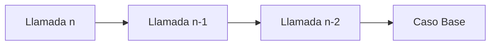
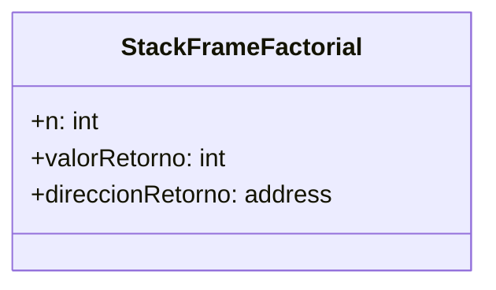

# Introducción a las Ciencias de la Computación - Administración de memoria durante ejecución

## 6.4 Implementación de la recursividad.

---

### 1. Concepto de Recursividad

#### 1.1 Definición

Técnica donde una función se llama a sí misma para resolver problemas mediante casos base y casos recursivos:

$$ f(n) = \begin{cases} \text{Caso Base} & \text{si } n \leq n_0 \\\ \text{Caso Recursivo} & \text{si } n > n_0 \end{cases} $$

#### 1.2 Componentes Esenciales

- **Caso base**: Condición de terminación
- **Caso recursivo**: Llamada a la misma función con parámetros reducidos
- **Progresión**: Cada llamada debe acercarse al caso base

### 2. Mecanismo de Ejecución

#### 2.1 Pila de Ejecución (Call Stack)

Cada llamada recursiva crea un nuevo marco de pila:



#### 2.2 Ejemplo Factorial

```java
public class Recursividad {
    public static int factorial(int n) {
        if (n == 0) {  // Caso base
            return 1;
        }
        return n * factorial(n - 1);  // Caso recursivo
    }
}
```

### 3. Análisis de Memoria

#### 3.1 Consumo de Stack

Cada llamada recursiva ocupa un stack frame:

$$ \text{Memoria} = O(n) \times \text{TamañoFrame} $$

#### 3.2 Ejemplo de Stack Frames



### 4. Recursividad vs Iteración

#### 4.1 Comparación de Eficiencia

| Aspecto         | Recursividad               | Iteración          |
| --------------- | -------------------------- | ------------------ |
| **Memoria**     | $O(n)$ (stack)             | $O(1)$ (variables) |
| **Legibilidad** | Alta (problemas naturales) | Media              |
| **Rendimiento** | Overhead llamadas          | Más rápido         |

#### 4.2 Conversión a Iterativo

```java
public static int factorialIterativo(int n) {
    int resultado = 1;
    for (int i = 1; i <= n; i++) {
        resultado *= i;
    }
    return resultado;
}
```

### 5. Recursividad de Cola (Tail Recursion)

#### 5.1 Optimización

Última operación es la llamada recursiva, permitiendo reutilizar el stack frame:

```scheme
(define (factorial n ac)
  (if (= n 0)
      ac
      (factorial (- n 1) (* n ac))))
```

#### 5.2 Condiciones para Tail Recursion

- La llamada recursiva debe ser la última operación
- No debe haber operaciones pendientes después de la llamada

### 6. Ejemplos Clásicos

#### 6.1 Fibonacci

```python
def fibonacci(n):
    if n <= 1:  # Caso base
        return n
    return fibonacci(n-1) + fibonacci(n-2)  # Caso recursivo
```

#### 6.2 Torres de Hanói

```typescript
function hanoi(n: number, origen: string, auxiliar: string, destino: string): void {
  if (n === 1) {
    console.log(`Mover disco 1 de ${origen} a ${destino}`);
    return;
  }
  hanoi(n - 1, origen, destino, auxiliar);
  console.log(`Mover disco ${n} de ${origen} a ${destino}`);
  hanoi(n - 1, auxiliar, origen, destino);
}
```

### 7. Ejercicios Prácticos

1. Calcula el máximo depth del stack para `factorial(100)`
2. Convierte esta función a tail recursion:

```java
int suma(int n) {
    if (n == 0) return 0;
    return n + suma(n - 1);
}
```

3. Dibuja el árbol de llamadas para `fibonacci(4)`

### Ver también

- **4.6** Funciones y recursión — la recursión cuya implementación se detalla aquí.
- **6.3** Pila de ejecución — el mecanismo de soporte de la recursión.
- **Estructuras de Datos 5.1** (Sem. 2) — recursión y el paradigma divide y vencerás.

### Referencias

- Aho, A. V. et al. (2007). _Compilers_ (2.ª ed.). Pearson. Cap. 7.
- Sedgewick, R., & Wayne, K. (2011). _Algorithms_ (4.ª ed.). Addison-Wesley. Cap. 1.
