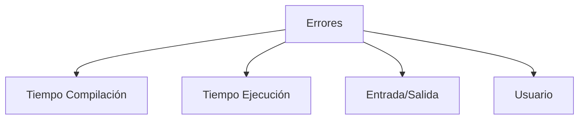
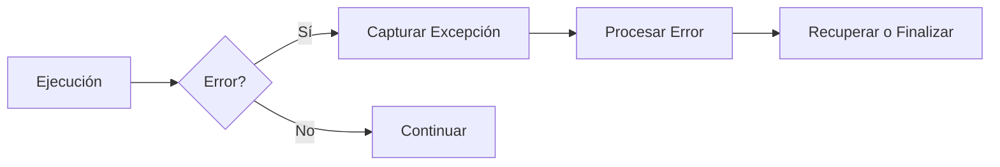

# Introducción a las Ciencias de la Computación - Manejo de errores en ejecución (excepciones)

## 7.1 Tipos de errores (ejecución, entrada y salida o del usuario).

---

### 1. Clasificación de Errores

#### 1.1 Taxonomía General

Los errores se categorizan según su origen y momento de detección:

$$ \text{Error} = \left\lbrace \begin{array}{ll} \text{Tiempo Compilación} & \text{(Sintaxis, tipos)} \\\ \text{Tiempo Ejecución} & \text{(Lógica, recursos)} \\\ \text{Entrada/Salida} & \text{(Archivos, red)} \\\ \text{Usuario} & \text{(Datos inválidos)} \end{array} \right. $$

#### 1.2 Diagrama de Clasificación



### 2. Errores de Tiempo de Ejecución

#### 2.1 Ejemplos Comunes

- **NullPointerException**: Acceso a referencia nula
- **ArrayIndexOutOfBounds**: Índice fuera de rango
- **ArithmeticException**: División por cero

#### 2.2 Código de Ejemplo (Java)

```java
public class ErroresEjecucion {
    public static void main(String[] args) {
        // NullPointerException
        String texto = null;
        int longitud = texto.length();  // Error

        // ArrayIndexOutOfBounds
        int[] numeros = new int[5];
        int valor = numeros[10];  // Error

        // ArithmeticException
        int resultado = 10 / 0;  // Error
    }
}
```

### 3. Errores de Entrada/Salida

#### 3.1 Tipos Comunes

- **FileNotFoundException**: Archivo no existe
- **IOException**: Error general de E/S
- **NetworkException**: Fallos de red

#### 3.2 Manejo en Java

```java
import java.io.*;

public class ManejoIO {
    public void leerArchivo(String ruta) {
        try {
            FileReader fr = new FileReader(ruta);
            BufferedReader br = new BufferedReader(fr);
            // Procesar archivo
        } catch (FileNotFoundException e) {
            System.err.println("Archivo no encontrado: " + e.getMessage());
        } catch (IOException e) {
            System.err.println("Error de E/S: " + e.getMessage());
        }
    }
}
```

### 4. Errores de Usuario

#### 4.1 Características

- Datos ingresados no válidos
- Validación insuficiente
- Flujos de trabajo incorrectos

#### 4.2 Ejemplo de Validación

```typescript
class Validador {
  static validarEmail(email: string): boolean {
    const regex = /^[^\s@]+@[^\s@]+\.[^\s@]+$/;
    if (!regex.test(email)) {
      throw new Error('Formato de email inválido');
    }
    return true;
  }
}

// Uso
try {
  Validador.validarEmail('usuario@dominio.com');
} catch (error) {
  console.error('Error de usuario:', error.message);
}
```

### 5. Diagrama de Flujo de Manejo de Errores



### 6. Estrategias de Manejo

#### 6.1 Defensiva vs Ofensiva

- **Defensiva**: Validar todas las entradas
- **Ofensiva**: Confiar en contratos, lanzar excepciones claras

#### 6.2 Principios SOLID Aplicados

- **Single Responsibility**: Clases dedicadas a validación
- **Open/Closed**: Extensible para nuevos tipos de error

### 7. Ejercicios Prácticos

1. Implementa un validador de número de teléfono con manejo de errores
2. Explica la diferencia entre `Exception` y `RuntimeException` en Java
3. Diseña un sistema de manejo de errores para una calculadora

### Ver también

- **7.2** Definición de errores con herencia — jerarquía de excepciones.
- **7.3** Detección y manejo — mecanismos concretos de try/catch.
- **5.1–5.2** Herencia — la jerarquía de excepciones usa herencia.

### Referencias

- Eckel, B. (2006). _Thinking in Java_ (4.ª ed.). Prentice Hall. Cap. 12.
- Martin, R. C. (2008). _Clean Code_. Prentice Hall. Cap. 7.
- Bloch, J. (2018). _Effective Java_ (3.ª ed.). Addison-Wesley. Cap. 10.
