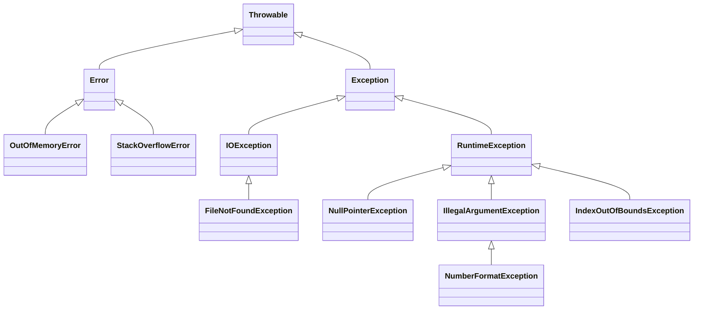

# Introducción a las Ciencias de la Computación - Manejo de errores en ejecución (excepciones)

## 7.1 Tipos de errores (ejecución, entrada y salida o del usuario).

---

Todo programa real enfrenta situaciones en que algo sale mal: un dato capturado con letras donde iban números, un archivo que no existe, una red que se cae, un índice fuera de rango por un descuido del programador. Estas situaciones no son iguales: tienen causas distintas, se detectan en momentos distintos y exigen respuestas distintas. Clasificarlas es el primer paso para manejarlas bien. Este tema estudia el mecanismo de **excepciones** de Java, con el que se separa el código que hace el trabajo del código que atiende los problemas.

### 1. Cuándo se detecta un error

**En tiempo de compilación.** El compilador rechaza el programa antes de ejecutarlo:

- errores **sintácticos**, como un punto y coma faltante o una llave sin cerrar;
- errores de **tipo**, como asignar un `String` a una variable `int` o llamar un método que no existe.

Son los más baratos de corregir: el compilador dice exactamente dónde están. Un lenguaje con tipos estáticos como Java mueve muchos errores a esta categoría.

**En tiempo de ejecución.** El programa compila pero falla al ejecutarse con ciertos datos. Java los señala lanzando una **excepción**.

**Nunca.** Un **error lógico** hace que el programa produzca un resultado incorrecto sin ningún aviso: un promedio mal calculado, un descuento aplicado dos veces. Ninguna herramienta lo detecta automáticamente; solo las pruebas y el razonamiento cuidadoso.

### 2. Errores de ejecución por fallas de programación

Son consecuencia de un descuido en el código. Si el programa fuera correcto, no ocurrirían.

```java
public class FallasDeProgramacion {
    public static void main(String[] args) {
        probar(() -> { String s = null; s.length(); });
        probar(() -> { int[] a = new int[5]; a[5] = 1; });
        probar(() -> { int x = 10 / 0; });
        probar(() -> { Object o = "texto"; Integer i = (Integer) o; });
        probar(() -> { java.util.List.of(1, 2).add(3); });
    }

    static void probar(Runnable r) {
        try {
            r.run();
        } catch (RuntimeException e) {
            System.out.println(e.getClass().getSimpleName());
        }
    }
}
```

```text
NullPointerException
ArrayIndexOutOfBoundsException
ArithmeticException
ClassCastException
UnsupportedOperationException
```

La respuesta correcta ante estos errores **no** es atraparlos y seguir adelante, sino **corregir el programa**. El ejemplo los atrapa solo para mostrar sus nombres.

### 3. Errores de entrada y salida

Se originan **fuera del programa**, en el entorno con el que interactúa: el sistema de archivos, la red, otros procesos. Un programa perfectamente escrito puede encontrarlos:

- el archivo no existe o fue borrado: `NoSuchFileException`, `FileNotFoundException`;
- no hay permiso para leerlo o escribirlo: `AccessDeniedException`;
- el disco está lleno;
- la conexión de red se interrumpe o tarda demasiado: `SocketTimeoutException`;
- el archivo existe pero su contenido no tiene el formato esperado.

Como no dependen del programador, Java obliga a considerarlos: la mayoría son excepciones **verificadas**, subclases de `IOException`, que el compilador exige atrapar o declarar.

```java
import java.io.IOException;
import java.nio.file.Files;
import java.nio.file.Path;

public class LeerConfiguracion {
    public static void main(String[] args) {
        Path ruta = Path.of("config.txt");
        try {
            String contenido = Files.readString(ruta);
            System.out.println(contenido);
        } catch (IOException e) {
            System.out.println("No se pudo leer " + ruta + ": " + e.getClass().getSimpleName());
            System.out.println("Se usará la configuración predeterminada.");
        }
    }
}
```

Aquí sí tiene sentido atrapar la excepción y **recuperarse**: usar valores predeterminados, pedir otro nombre de archivo o reintentar más tarde.

### 4. Errores del usuario

El usuario puede escribir texto donde se esperaba un número, una fecha imposible o un correo sin arroba. Estos errores no son excepcionales: **son esperables** y el programa debe anticiparlos. La estrategia es **validar** la entrada y volver a pedirla con un mensaje claro:

```java
import java.util.Scanner;

public class PedirEdad {
    public static void main(String[] args) {
        Scanner sc = new Scanner(System.in);
        int edad = -1;
        while (edad < 0) {
            System.out.print("Edad: ");
            String texto = sc.nextLine().strip();
            try {
                edad = Integer.parseInt(texto);
                if (edad < 0 || edad > 130) {
                    System.out.println("La edad debe estar entre 0 y 130.");
                    edad = -1;
                }
            } catch (NumberFormatException e) {
                System.out.println("\"" + texto + "\" no es un número entero.");
            }
        }
        System.out.println("Edad registrada: " + edad);
    }
}
```

El mensaje debe estar dirigido al usuario, en sus términos, sin trazas de la pila ni nombres de clases.

### 5. Errores graves del sistema

Algunos problemas indican que la máquina virtual misma está en dificultades: se agotó la memoria (`OutOfMemoryError`), se desbordó la pila (`StackOverflowError`) o falta una clase necesaria. En Java son subclases de `Error`, y en general un programa no puede hacer nada razonable para recuperarse de ellos.

### 6. La jerarquía de Java



| Categoría              | Clase base           | ¿Verificada? | Origen típico                      | Respuesta adecuada              |
| ---------------------- | -------------------- | ------------ | ---------------------------------- | ------------------------------- |
| Falla de programación  | `RuntimeException`   | no           | un error en el código              | corregir el código              |
| Entrada y salida       | `IOException` y otras `Exception` | sí | el entorno: archivos, red      | recuperarse o informar          |
| Dato inválido del usuario | `NumberFormatException`, validaciones propias | no | el usuario | validar y volver a pedir |
| Falla del sistema      | `Error`              | no           | la JVM o el hardware               | normalmente terminar            |

Las excepciones **verificadas** (*checked*) son las subclases de `Exception` que no son subclases de `RuntimeException`. El compilador exige que todo método que pueda lanzarlas las atrape o lo declare con `throws`. Las **no verificadas** (*unchecked*), es decir, `RuntimeException`, `Error` y sus subclases, no tienen esa exigencia. La idea es que las verificadas representan situaciones que un programa correcto debe prever, y las no verificadas, errores de programación o fallas irrecuperables.

> **Conexión con CC.** Distintos lenguajes adoptan estrategias distintas: C indica los errores con códigos de regreso que es fácil ignorar, Go regresa el error como un valor adicional que el programador debe revisar, y Rust usa un tipo `Result` que obliga a tratar el caso de error antes de usar el resultado. Java, C# y Python usan excepciones, que separan el flujo normal del manejo de errores.

### Ejercicios propuestos

1. Clasifique cada situación según la tabla de la sección 6 y diga cuál sería la respuesta adecuada: (a) el usuario escribe "doce" como cantidad; (b) se divide entre una variable que quedó en cero por un error de lógica; (c) el servidor de base de datos no responde; (d) una recursión infinita; (e) un archivo CSV tiene una línea con menos columnas de las esperadas.
2. Escriba un fragmento que provoque cada una de estas excepciones: `NumberFormatException`, `StringIndexOutOfBoundsException`, `NegativeArraySizeException` e `IllegalArgumentException`, esta última con algún método de la biblioteca estándar.
3. Modifique `PedirEdad` para que también pida una fecha de nacimiento en formato `dd/mm/aaaa`, rechace fechas imposibles como el 31 de febrero, y verifique que coincide con la edad.
4. Explique por qué `IOException` es verificada y `NullPointerException` no. ¿Qué pasaría si `NullPointerException` fuera verificada?
5. Dé un ejemplo de un error lógico que ninguna excepción detectaría y proponga una prueba que lo descubriría.

### Ver también

- **1.6** Principios de lenguajes de programación — errores sintácticos, semánticos y lógicos.
- **2.4** Entrada y salida — leer datos del usuario y de archivos.
- **7.2** Definición de errores aprovechando la herencia — excepciones propias.
- **7.3** Detección y manejo de errores de ejecución — `try`, `catch` y `finally`.
- **7.4** Recomendaciones generales.

### Referencias

- Bloch, J. (2018). _Effective Java_ (3.ª ed.). Addison-Wesley. Cap. 10: Exceptions.
- Oracle. _The Java Tutorials: Exceptions_. https://docs.oracle.com/javase/tutorial/essential/exceptions/
- Gosling, J., et al. _The Java Language Specification_. Cap. 11: Exceptions.
