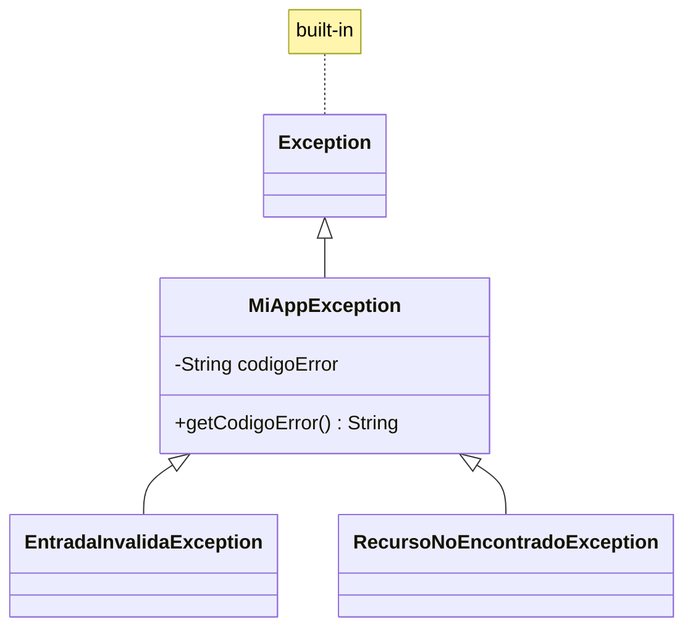

# Introducción a las Ciencias de la Computación - Manejo de errores en ejecución (excepciones)

## 7.2 Definición de errores aprovechando la herencia.

---

### 1. Jerarquía de Excepciones con Herencia

#### 1.1 Concepto Fundamental

Crear una jerarquía de clases de excepción que permita manejo específico y genérico:

$$ \text{ExceptionHierarchy} = \text{BaseException} + \sum \text{SpecificExceptions} $$

#### 1.2 Ventajas de la Herencia

- **Manejo polimórfico**: Captura de múltiples tipos con una sola cláusula
- **Reutilización de código**: Comportamiento común en la clase base
- **Extensibilidad**: Fácil añadir nuevos tipos de error

### 2. Diseño de una Jerarquía de Excepciones

#### 2.1 Estructura Básica en Java

```java
// Clase base personalizada
public class MiAppException extends Exception {
    private final String codigoError;

    public MiAppException(String mensaje, String codigoError) {
        super(mensaje);
        this.codigoError = codigoError;
    }

    public String getCodigoError() {
        return codigoError;
    }
}

// Excepciones específicas
public class EntradaInvalidaException extends MiAppException {
    public EntradaInvalidaException(String campo) {
        super("Entrada inválida en campo: " + campo, "ERR-001");
    }
}

public class RecursoNoEncontradoException extends MiAppException {
    public RecursoNoEncontradoException(String recurso) {
        super("Recurso no encontrado: " + recurso, "ERR-002");
    }
}
```

#### 2.2 Diagrama UML de la Jerarquía



### 3. Implementación en TypeScript

#### 3.1 Jerarquía con Clases

```typescript
class MiAppError extends Error {
  constructor(
    message: string,
    public readonly codigoError: string,
  ) {
    super(message);
    this.name = this.constructor.name;
  }
}

class ValidacionError extends MiAppError {
  constructor(campo: string) {
    super(`Campo inválido: ${campo}`, 'VAL-001');
  }
}

class BaseDatosError extends MiAppError {
  constructor(operacion: string) {
    super(`Error en BD: ${operacion}`, 'DB-001');
  }
}
```

### 4. Manejo Polimórfico de Excepciones

#### 4.1 Captura Específica y Genérica

```java
try {
    // Código que puede lanzar múltiples excepciones
    procesarEntrada(usuario);
} catch (EntradaInvalidaException e) {
    System.out.println("Error específico: " + e.getCodigoError());
} catch (MiAppException e) {
    System.out.println("Error general: " + e.getCodigoError());
} catch (Exception e) {
    System.out.println("Error inesperado: " + e.getMessage());
}
```

#### 4.2 Fórmula de Especificidad

$$ \text{Especificidad} = \frac{1}{\text{NivelHerencia}} $$

### 5. Buenas Prácticas en el Diseño

#### 5.1 Principios de Diseño

- **Jerarquía plana**: Evitar demasiados niveles de herencia
- **Excepciones ricas**: Incluir información contextual relevante
- **Inmutabilidad**: Las excepciones no deberían cambiar después de creadas

#### 5.2 Ejemplo de Excepción Rica

```java
public class ApiException extends Exception {
    private final int statusCode;
    private final Instant timestamp;

    public ApiException(String message, int statusCode) {
        super(message);
        this.statusCode = statusCode;
        this.timestamp = Instant.now();
    }

    // Getters para información adicional
}
```

### 6. Ejercicios Prácticos

1. Diseña una jerarquía para una aplicación de comercio electrónico con:

- `StockException`, `PagoException`, `EnvioException`

2. Implementa el manejo polimórfico para estas excepciones
3. Explica por qué es mejor usar herencia que códigos de error simples

### Ver también

- **7.1** Tipos de errores — taxonomía de las excepciones.
- **5.1** Extensión de clases — las excepciones son clases que extienden Throwable.
- **7.3** Manejo de errores — cómo se capturan las excepciones definidas aquí.

### Referencias

- Eckel, B. (2006). _Thinking in Java_ (4.ª ed.). Prentice Hall. Cap. 12.
- Bloch, J. (2018). _Effective Java_ (3.ª ed.). Addison-Wesley. Ítem 70-75.
