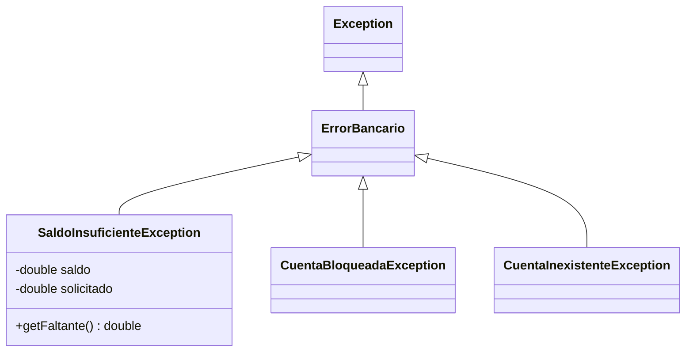

# Introducción a las Ciencias de la Computación - Manejo de errores en ejecución (excepciones)

## 7.2 Definición de errores aprovechando la herencia.

---

En Java las excepciones son **objetos**, instancias de clases que forman una jerarquía con raíz en `Throwable`. Esto significa que todo lo aprendido sobre herencia se aplica a ellas: se pueden definir excepciones propias extendiendo las existentes, agregarles atributos con información sobre el problema y, sobre todo, atraparlas **polimórficamente**: un `catch` de una superclase atrapa también todas sus subclases. Diseñar bien la jerarquía de excepciones de un programa permite que cada parte del código atienda exactamente los errores que le corresponden.

### 1. ¿Cuándo definir una excepción propia?

Primero conviene **reutilizar** las excepciones estándar cuando expresan el problema:

| Excepción estándar                 | Úsela cuando                                                      |
| ---------------------------------- | ----------------------------------------------------------------- |
| `IllegalArgumentException`         | un parámetro tiene un valor inválido                               |
| `NullPointerException`             | un parámetro es `null` y no debería, por ejemplo con `Objects.requireNonNull` |
| `IllegalStateException`            | el objeto no está en un estado que permita la operación, como leer de un archivo cerrado |
| `IndexOutOfBoundsException`        | un índice está fuera de rango                                     |
| `UnsupportedOperationException`    | la operación no está soportada, como modificar una lista inmutable |
| `NoSuchElementException`           | se pide un elemento que no existe, como desapilar una pila vacía  |

Se justifica una excepción propia cuando el error pertenece al **dominio del problema** y quien llama necesita distinguirlo de otros para reaccionar de manera específica, o cuando hay que transportar información adicional sobre el error.

### 2. Una jerarquía para un sistema bancario

```java
/** Raíz de los errores de negocio del banco. */
public class ErrorBancario extends Exception {
    public ErrorBancario(String mensaje) { super(mensaje); }
    public ErrorBancario(String mensaje, Throwable causa) { super(mensaje, causa); }
}

/** No hay fondos suficientes para un retiro o transferencia. */
class SaldoInsuficienteException extends ErrorBancario {
    private final double saldo;
    private final double solicitado;

    public SaldoInsuficienteException(double saldo, double solicitado) {
        super(String.format("Saldo insuficiente: se solicitaron %.2f y hay %.2f", solicitado, saldo));
        this.saldo = saldo;
        this.solicitado = solicitado;
    }

    public double getFaltante() { return solicitado - saldo; }
}

/** La cuenta está bloqueada y no admite movimientos. */
class CuentaBloqueadaException extends ErrorBancario {
    public CuentaBloqueadaException(String numero) {
        super("La cuenta " + numero + " está bloqueada");
    }
}

/** No existe una cuenta con el número indicado. */
class CuentaInexistenteException extends ErrorBancario {
    public CuentaInexistenteException(String numero) {
        super("No existe la cuenta " + numero);
    }
}
```



**Convenciones.**

- El nombre termina en `Exception` y describe el problema, no el lugar donde ocurrió.
- Se ofrecen al menos dos constructores: uno con mensaje y otro con mensaje y **causa**, para poder encadenar excepciones (sección 5).
- Los atributos adicionales dan a quien atrapa la excepción la información que necesita para reaccionar, como el faltante, sin tener que analizar el texto del mensaje.

### 3. Lanzar las excepciones

```java
class Cuenta {
    private final String numero;
    private double saldo;
    private boolean bloqueada;

    Cuenta(String numero, double saldo) { this.numero = numero; this.saldo = saldo; }

    void bloquear() { bloqueada = true; }

    void retirar(double monto) throws SaldoInsuficienteException, CuentaBloqueadaException {
        if (monto <= 0) throw new IllegalArgumentException("Monto no positivo: " + monto);
        if (bloqueada) throw new CuentaBloqueadaException(numero);
        if (monto > saldo) throw new SaldoInsuficienteException(saldo, monto);
        saldo -= monto;
    }

    double getSaldo() { return saldo; }
}
```

Observe la distinción: un monto no positivo es un **error del programa que llama**, que debió validar antes, y se señala con una excepción no verificada estándar. El saldo insuficiente o la cuenta bloqueada son **situaciones de negocio** perfectamente posibles en un programa correcto, y se señalan con excepciones verificadas propias, que obligan a quien llama a considerarlas.

### 4. Atrapar polimórficamente

Un `catch` atrapa la clase indicada **y todas sus subclases**. Esto permite tratar los errores con el nivel de detalle que convenga en cada lugar:

```java
public class Cajero {
    public static void main(String[] args) {
        Cuenta c = new Cuenta("001", 500);
        double[] retiros = {200, 400, 100};
        for (double r : retiros) {
            try {
                c.retirar(r);
                System.out.println("Retiro de " + r + " exitoso. Saldo: " + c.getSaldo());
            } catch (SaldoInsuficienteException e) {         // caso específico primero
                System.out.println(e.getMessage() + ". Faltan " + e.getFaltante());
            } catch (ErrorBancario e) {                      // cualquier otro error del banco
                System.out.println("Operación rechazada: " + e.getMessage());
            }
        }
        c.bloquear();
        try {
            c.retirar(10);
        } catch (ErrorBancario e) {                          // un solo catch para toda la familia
            System.out.println("Operación rechazada: " + e.getMessage());
        }
    }
}
```

```text
Retiro de 200.0 exitoso. Saldo: 300.0
Saldo insuficiente: se solicitaron 400.00 y hay 300.00. Faltan 100.0
Retiro de 100.0 exitoso. Saldo: 200.0
Operación rechazada: La cuenta 001 está bloqueada
```

**El orden importa.** Los `catch` se revisan de arriba hacia abajo y se ejecuta el primero que coincide. Por eso las subclases deben ir **antes** que sus superclases; si se invierte el orden, el compilador señala que el `catch` específico es inalcanzable.

**Atrapar varias a la vez.** Si dos excepciones no relacionadas se tratan igual, se pueden combinar: `catch (CuentaBloqueadaException | CuentaInexistenteException e)`.

### 5. Encadenar excepciones

Cuando una capa del programa atrapa una excepción técnica y la traduce a una del dominio, debe conservar la original como **causa**, para no perder la información de dónde y por qué ocurrió:

```java
Cuenta buscar(String numero) throws ErrorBancario {
    try {
        return leerDeArchivo(numero);
    } catch (java.io.IOException e) {
        throw new ErrorBancario("No se pudo consultar la cuenta " + numero, e);   // e es la causa
    }
}
```

Quien atrape el `ErrorBancario` ve un mensaje en términos del negocio, y en la traza de la pila aparece también, bajo el título "Caused by", la `IOException` original.

### 6. ¿Verificada o no verificada?

- Extienda `Exception` (verificada) cuando el error es una **situación esperable** de la que quien llama puede y debe recuperarse, como un saldo insuficiente.
- Extienda `RuntimeException` (no verificada) cuando el error indica una **falla de programación**, como violar una precondición, o cuando quien llama en la práctica no puede hacer nada útil.

Abusar de las verificadas obliga a llenar el código de `try` y `throws` que no agregan nada; abusar de las no verificadas permite que situaciones esperables queden sin atender. Muchos marcos de trabajo modernos prefieren las no verificadas y documentan con cuidado cuáles pueden ocurrir.

> **Conexión con CC.** En aplicaciones web, una jerarquía de excepciones de negocio se traduce directamente a respuestas del protocolo HTTP: un `CuentaInexistenteException` se convierte en una respuesta 404, uno de validación en una 400 y uno inesperado en una 500. Los marcos de trabajo permiten registrar un manejador por cada clase de la jerarquía, aprovechando el mismo polimorfismo del `catch`.

### Ejercicios propuestos

1. Agregue a la jerarquía una excepción `LimiteDiarioExcedidoException` con el límite y el monto ya retirado en el día, e intégrela al método `retirar`.
2. ¿Qué ocurre si en `Cajero` se escribe el `catch (ErrorBancario e)` antes del `catch (SaldoInsuficienteException e)`? Compruébelo.
3. Escriba un método `transferir(Cuenta origen, Cuenta destino, double monto)` que lance las excepciones apropiadas y deje ambas cuentas sin cambios si la transferencia falla.
4. Para una clase `Pila<T>`, decida qué excepción lanzar al desapilar una pila vacía. ¿Conviene definir una propia o usar una estándar? Justifique.
5. Diseñe una jerarquía de excepciones para un sistema de inscripción a cursos: curso lleno, requisitos no cumplidos, horario empalmado y alumno inexistente. Indique cuáles serían verificadas.

### Ver también

- **5.1 y 5.2** Extensión de clases y aspectos de la herencia — constructores y `super`.
- **5.3** Polimorfismo — el `catch` como forma de polimorfismo.
- **7.1** Tipos de errores — excepciones verificadas y no verificadas.
- **7.3** Detección y manejo de errores de ejecución — `throw`, `try` y propagación.
- **7.4** Recomendaciones generales.

### Referencias

- Bloch, J. (2018). _Effective Java_ (3.ª ed.). Addison-Wesley. Ítems 70 a 73.
- Oracle. _The Java Tutorials: Creating Exception Classes_ y _Chained Exceptions_.
- Eckel, B. (2006). _Thinking in Java_ (4.ª ed.). Prentice Hall. Cap. 12.
