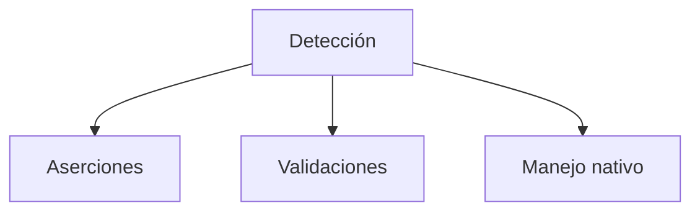
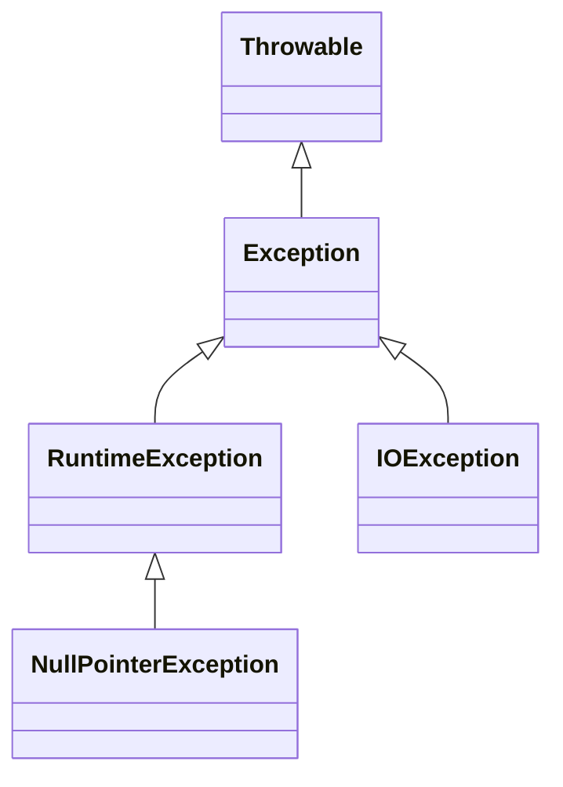

# Introducción a las Ciencias de la Computación - Manejo de errores en ejecución (excepciones)

## 7.3 Detección y manejo de errores de ejecución

---

### 1. Mecanismos de Detección de Errores

#### 1.1 Tipos de Errores de Ejecución

- **Errores lógicos**: Resultados incorrectos (ej: división por cero)
- **Errores de recursos**: Memoria, archivos, red
- **Errores de estado**: Objetos en estado inválido

#### 1.2 Estrategias de Detección



### 2. Manejo con Try-Catch-Finally

#### 2.1 Estructura Básica

Bloque que captura y procesa excepciones:

$$ \text{ManejoSeguro} = \text{try} \cup \text{catch} \cup \text{finally} $$

#### 2.2 Ejemplo en Java

```java
public class ManejoErrores {
    public static void main(String[] args) {
        try {
            // Código que puede fallar
            int resultado = 10 / 0;
            System.out.println("Resultado: " + resultado);
        } catch (ArithmeticException e) {
            // Manejo específico
            System.err.println("Error aritmético: " + e.getMessage());
        } catch (Exception e) {
            // Manejo genérico
            System.err.println("Error inesperado: " + e.getMessage());
        } finally {
            // Siempre se ejecuta
            System.out.println("Limpieza de recursos");
        }
    }
}
```

### 3. Tipos de Excepciones

#### 3.1 Checked vs Unchecked

| Tipo          | Herencia           | Manejo obligatorio | Ejemplo                |
| ------------- | ------------------ | ------------------ | ---------------------- |
| **Checked**   | `Exception`        | Sí                 | `IOException`          |
| **Unchecked** | `RuntimeException` | No                 | `NullPointerException` |

#### 3.2 Diagrama de Herencia



### 4. Patrones de Manejo Avanzado

#### 4.1 Try-With-Resources (Java)

Cierre automático de recursos:

```java
try (FileReader fr = new FileReader("archivo.txt");
     BufferedReader br = new BufferedReader(fr)) {
    String linea = br.readLine();
    System.out.println(linea);
} catch (IOException e) {
    System.err.println("Error de E/S: " + e.getMessage());
}
```

#### 4.2 Pattern Matching (Java 17+)

```java
try {
    procesoRiesgoso();
} catch (Exception e) {
    switch (e) {
        case IOException ioe -> System.out.println("Error E/S: " + ioe.getMessage());
        case SQLException sqle -> System.out.println("Error BD: " + sqle.getErrorCode());
        default -> System.out.println("Error inesperado: " + e.getMessage());
    }
}
```

### 5. Custom Exceptions

#### 5.1 Creación de Excepciones Personalizadas

```java
public class SaldoInsuficienteException extends RuntimeException {
    private final double saldoActual;
    private final double montoRequerido;

    public SaldoInsuficienteException(double saldo, double monto) {
        super("Saldo insuficiente: " + saldo + " < " + monto);
        this.saldoActual = saldo;
        this.montoRequerido = monto;
    }

    public double getSaldoActual() { return saldoActual; }
    public double getMontoRequerido() { return montoRequerido; }
}
```

#### 5.2 Uso en Aplicación

```java
public class CuentaBancaria {
    private double saldo;

    public void retirar(double monto) {
        if (monto > saldo) {
            throw new SaldoInsuficienteException(saldo, monto);
        }
        saldo -= monto;
    }
}
```

### 6. Ejercicios Prácticos

1. Implementa un manejor de errores para una calculadora con:
   - División por cero
   - Entradas no numéricas
   - Overflow matemático
2. Crea una jerarquía de excepciones para una aplicación de reservas
3. Explica la diferencia entre `throw` y `throws` en Java

### Ver también

- **7.1** Tipos de errores — qué errores se manejan aquí.
- **7.2** Definición de excepciones — las clases que se capturan.
- **8.1** E/S — los errores de E/S son uno de los casos más comunes de manejo de excepciones.

### Referencias

- Eckel, B. (2006). _Thinking in Java_ (4.ª ed.). Prentice Hall. Cap. 12.
- Martin, R. C. (2008). _Clean Code_. Prentice Hall. Cap. 7.
