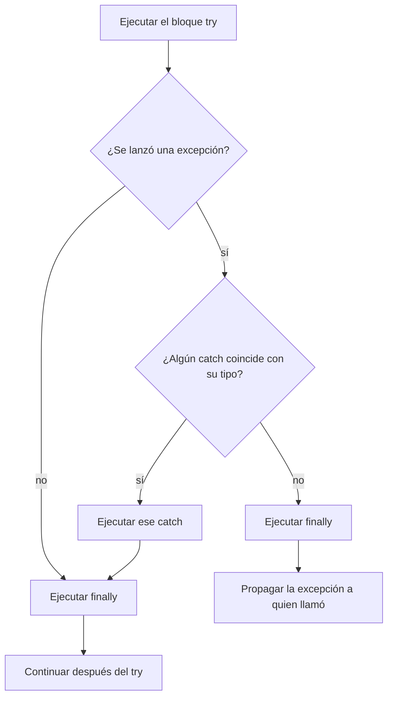

# Introducción a las Ciencias de la Computación - Manejo de errores en ejecución (excepciones)

## 7.3 Detección y manejo de errores de ejecución.

---

Cuando un método detecta una situación que no puede resolver, **lanza** una excepción: interrumpe su ejecución y entrega a quien lo llamó un objeto que describe el problema. La excepción **se propaga** hacia atrás por la pila de llamadas hasta que algún método la **atrapa** con un bloque `try`-`catch`, o hasta que sale de `main` y termina el programa con una traza de la pila. Este mecanismo separa el lugar donde se **detecta** un error, que suele estar en lo profundo del código, del lugar donde se sabe **qué hacer** con él, que suele estar más arriba.

### 1. Lanzar: `throw`

```java
static double raizCuadrada(double x) {
    if (x < 0) {
        throw new IllegalArgumentException("No hay raíz real de " + x);
    }
    return Math.sqrt(x);
}
```

`throw` recibe un objeto de tipo `Throwable`. La ejecución del método se interrumpe en ese punto: las instrucciones siguientes no se ejecutan y el método no regresa ningún valor.

**Detectar pronto.** Es mejor verificar las precondiciones al **inicio** del método y lanzar la excepción ahí, con un mensaje claro, que dejar que el valor inválido cause un error confuso más adelante. A esto se le llama **fallar rápido**. La biblioteca ofrece atajos:

```java
import java.util.Objects;

public Cuenta(String titular, double saldoInicial) {
    this.titular = Objects.requireNonNull(titular, "titular");
    if (saldoInicial < 0) throw new IllegalArgumentException("saldo inicial negativo");
    this.saldo = saldoInicial;
}
```

### 2. Atrapar: `try`, `catch` y `finally`

```java
try {
    // código que puede lanzar excepciones
} catch (TipoA e) {
    // se ejecuta si ocurre una excepción de TipoA o una subclase
} catch (TipoB | TipoC e) {
    // para varios tipos con el mismo tratamiento
} finally {
    // se ejecuta SIEMPRE: haya o no excepción, la atrape o no un catch
}
```

**Flujo de ejecución:**



- Si el `try` termina sin problemas, se saltan los `catch`.
- Si se lanza una excepción, el resto del `try` **no** se ejecuta; se busca el primer `catch` compatible.
- El `finally` se ejecuta en todos los casos, incluso si el `try` o el `catch` ejecutan `return`. Se usa para liberar recursos.

### 3. Propagación

Si un método no atrapa una excepción, esta sale del método y continúa en el que lo llamó, desapilando registros de activación (subtema 6.3):

```java
public class Propagacion {
    static int leerEntero(String texto) {
        return Integer.parseInt(texto);              // puede lanzar NumberFormatException
    }

    static int sumarTodos(String[] textos) {
        int suma = 0;
        for (String t : textos) suma += leerEntero(t);   // no la atrapa: se propaga
        return suma;
    }

    public static void main(String[] args) {
        String[] datos = {"10", "20", "treinta", "40"};
        try {
            System.out.println(sumarTodos(datos));
        } catch (NumberFormatException e) {
            System.out.println("Dato inválido: " + e.getMessage());
        }
        System.out.println("El programa continúa");
    }
}
```

```text
Dato inválido: For input string: "treinta"
El programa continúa
```

La excepción nació en `parseInt`, atravesó `leerEntero` y `sumarTodos` sin ser atrapada, y fue atendida en `main`. Las sumas parciales se perdieron, porque los registros de activación de `sumarTodos` y `leerEntero` se destruyeron al propagarse.

**Declarar con `throws`.** Para las excepciones verificadas, el compilador exige que cada método las atrape o las declare en su firma:

```java
static String primeraLinea(java.nio.file.Path p) throws java.io.IOException {
    return java.nio.file.Files.readAllLines(p).get(0);
}
```

`throws` forma parte del contrato del método: avisa a quien lo usa qué problemas debe prever.

### 4. Liberar recursos: `try` con recursos

Archivos, conexiones de red y de bases de datos son **recursos** que deben cerrarse después de usarlos, haya o no errores. La forma clásica con `finally` es larga y fácil de equivocar. Desde Java 7, el **`try` con recursos** cierra automáticamente todo objeto que implemente `AutoCloseable`, en orden inverso al que se abrió:

```java
import java.io.BufferedReader;
import java.io.IOException;
import java.nio.file.Files;
import java.nio.file.Path;

public class ContarLineas {
    static long contar(Path p) throws IOException {
        try (BufferedReader lector = Files.newBufferedReader(p)) {   // se cierra al salir
            long n = 0;
            while (lector.readLine() != null) n++;
            return n;
        }
    }

    public static void main(String[] args) {
        try {
            Path p = Files.writeString(Files.createTempFile("ej", ".txt"), "uno\ndos\ntres\n");
            System.out.println(contar(p) + " líneas");     // 3 líneas
            System.out.println(contar(Path.of("no-existe.txt")));
        } catch (IOException e) {
            System.out.println("Error de E/S: " + e);
        }
    }
}
```

Las clases propias también pueden usarse así implementando `AutoCloseable` y su método `close`.

### 5. Qué hacer en un `catch`

Atrapar una excepción solo tiene sentido si en ese punto se puede hacer algo útil:

- **Recuperarse:** usar un valor predeterminado, reintentar, pedir otro dato al usuario.
- **Traducir:** convertir una excepción técnica en una del dominio, conservando la causa (subtema 7.2).
- **Informar y terminar ordenadamente:** registrar el error con su traza y mostrar al usuario un mensaje comprensible.

Lo que **nunca** debe hacerse es atraparla y no hacer nada:

```java
try {
    guardar(datos);
} catch (Exception e) {
    // vacío: el error desaparece y el usuario cree que sus datos se guardaron
}
```

### 6. Aserciones

Una **aserción** verifica una condición que, si el programa es correcto, **siempre** debe cumplirse. Sirve para documentar y comprobar invariantes durante el desarrollo:

```java
static int maximo(int[] a) {
    int max = a[0];
    for (int x : a) if (x > max) max = x;
    assert esMaximo(max, a) : "El máximo calculado no es correcto";
    return max;
}
```

Las aserciones están **desactivadas** por omisión y se activan con `java -ea`. Por eso nunca deben usarse para validar datos del usuario o parámetros de métodos públicos: en producción no se ejecutarían.

> **Conexión con CC.** El mecanismo de excepciones se implementa con las estructuras del tema 6: al lanzar, la JVM busca en una tabla de cada método qué rangos de instrucciones están protegidos por qué `catch`, y desapila registros de activación hasta encontrar uno. En sistemas distribuidos, donde una llamada puede viajar por la red, los errores se propagan de forma análoga entre servicios, y diseñar qué hacer cuando un servicio remoto falla es parte central de la ingeniería de sistemas confiables.

### Ejercicios propuestos

1. Prediga qué imprime y verifíquelo:

```java
static int prueba() {
    try {
        System.out.println("try");
        throw new IllegalStateException("x");
    } catch (IllegalStateException e) {
        System.out.println("catch");
        return 1;
    } finally {
        System.out.println("finally");
    }
}
```

2. Modifique `sumarTodos` para que ignore los datos inválidos, mostrando un aviso por cada uno, y regrese la suma de los válidos.
3. Escriba un programa que pida al usuario el nombre de un archivo y cuente sus palabras, volviendo a pedir el nombre si el archivo no existe.
4. Escriba una clase `Cronometro` que implemente `AutoCloseable` y que, al cerrarse, imprima cuánto tiempo pasó desde que se creó. Úsela en un `try` con recursos.
5. Explique por qué el siguiente código es un error y corríjalo:

```java
public double promedio(int[] datos) {
    try {
        int suma = 0;
        for (int d : datos) suma += d;
        return (double) suma / datos.length;
    } catch (Exception e) {
        return 0;
    }
}
```

### Ver también

- **6.3** La pila de ejecución — cómo se desapilan los registros al propagar.
- **7.1** Tipos de errores — verificadas y no verificadas.
- **7.2** Definición de errores aprovechando la herencia — excepciones propias y encadenamiento.
- **7.4** Recomendaciones generales.
- **8.2** Mecanismos para el uso de archivos de disco — recursos y su cierre.

### Referencias

- Bloch, J. (2018). _Effective Java_ (3.ª ed.). Addison-Wesley. Ítems 9, 49 y 69 a 77.
- Oracle. _The Java Tutorials: The try-with-resources Statement_.
- Gosling, J., et al. _The Java Language Specification_. Sección 14.20: The try statement.
