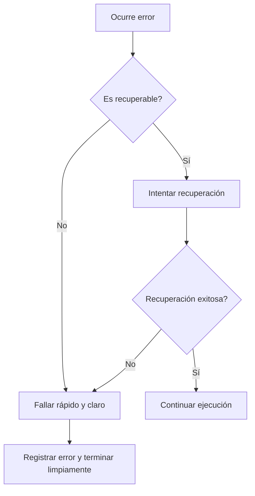

# Introducción a las Ciencias de la Computación - Manejo de errores en ejecución (excepciones)

## 7.4 Recomendaciones generales.

---

### 1. Principios Fundamentales

#### 1.1 Filosofía de Diseño

El manejo de errores debe ser:

- **Explícito**: Nunca silenciar errores inadvertidamente
- **Contextual**: Proporcionar información útil para debug
- **Recuperable**: Permitir que el sistema continúe cuando sea posible

$$ \text{CalidadManejoErrores} = \frac{\text{InformaciónÚtil} \times \text{CapacidadRecuperación}}{\text{Complejidad}} $$

#### 1.2 Diagrama de Decisiones



### 2. Mejores Prácticas en Código

#### 2.1 Uso Adecuado de Try-Catch

```java
// (✓) CORRECTO: Específico y con logging
try {
    procesarArchivo(ruta);
} catch (FileNotFoundException e) {
    log.error("Archivo no encontrado: {}", ruta, e);
    throw new MiAppException("No se pudo procesar el archivo", e);
}

// (X) EVITAR: Catch genérico sin acción
try {
    procesarArchivo(ruta);
} catch (Exception e) {
    // Peligro: error silenciado
}
```

#### 2.2 Diseño de Excepciones Personalizadas

```java
public class MiAppException extends RuntimeException {
    private final String codigoError;
    private final Instant timestamp;

    public MiAppException(String mensaje, String codigoError, Throwable causa) {
        super(mensaje, causa);
        this.codigoError = codigoError;
        this.timestamp = Instant.now();
    }

    // Getters para información adicional
}
```

### 3. Patrones Recomendados

#### 3.1 Pattern: Result Object

Alternative a excepciones para flujos esperados:

```java
public class Resultado<T> {
    private final T valor;
    private final String error;

    private Resultado(T valor, String error) {
        this.valor = valor;
        this.error = error;
    }

    public static <T> Resultado<T> exito(T valor) {
        return new Resultado<>(valor, null);
    }

    public static <T> Resultado<T> error(String mensaje) {
        return new Resultado<>(null, mensaje);
    }

    public boolean esExitoso() { return error == null; }
    // Getters...
}
```

#### 3.2 Pattern: Null Object

Evitar null checks excesivos:

```java
public interface Usuario {
    String getNombre();
    boolean esAnonimo();
}

public class UsuarioReal implements Usuario {
    public String getNombre() { return nombre; }
    public boolean esAnonimo() { return false; }
}

public class UsuarioAnonimo implements Usuario {
    public String getNombre() { return "Invitado"; }
    public boolean esAnonimo() { return true; }
}
```

### 4. Estrategias de Logging

#### 4.1 Información Esencial a Registrar

```java
try {
    servicio.procesar(datos);
} catch (MiAppException e) {
    log.error("Error procesando datos: {} - Usuario: {} - Tiempo: {}",
              e.getCodigoError(), usuarioActual, Instant.now(), e);
    metrics.incrementCounter("errores.procesamiento");
}
```

#### 4.2 Niveles de Log Recomendados

- **ERROR**: Errores recuperables o que requieren atención
- **WARN**: Situaciones inusuales pero no errores
- **INFO**: Información de progreso de la aplicación
- **DEBUG**: Información para troubleshooting

### 5. Recomendaciones de Performance

#### 5.1 Costo de las Excepciones

$$ \text{CostoExcepcion} \approx 100-1000\times \text{CostoMétodoNormal} $$

#### 5.2 Guidelines de Performance

- **Evitar** excepciones en flujos normales (usar checks booleanos)
- **Usar** excepciones solo para casos excepcionales
- **Preferir** excepciones unchecked para errores de programación

### 6. Ejercicios Prácticos

1. Refactoriza este código aplicando las recomendaciones:

```java
try {
    return Integer.parseInt(input);
} catch (Exception e) {
    return 0;
}
```

2. Diseña un sistema de manejo de errores para un microservicio
3. Explica por qué el pattern Result Object es útil en APIs REST

### Ver también

- **7.1–7.3** Tipos, definición y manejo de errores — síntesis y buenas prácticas.
- **2.1** SOLID — los principios guían el diseño del manejo de errores.

### Referencias

- Martin, R. C. (2008). _Clean Code_. Prentice Hall. Cap. 7.
- Bloch, J. (2018). _Effective Java_ (3.ª ed.). Addison-Wesley. Cap. 10.
