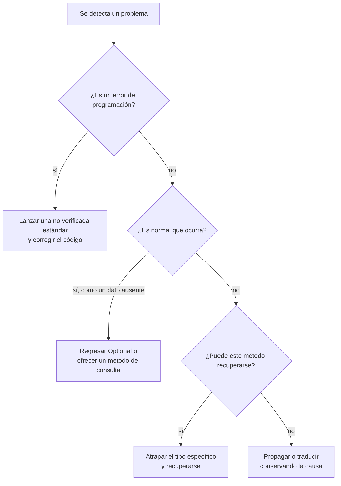

# Introducción a las Ciencias de la Computación - Manejo de errores en ejecución (excepciones)

## 7.4 Recomendaciones generales.

---

Conocer la sintaxis de `throw` y `try` es fácil; usarlas bien requiere criterio. Un manejo de errores descuidado produce programas que fallan en silencio, que muestran mensajes incomprensibles o que dejan los datos a medio modificar. Las recomendaciones de esta página recogen la experiencia acumulada por la comunidad de Java, en buena parte sistematizada por Joshua Bloch en *Effective Java*, y se aplican con pocas variaciones a cualquier lenguaje con excepciones.

### 1. Nunca silenciar una excepción

Un `catch` vacío es el error más dañino, porque convierte una falla visible en un comportamiento incorrecto invisible:

```java
// MAL: si falla, nadie se entera
try { guardar(datos); } catch (IOException e) { }
```

Si de verdad no hay nada que hacer, al menos debe quedar registro y una explicación de por qué es seguro ignorarla:

```java
try {
    archivoTemporal.close();
} catch (IOException e) {
    // Se ignora: el archivo solo se leía y ya se obtuvieron los datos.
    registro.warning("No se pudo cerrar el temporal: " + e.getMessage());
}
```

### 2. Atrapar lo específico, en el lugar adecuado

- Atrape el tipo **más específico** que pueda manejar. `catch (Exception e)` atrapa también errores de programación como `NullPointerException`, que deberían corregirse, no ocultarse.
- Atrape la excepción **donde se pueda hacer algo** con ella. Si un método de bajo nivel no sabe cómo recuperarse, debe dejarla pasar o declararla con `throws`; atraparla solo para imprimirla y continuar es casi siempre un error.
- Un `catch` genérico solo tiene sentido en el **nivel más alto** del programa, como el `main` o el ciclo de atención de un servidor, para registrar el error y evitar que una petición fallida derribe todo el sistema.

### 3. Fallar rápido y validar las precondiciones

Verifique los argumentos al inicio de los métodos públicos y lance una excepción en cuanto detecte algo inválido. Cuanto más cerca está la detección del origen del problema, más fácil es diagnosticarlo:

```java
public void programarCita(LocalDate fecha, int duracionMin) {
    Objects.requireNonNull(fecha, "fecha");
    if (duracionMin <= 0 || duracionMin > 480)
        throw new IllegalArgumentException("Duración fuera de rango: " + duracionMin);
    if (fecha.isBefore(LocalDate.now()))
        throw new IllegalArgumentException("La fecha ya pasó: " + fecha);
    // ...
}
```

### 4. Preferir las excepciones estándar

Antes de crear una excepción propia, revise si alguna estándar expresa el problema (tabla del subtema 7.2). Los programadores ya conocen su significado, y la documentación de la biblioteca las usa con convenciones claras. Reserve las propias para los errores del dominio que quien llama necesita distinguir.

### 5. Mensajes con contexto

El mensaje de una excepción debe permitir entender qué pasó sin abrir el código. Incluya los **valores** involucrados:

| Mensaje pobre               | Mensaje útil                                                         |
| --------------------------- | -------------------------------------------------------------------- |
| `Error`                     | `Índice 12 fuera de rango para una lista de 10 elementos`            |
| `Dato inválido`             | `Línea 37 de alumnos.csv: se esperaban 4 columnas y hay 3`           |
| `No se pudo conectar`       | `No se pudo conectar a db.ejemplo.mx:5432 tras 3 intentos`           |

Distinga además dos públicos: el mensaje de la excepción y el registro son para el **programador**; al **usuario** se le muestra un mensaje en sus términos, sin trazas ni nombres de clases, que le diga qué puede hacer.

### 6. Conservar la causa

Al traducir una excepción, pase la original como causa. Perderla obliga a adivinar dónde empezó el problema:

```java
} catch (SQLException e) {
    throw new ErrorBancario("No se pudo registrar el depósito", e);    // bien
    // throw new ErrorBancario("No se pudo registrar el depósito");    // mal: se pierde e
}
```

### 7. No usar excepciones para el flujo normal

Las excepciones son para situaciones **excepcionales**. Usarlas como estructura de control hace el código confuso y lento, porque crear una excepción implica capturar la traza de la pila:

```java
// MAL: se usa la excepción para terminar el ciclo
try {
    int i = 0;
    while (true) procesar(arreglo[i++]);
} catch (ArrayIndexOutOfBoundsException e) { }

// BIEN
for (int x : arreglo) procesar(x);
```

Del mismo modo, conviene ofrecer métodos que permitan **consultar antes de actuar**, como `hasNext()` antes de `next()` en un iterador, o regresar un `Optional` cuando la ausencia de un resultado es normal:

```java
Optional<Cuenta> buscar(String numero) { ... }     // la cuenta puede no existir

buscar("001").ifPresentOrElse(
    c -> System.out.println(c.getSaldo()),
    () -> System.out.println("No existe la cuenta"));
```

### 8. Liberar siempre los recursos

Todo recurso que se abre debe cerrarse, también cuando ocurre un error. Use `try` con recursos en lugar de cerrar a mano en `finally`, y haga que sus propias clases que administran recursos implementen `AutoCloseable` (subtema 7.3).

### 9. Atomicidad ante fallas

Si un método falla, el objeto debería quedar en el **mismo estado que antes** de la llamada. La forma más sencilla de lograrlo es hacer todas las verificaciones **antes** de modificar algo:

```java
void transferir(Cuenta origen, Cuenta destino, double monto) throws ErrorBancario {
    origen.verificarRetiro(monto);      // puede lanzar: todavía no se ha modificado nada
    destino.verificarDeposito(monto);   // puede lanzar: todavía no se ha modificado nada
    origen.retirar(monto);              // a partir de aquí ya no debería fallar
    destino.depositar(monto);
}
```

Si las verificaciones no pueden hacerse por adelantado, se trabaja sobre una copia y solo al final se reemplaza el original, o se deshacen explícitamente los cambios en el `catch`. Las bases de datos resuelven este problema con **transacciones**.

### 10. Documentar las excepciones

Indique en la documentación de cada método qué excepciones puede lanzar y en qué condiciones, tanto las verificadas como las no verificadas relevantes:

```java
/**
 * Retira un monto de la cuenta.
 *
 * @param monto cantidad a retirar, debe ser positiva
 * @throws IllegalArgumentException si monto no es positivo
 * @throws CuentaBloqueadaException si la cuenta está bloqueada
 * @throws SaldoInsuficienteException si el saldo es menor que monto
 */
void retirar(double monto) throws SaldoInsuficienteException, CuentaBloqueadaException
```

### 11. Probar los casos de error

Los caminos de error suelen ser los menos probados y los que fallan en producción. Escriba pruebas que verifiquen que se lanza la excepción correcta con los datos incorrectos:

```java
@Test
void retiroMayorAlSaldoLanzaExcepcion() {
    Cuenta c = new Cuenta("001", 100);
    assertThrows(SaldoInsuficienteException.class, () -> c.retirar(150));
    assertEquals(100, c.getSaldo());     // y comprueba la atomicidad
}
```

### Resumen



> **Conexión con CC.** En ingeniería de software estas recomendaciones se formalizan en la **programación por contrato**, propuesta por Bertrand Meyer: cada método declara sus precondiciones, poscondiciones e invariantes, y una excepción señala que alguien violó el contrato. En sistemas críticos, como el software de aviación o de equipo médico, el manejo de errores se diseña y se verifica con el mismo rigor que la funcionalidad principal.

### Ejercicios propuestos

1. Revise un programa suyo de temas anteriores y encuentre al menos tres lugares donde el manejo de errores viole alguna de estas recomendaciones. Corríjalos.
2. Reescriba el siguiente método para que no use excepciones como control de flujo:

```java
static boolean esNumero(String s) {
    try { Integer.parseInt(s); return true; }
    catch (NumberFormatException e) { return false; }
}
```

¿Es realmente un mal uso en este caso? Discuta las ventajas y desventajas.

3. Implemente `transferir` de la sección 9 de modo que, si el depósito falla después del retiro, se reintegre el dinero a la cuenta de origen.
4. Mejore los mensajes de error de un programa que lea un archivo CSV de calificaciones para que indiquen el número de línea, la columna y el valor que causó el problema.
5. Escriba pruebas para la clase `Cuenta` que verifiquen cada una de las excepciones documentadas en la sección 10.

### Ver también

- **7.1** Tipos de errores — qué tipo de excepción corresponde a cada situación.
- **7.2** Definición de errores aprovechando la herencia — jerarquías y encadenamiento.
- **7.3** Detección y manejo de errores de ejecución — `try` con recursos y aserciones.
- **8.2** Mecanismos para el uso de archivos de disco — errores de entrada y salida en la práctica.
- **9.5** Depuración en hilos de ejecución — excepciones en hilos.

### Referencias

- Bloch, J. (2018). _Effective Java_ (3.ª ed.). Addison-Wesley. Cap. 10: Exceptions.
- Meyer, B. (1997). _Object-Oriented Software Construction_ (2.ª ed.). Prentice Hall. Cap. 11 y 12: diseño por contrato y excepciones.
- Martin, R. C. (2008). _Clean Code_. Prentice Hall. Cap. 7: Error Handling.
