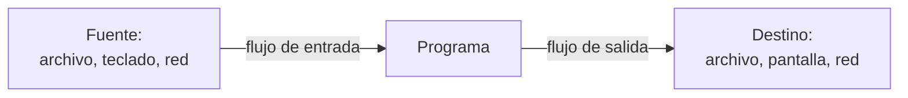
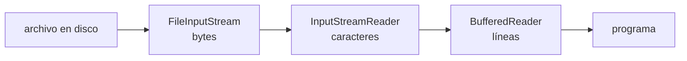

# Introducción a las Ciencias de la Computación - Entrada y salida estructurada

## 8.1 Conceptos generales.

---

Los datos de un programa viven en la memoria principal y desaparecen cuando el programa termina. Para que la información **persista**, o para intercambiarla con otros programas, con el usuario o con otras computadoras, hay que enviarla fuera del programa y poder recuperarla después: eso es la **entrada y salida** (E/S). La E/S es **estructurada** cuando los datos no se tratan como una sucesión arbitraria de bytes, sino con una organización conocida, en líneas, registros, campos u objetos, que permite que quien los lee reconstruya exactamente lo que se escribió. Este tema presenta las abstracciones con que Java maneja la E/S y las distintas formas de organizar los datos en un archivo.

### 1. Fuentes, destinos y flujos

Un programa puede leer de muchas **fuentes** y escribir en muchos **destinos**: el teclado y la pantalla, archivos en disco, conexiones de red, otros procesos, incluso arreglos en memoria. En lugar de ofrecer operaciones distintas para cada uno, los lenguajes ofrecen una abstracción común, el **flujo** (*stream*): una secuencia ordenada de datos que se lee o se escribe de principio a fin.



El programa trabaja siempre con las mismas operaciones, **abrir**, **leer o escribir** y **cerrar**, sin importar de dónde vienen o a dónde van los datos. Así, un método que procesa un `Reader` funciona igual sobre un archivo que sobre el teclado o sobre una cadena.

### 2. Los flujos estándar

Todo proceso arranca con tres flujos ya abiertos por el sistema operativo:

| Flujo             | En Java       | Conectado por omisión a |
| ----------------- | ------------- | ----------------------- |
| entrada estándar  | `System.in`   | el teclado              |
| salida estándar   | `System.out`  | la consola              |
| error estándar    | `System.err`  | la consola              |

Desde la terminal se pueden **redirigir** a archivos sin cambiar el programa:

```bash
java Promedio < datos.txt > resultado.txt 2> errores.txt
java Generador | java Filtro          # la salida de uno es la entrada del otro
```

Separar los errores de la salida normal permite, por ejemplo, guardar los resultados en un archivo y seguir viendo los avisos en la pantalla.

### 3. Bytes y caracteres

En el nivel más bajo, todo archivo es una sucesión de **bytes**. Un archivo de **texto** es uno cuyos bytes representan caracteres según una **codificación**:

| Codificación | Bytes por carácter | Comentario                                                     |
| ------------ | ------------------ | -------------------------------------------------------------- |
| ASCII        | 1                  | solo 128 caracteres: no incluye la ñ ni los acentos            |
| ISO-8859-1   | 1                  | 256 caracteres de lenguas de Europa occidental                 |
| UTF-8        | de 1 a 4           | todo Unicode, compatible con ASCII; el estándar actual          |
| UTF-16       | 2 o 4              | la representación interna de `String` en Java                   |

La palabra `año` ocupa 3 bytes en ISO-8859-1 y 4 en UTF-8, donde la `ñ` se codifica con los bytes `C3 B1`. Si un archivo se escribe con una codificación y se lee con otra, aparecen caracteres extraños como `año`. Por eso conviene **indicar siempre la codificación**, de preferencia UTF-8.

Java distingue dos familias de flujos:

- **Flujos de bytes**, `InputStream` y `OutputStream`: transportan bytes sin interpretarlos. Se usan para imágenes, audio, archivos comprimidos y cualquier dato binario.
- **Flujos de caracteres**, `Reader` y `Writer`: convierten automáticamente entre bytes y caracteres con una codificación. Se usan para texto.

`InputStreamReader` y `OutputStreamWriter` son el puente entre ambas familias.

### 4. Capas de flujos: el patrón decorador

Las clases de `java.io` se diseñaron para **combinarse**: un flujo básico conectado a la fuente se envuelve en otros que agregan funciones, como un búfer, la conversión a caracteres o la lectura de tipos primitivos.

```java
BufferedReader lector = new BufferedReader(          // agrega búfer y readLine()
        new InputStreamReader(                        // convierte bytes en caracteres
                new FileInputStream("datos.txt"),     // lee bytes del archivo
                StandardCharsets.UTF_8));
```



Esta organización es un ejemplo del patrón de diseño **decorador**: cada capa tiene la misma interfaz que la que envuelve y le agrega una responsabilidad. La biblioteca moderna `java.nio.file` ofrece atajos, como `Files.newBufferedReader(ruta)`, que construyen estas capas automáticamente.

### 5. Búferes

Cada acceso al disco o a la red es muy costoso comparado con una operación en memoria: leer un byte del disco puede tardar cientos de miles de veces más que leerlo de la RAM. Un **búfer** es un arreglo en memoria que agrupa muchas operaciones pequeñas en pocas grandes: al leer, se trae del disco un bloque de miles de bytes de una vez y las siguientes lecturas se atienden desde el búfer; al escribir, se acumulan los datos y se envían juntos cuando el búfer se llena.

**Consecuencia.** Lo escrito en un flujo con búfer puede no haber llegado aún al archivo. Hay que llamar a `flush()` o cerrar el flujo, que lo vacía automáticamente; si el programa termina abruptamente sin cerrarlo, los últimos datos se pierden.

### 6. Acceso secuencial y acceso directo

- **Acceso secuencial:** los datos se leen o escriben en orden, del principio al final. Es el modelo natural de los flujos y el único posible en el teclado o la red.
- **Acceso directo o aleatorio:** se puede saltar a cualquier posición del archivo y leer o escribir ahí. Requiere que se pueda calcular dónde está cada dato, lo que es fácil si todos los registros tienen el **mismo tamaño**: el registro $i$ empieza en el byte $i \cdot t$, donde $t$ es el tamaño de cada registro.

| Operación                         | Secuencial        | Directo         |
| --------------------------------- | ----------------- | --------------- |
| leer todos los registros          | $O(n)$            | $O(n)$          |
| leer el registro $i$              | $O(i)$            | $O(1)$          |
| modificar un registro en su lugar | reescribir todo   | $O(1)$          |

### 7. Texto, binario y formatos estructurados

**Texto.** Los datos se escriben como caracteres legibles: el número 1000 se guarda como los cuatro caracteres `1`, `0`, `0`, `0`. Se pueden abrir con cualquier editor, son portables entre sistemas y fáciles de depurar, pero ocupan más espacio y hay que convertirlos al leerlos.

**Binario.** Los datos se escriben con su representación interna: un `int` ocupa siempre 4 bytes. Es compacto y rápido, y permite registros de tamaño fijo, pero no es legible y hay que conocer exactamente el formato para interpretarlo, incluido el orden de los bytes.

Para que otro programa entienda los datos hace falta un **formato** acordado. Algunos formatos de texto muy usados:

| Formato | Estructura                                      | Uso típico                                 |
| ------- | ----------------------------------------------- | ------------------------------------------ |
| CSV     | una línea por registro, campos separados por comas | tablas, hojas de cálculo                 |
| JSON    | objetos y arreglos anidados                     | comunicación entre servicios web, configuración |
| XML     | etiquetas anidadas                              | documentos, intercambio entre sistemas     |
| YAML    | anidación por sangría                           | archivos de configuración                  |

```text
CSV:   2024001,Ana López,9.5
JSON:  {"cuenta": "2024001", "nombre": "Ana López", "promedio": 9.5}
```

**Serialización** es el proceso de convertir un objeto en memoria en una secuencia de bytes o de texto que puede guardarse o transmitirse; **deserialización** es el proceso inverso. Todos los formatos anteriores son formas de serializar.

### 8. La E/S puede fallar

A diferencia de las operaciones en memoria, la E/S depende del entorno: el archivo puede no existir, el disco llenarse o la red caerse. Por eso casi todas las operaciones de E/S de Java lanzan `IOException`, una excepción verificada (subtema 7.1), y todo flujo abierto debe cerrarse con `try` con recursos (subtema 7.3).

> **Conexión con CC.** El sistema operativo implementa los archivos sobre los bloques del disco y ofrece a los programas las llamadas al sistema `open`, `read`, `write` y `close`, sobre las que se construyen las bibliotecas de E/S de todos los lenguajes. En Unix la abstracción se lleva al extremo: casi todo, desde los dispositivos hasta las conexiones de red, se maneja como un archivo. Las bases de datos, por su parte, son en esencia sistemas sofisticados de archivos de acceso directo con índices.

### Ejercicios propuestos

1. Escriba un programa que lea números de la entrada estándar hasta el fin de archivo e imprima su promedio. Ejecútelo escribiendo los números en el teclado y luego redirigiendo la entrada desde un archivo.
2. ¿Cuántos bytes ocupa la cadena `"Ñandú"` en ASCII, ISO-8859-1, UTF-8 y UTF-16? Compruébelo con `"Ñandú".getBytes(StandardCharsets.UTF_8).length` y las demás codificaciones.
3. Guarde el arreglo `{1, 1000, 1000000}` en un archivo de texto, un número por línea, y en uno binario con `DataOutputStream`. Compare los tamaños.
4. En un archivo binario de registros de 64 bytes cada uno, ¿en qué byte empieza el registro 150? ¿Cuántos registros hay si el archivo mide 64 000 bytes?
5. Represente la misma información de tres alumnos en CSV y en JSON. ¿Qué pasa en cada formato si el nombre de un alumno contiene una coma?

### Ver también

- **2.4** Entrada y salida — lectura del teclado con `Scanner`.
- **1.5** Representación digital de la información — códigos de caracteres.
- **5.4** Clases abstractas — `InputStream` y `Reader` como clases abstractas.
- **7.1** Tipos de errores — los errores de entrada y salida.
- **8.2** Mecanismos para el uso de archivos de disco.
- **8.3** Manejo de archivos — texto, registros, objetos y acceso directo.
- **Sistemas Operativos 6 y 7** (Sem. 6) — sistemas de archivos y entrada-salida.

### Referencias

- Oracle. _The Java Tutorials: Basic I/O_. https://docs.oracle.com/javase/tutorial/essential/io/
- Horstmann, C. S. (2022). _Core Java, Volume II: Advanced Features_ (12.ª ed.). Pearson. Cap. 2: Input and Output.
- Gamma, E., Helm, R., Johnson, R., & Vlissides, J. (1994). _Design Patterns_. Addison-Wesley. Patrón Decorator.
