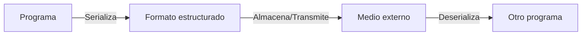

# Introducción a las Ciencias de la Computación - Entrada y salida estructurada

## 8.1 Conceptos generales.

---

### 1. Definición y Fundamentos

#### 1.1 ¿Qué es E/S Estructurada?

Intercambio de información entre un programa y su entorno utilizando formatos organizados y estandarizados:

$$ \text{E/S Estructurada} = \left\lbrace \begin{array}{ll} \text{Datos organizados} & \\\ \text{Formatos predefinidos} & \\\ \text{Esquemas de validación} & \end{array} \right\rbrace. $$

#### 1.2 Ventajas sobre E/S Cruda

- **Integridad**: Validación automática de datos
- **Mantenibilidad**: Estructuras claras y documentadas
- **Interoperabilidad**: Intercambio entre sistemas heterogéneos

### 2. Formatos Comunes de E/S Estructurada

#### 2.1 Comparativa de Formatos

| Formato  | Ventajas                     | Desventajas          | Uso típico        |
| -------- | ---------------------------- | -------------------- | ----------------- |
| **JSON** | Ligero, fácil lectura        | Sin esquema estricto | APIs web, configs |
| **XML**  | Esquemas robustos (XSD)      | Verboso, complejo    | Enterprise, SOAP  |
| **YAML** | Sintaxis humana, comentarios | Indentación crítica  | Configuraciones   |
| **CSV**  | Simple, universal            | Sin tipos de datos   | Datos tabulares   |

#### 2.2 Diagrama de Flujo E/S



### 3. Serialización y Deserialización

#### 3.1 Proceso Fundamental

Conversión entre objetos en memoria y formatos estructurados:

$$ \text{Serialización} : \text{Objeto} \rightarrow \text{ByteStream} $$ $$ \text{Deserialización} : \text{ByteStream} \rightarrow \text{Objeto} $$

#### 3.2 Ejemplo en Java (JSON)

```java
import com.fasterxml.jackson.databind.ObjectMapper;

public class Persona {
    private String nombre;
    private int edad;

    // Getters y setters necesarios

    public String toJson() throws Exception {
        ObjectMapper mapper = new ObjectMapper();
        return mapper.writeValueAsString(this);
    }

    public static Persona fromJson(String json) throws Exception {
        ObjectMapper mapper = new ObjectMapper();
        return mapper.readValue(json, Persona.class);
    }
}
```

### 4. Validación y Esquemas

#### 4.1 Importancia de los Esquemas

Definición formal de la estructura esperada de los datos:

$$ \text{Validez} = \text{Datos} \models \text{Esquema} $$

#### 4.2 Ejemplo de Esquema JSON Schema

```json
{
  "$schema": "http://json-schema.org/draft-07/schema#",
  "type": "object",
  "properties": {
    "nombre": {
      "type": "string",
      "minLength": 1
    },
    "edad": {
      "type": "integer",
      "minimum": 0
    }
  },
  "required": ["nombre", "edad"]
}
```

### 5. Patrones de Diseño Comunes

#### 5.1 Data Transfer Object (DTO)

```java
public class UsuarioDTO {
    private String username;
    private String email;
    private LocalDateTime fechaCreacion;

    // Constructor, getters y setters
    // Métodos de conversión desde/entidad
}
```

#### 5.2 Builder para Objetos Complejos

```java
public class ConfiguracionBuilder {
    private String host;
    private int port;
    private boolean ssl;

    public ConfiguracionBuilder setHost(String host) {
        this.host = host;
        return this;
    }

    public Configuracion build() {
        return new Configuracion(host, port, ssl);
    }
}
```

### 6. Manejo de Errores en E/S

#### 6.1 Estrategias Recomendadas

- **Validación temprana**: Rechazar datos inválidos lo antes posible
- **Mensajes claros**: Información específica sobre errores de validación
- **Tolerancia a fallos**: Continuar procesando datos válidos cuando sea posible

#### 6.2 Ejemplo de Validación

```typescript
interface DatosEntrada {
  nombre: string;
  edad: number;
}

function validarEntrada(datos: any): DatosEntrada {
  if (typeof datos.nombre !== 'string' || datos.nombre.trim() === '') {
    throw new Error('Nombre inválido o vacío');
  }
  if (typeof datos.edad !== 'number' || datos.edad < 0) {
    throw new Error('Edad debe ser número positivo');
  }
  return datos as DatosEntrada;
}
```

### 7. Ejercicios Prácticos

1. Diseña un esquema JSON para representar libros con:
   - Título, autor, ISBN, fecha publicación
   - Validación de ISBN formato
2. Implementa serialización/deserialización en tu lenguaje favorito
3. Explica la diferencia entre serialización binaria y textual

### Ver también

- **3.3** Variables y referencias — los objetos File y streams son referencias.
- **8.2** Mecanismos para uso de archivos — implementación concreta.
- **7.3** Manejo de errores — los errores de E/S se manejan con excepciones.

### Referencias

- Eckel, B. (2006). _Thinking in Java_ (4.ª ed.). Prentice Hall. Cap. 18.
- Tanenbaum, A. S. (2014). _Modern Operating Systems_ (4.ª ed.). Pearson. Cap. 4.
