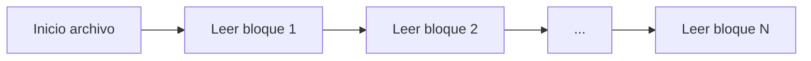
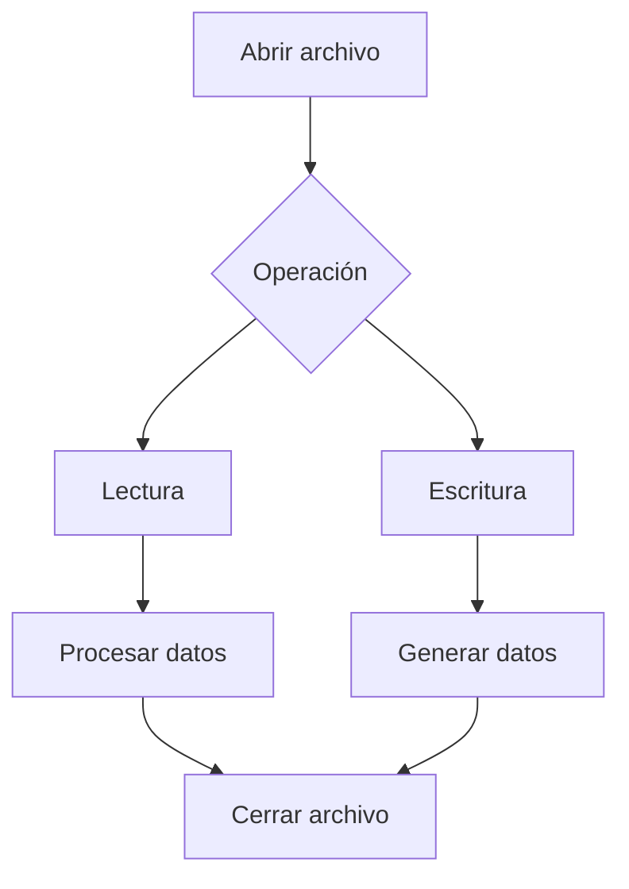

# Introducción a las Ciencias de la Computación - Entrada y salida estructurada

## 8.2 Mecanismos para el uso de archivos de disco.

---

### 1. Conceptos Fundamentales

#### 1.1 Sistema de Archivos

Estructura que organiza y gestiona el almacenamiento en disco:

$$ \text{SistemaArchivos} = \left\lbrace \begin{array}{ll} \text{Directorios} & \\\ \text{Archivos} & \\\ \text{Metadatos} & \end{array} \right\rbrace $$

#### 1.2 Operaciones Básicas

- **Creación** (`create`): Nuevo archivo
- **Lectura** (`read`): Acceso a contenido
- **Escritura** (`write`): Modificación
- **Eliminación** (`delete`): Borrado

### 2. Modos de Acceso a Archivos

#### 2.1 Acceso Secuencial

Lectura/escritura en orden desde inicio a fin:



#### 2.2 Acceso Aleatorio

Acceso directo a cualquier posición:  

$$ \text{Posición} = \text{offset} \times \text{tamaño}_{\text{bloque}} $$

#### 2.3 Ejemplo en Python

```python
# Acceso secuencial
with open('datos.txt', 'r') as archivo:
    for linea in archivo:
        print(linea.strip())

# Acceso aleatorio
with open('datos.bin', 'rb') as archivo:
    archivo.seek(1024)  # Ir a posición 1024
    datos = archivo.read(100)  # Leer 100 bytes
```

### 3. Buffering y Gestión de Memoria

#### 3.1 Mecanismo de Búfer

Almacenamiento temporal en memoria para optimizar E/S:

$$ \text{Eficiencia} = \frac{\text{OperacionesDisk}}{\text{OperacionesMemoria}} \propto \frac{1}{\text{TamañoBuffer}} $$

#### 3.2 Ejemplo en Java

```java
import java.io.*;

public class BufferedExample {
    public static void main(String[] args) {
        try (BufferedReader br = new BufferedReader(new FileReader("archivo.txt"))) {
            String linea;
            while ((linea = br.readLine()) != null) {
                System.out.println(linea);
            }
        } catch (IOException e) {
            e.printStackTrace();
        }
    }
}
```

### 4. Formatos de Archivos Estructurados

#### 4.1 Texto vs Binario

| Característica   | Texto  | Binario    |
| ---------------- | ------ | ---------- |
| **Legibilidad**  | Humana | Máquina    |
| **Tamaño**       | Mayor  | Menor      |
| **Portabilidad** | Alta   | Media/Baja |

#### 4.2 Ejemplo CSV en Java

```java
import java.nio.file.*;
import java.util.*;

public class CSVProcessor {
    public static List<String[]> readCSV(String filePath) throws IOException {
        List<String[]> datos = new ArrayList<>();
        List<String> lineas = Files.readAllLines(Paths.get(filePath));
        for (String linea : lineas) {
            datos.add(linea.split(","));
        }
        return datos;
    }
}
```

### 5. Manejo de Errores y Recursos

#### 5.1 Try-with-Resources (Java)

Cierre automático de recursos:

```java
try (FileInputStream fis = new FileInputStream("archivo.dat");
     DataInputStream dis = new DataInputStream(fis)) {
    while (dis.available() > 0) {
        int valor = dis.readInt();
        System.out.println(valor);
    }
} catch (IOException e) {
    System.err.println("Error: " + e.getMessage());
}
```

#### 5.2 Patrón de Reintento

```java
public class FileRetry {
    public static String readFileWithRetry(String path, int maxAttempts) {
        for (int attempt = 1; attempt <= maxAttempts; attempt++) {
            try {
                return Files.readString(Paths.get(path));
            } catch (IOException e) {
                if (attempt == maxAttempts) throw new RuntimeException(e);
                try { Thread.sleep(1000); } catch (InterruptedException ie) { Thread.currentThread().interrupt(); }
            }
        }
        throw new IllegalStateException("Unreachable");
    }
}
```

### 6. Diagrama de Flujo de Operaciones



### 7. Ejercicios Prácticos

1. Implementa un copiador de archivos con buffer personalizado
2. Crea un sistema de logging que escriba en archivo con rotación
3. Explica la diferencia entre `FileInputStream` y `FileReader`

### Ver también

- **8.1** Conceptos de E/S — la teoría que se implementa aquí.
- **8.3** Tipos de archivos — distintas formas de acceder a los archivos.
- **7.3** Manejo de errores — FileNotFoundException y IOException.

### Referencias

- Eckel, B. (2006). _Thinking in Java_ (4.ª ed.). Prentice Hall. Cap. 18.
- Oracle. _Java I/O Documentation_. https://docs.oracle.com/javase/8/docs/api/java/io/
