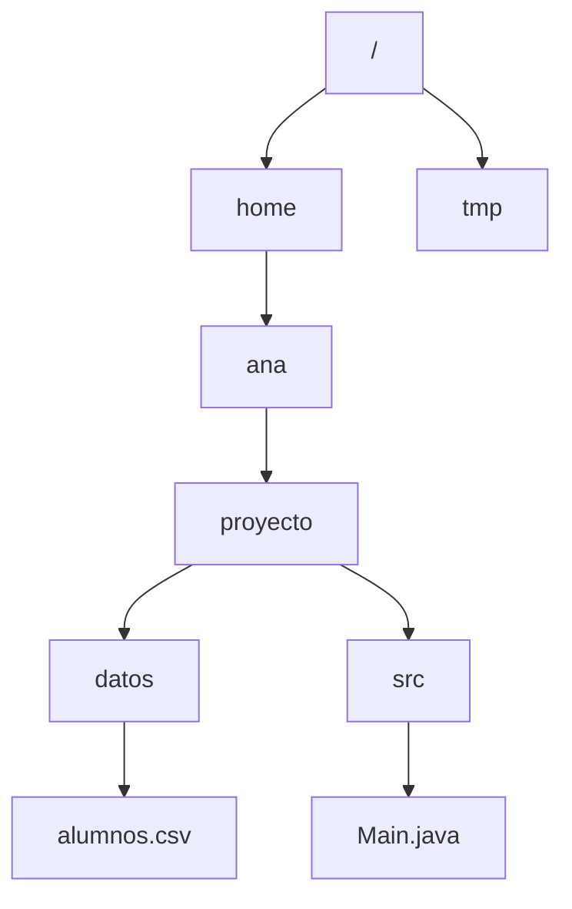

# Introducción a las Ciencias de la Computación - Entrada y salida estructurada

## 8.2 Mecanismos para el uso de archivos de disco.

---

Un **archivo** es una secuencia de bytes con nombre, guardada en un dispositivo de almacenamiento persistente y administrada por el **sistema de archivos** del sistema operativo. Para usarlo, un programa necesita poder nombrarlo con una ruta, averiguar si existe y cuáles son sus propiedades, crearlo, abrirlo para leer o escribir, cerrarlo, y también copiarlo, moverlo o borrarlo. Esta página presenta esos mecanismos con la biblioteca `java.nio.file`, la forma recomendada desde Java 7, y los compara con la clase `File` que aparece en código más antiguo.

### 1. El sistema de archivos

Los archivos se organizan en un **árbol de directorios**, también llamados carpetas. Cada archivo se identifica por su **ruta**, la secuencia de directorios que hay que recorrer para llegar a él:



- Una **ruta absoluta** empieza en la raíz: `/home/ana/proyecto/datos/alumnos.csv` en Linux y macOS, o `C:\Users\ana\proyecto\datos\alumnos.csv` en Windows.
- Una **ruta relativa** se interpreta a partir del **directorio de trabajo** del proceso, que normalmente es el directorio desde donde se ejecutó el programa. Si se ejecuta desde `/home/ana/proyecto`, la ruta `datos/alumnos.csv` designa el mismo archivo. Los nombres especiales `.` y `..` designan el directorio actual y el directorio padre.

Además de su contenido, el sistema guarda **metadatos** de cada archivo: tamaño, fechas de creación y modificación, dueño y permisos de lectura, escritura y ejecución.

### 2. Rutas en Java: `Path`

Un objeto `Path` representa una ruta; crearlo **no** crea ni abre ningún archivo, solo describe un nombre.

```java
import java.nio.file.Path;

public class Rutas {
    public static void main(String[] args) {
        Path p = Path.of("datos", "alumnos.csv");      // usa el separador del sistema
        System.out.println(p);                          // datos/alumnos.csv
        System.out.println(p.getFileName());            // alumnos.csv
        System.out.println(p.getParent());              // datos
        System.out.println(p.isAbsolute());             // false
        System.out.println(p.toAbsolutePath().isAbsolute());   // true
        Path respaldo = p.resolveSibling("alumnos.bak");
        System.out.println(respaldo);                   // datos/alumnos.bak
        System.out.println(Path.of("a/b/../c/./d").normalize());   // a/c/d
    }
}
```

Construir las rutas con `Path.of` y `resolve`, en lugar de concatenar cadenas con `/` o `\`, hace que el programa funcione igual en cualquier sistema operativo.

### 3. Consultar y administrar archivos: `Files`

La clase `Files` reúne métodos estáticos para operar sobre rutas:

| Método                                 | Efecto                                                      |
| -------------------------------------- | ----------------------------------------------------------- |
| `exists(p)`, `isDirectory(p)`, `isReadable(p)` | consultas sobre el archivo                          |
| `size(p)`, `getLastModifiedTime(p)`    | metadatos                                                   |
| `createFile(p)`, `createDirectories(p)` | crear un archivo vacío o una cadena de directorios         |
| `copy(origen, destino, opciones)`      | copiar                                                      |
| `move(origen, destino, opciones)`      | mover o renombrar                                           |
| `delete(p)`, `deleteIfExists(p)`       | borrar; un directorio solo si está vacío                    |
| `list(dir)`, `walk(dir)`               | contenido de un directorio, o de todo el subárbol           |
| `createTempFile(prefijo, sufijo)`      | archivo temporal con nombre único                           |

**Cuidado con consultar antes de actuar.** Entre `exists` y la operación siguiente otro programa puede crear o borrar el archivo. Por eso, en lugar de preguntar si existe y luego abrir, es más robusto intentar la operación y atrapar la excepción, como `NoSuchFileException` o `FileAlreadyExistsException`.

### 4. Leer y escribir

Hay dos estilos, según el tamaño de los datos.

**Todo de una vez**, cómodo para archivos pequeños que caben en memoria:

```java
String texto       = Files.readString(p);                     // todo el contenido
List<String> lineas = Files.readAllLines(p);                  // una cadena por línea
Files.writeString(p, "hola\n");                               // crea o reemplaza
Files.write(p, List.of("uno", "dos"), StandardOpenOption.APPEND);   // agrega al final
```

**Por flujos**, procesando una parte a la vez, para archivos grandes o cuando los datos se generan poco a poco:

```java
try (BufferedReader in = Files.newBufferedReader(p)) {
    String linea;
    while ((linea = in.readLine()) != null) {
        procesar(linea);
    }
}
```

Las **opciones de apertura** de `StandardOpenOption` indican cómo abrir el archivo: `CREATE` lo crea si no existe, `CREATE_NEW` falla si ya existe, `TRUNCATE_EXISTING` borra su contenido anterior y `APPEND` escribe al final. Si no se indica nada, al escribir se crea el archivo o se reemplaza su contenido.

### 5. Un ejemplo completo

El siguiente programa crea un directorio de trabajo, escribe un archivo de calificaciones, lo lee calculando el promedio, hace un respaldo, lista el directorio y limpia todo al final:

```java
import java.io.BufferedReader;
import java.io.BufferedWriter;
import java.io.IOException;
import java.nio.file.Files;
import java.nio.file.Path;
import java.nio.file.StandardCopyOption;
import java.util.Comparator;
import java.util.stream.Stream;

public class Calificaciones {
    public static void main(String[] args) throws IOException {
        Path dir = Files.createTempDirectory("curso");
        Path archivo = dir.resolve("calificaciones.txt");

        try (BufferedWriter out = Files.newBufferedWriter(archivo)) {
            String[] nombres = {"Ana", "Luis", "Marta"};
            double[] notas = {9.5, 7.0, 8.5};
            for (int i = 0; i < nombres.length; i++) {
                out.write(nombres[i] + " " + notas[i]);
                out.newLine();
            }
        }

        double suma = 0;
        int n = 0;
        try (BufferedReader in = Files.newBufferedReader(archivo)) {
            String linea;
            while ((linea = in.readLine()) != null) {
                String[] partes = linea.split(" ");
                suma += Double.parseDouble(partes[1]);
                n++;
            }
        }
        System.out.printf("Promedio de %d alumnos: %.2f%n", n, suma / n);

        Files.copy(archivo, dir.resolve("calificaciones.bak"), StandardCopyOption.REPLACE_EXISTING);
        try (Stream<Path> contenido = Files.list(dir)) {
            contenido.sorted().forEach(p -> {
                try {
                    System.out.println(p.getFileName() + " (" + Files.size(p) + " bytes)");
                } catch (IOException e) {
                    System.out.println(p.getFileName() + " (tamaño desconocido)");
                }
            });
        }

        try (Stream<Path> todo = Files.walk(dir)) {               // borrar el árbol,
            for (Path p : todo.sorted(Comparator.reverseOrder()).toList()) {
                Files.delete(p);                                   // primero los hijos
            }
        }
        System.out.println("¿Existe aún? " + Files.exists(dir));
    }
}
```

```text
Promedio de 3 alumnos: 8.33
calificaciones.bak (27 bytes)
calificaciones.txt (27 bytes)
¿Existe aún? false
```

Observe que `Files.list` y `Files.walk` regresan flujos que mantienen abierto el directorio, por lo que también se usan dentro de `try` con recursos.

### 6. La clase `File` y la biblioteca anterior

En código escrito antes de Java 7 se usa la clase `java.io.File`, junto con `FileReader`, `FileWriter`, `FileInputStream` y `FileOutputStream`:

```java
File f = new File("datos/alumnos.csv");
if (f.exists()) {
    try (Scanner sc = new Scanner(f, "UTF-8")) {
        while (sc.hasNextLine()) System.out.println(sc.nextLine());
    }
}
```

`File` tiene defectos: muchos de sus métodos regresan `false` en lugar de lanzar una excepción que explique la falla, y no maneja bien los enlaces simbólicos ni los metadatos. Ambas bibliotecas se pueden combinar con `file.toPath()` y `path.toFile()`.

### 7. Lo que hace el sistema operativo

Al **abrir** un archivo, el sistema operativo verifica los permisos, localiza el archivo en el disco y entrega al proceso un **descriptor**: un número que lo identifica en las operaciones siguientes. El sistema mantiene la posición actual de lectura o escritura de cada archivo abierto. Al **cerrar**, se vacían los búferes pendientes y se libera el descriptor.

Cada proceso puede tener abiertos un número limitado de archivos, a menudo unos pocos miles. Un programa que abre archivos sin cerrarlos acaba fallando con un error como *Too many open files*, otra razón para usar siempre `try` con recursos.

> **Conexión con CC.** El sistema de archivos es uno de los componentes centrales de un sistema operativo: decide cómo repartir los bloques del disco entre los archivos, cómo representar los directorios, normalmente con árboles balanceados, y cómo recuperarse si se corta la corriente a la mitad de una escritura, para lo que usa una bitácora o *journal*. Las rutas forman un árbol que se recorre como los de Estructuras de Datos.

### Ejercicios propuestos

1. Escriba un programa que reciba una ruta de directorio como argumento e imprima el nombre y tamaño de cada archivo que contiene, ordenados de mayor a menor tamaño, y el tamaño total.
2. Modifique `Calificaciones` para que, si el archivo ya existe, agregue nuevas calificaciones al final en lugar de reemplazarlo.
3. Escriba un método `respaldar(Path archivo)` que copie el archivo agregando a su nombre la fecha actual, por ejemplo `datos-2026-10-23.csv`, sin sobrescribir un respaldo existente.
4. Usando `Files.walk`, cuente cuántos archivos `.java` hay en un proyecto y cuántas líneas suman en total.
5. ¿Qué imprime `Path.of("/home/ana/proyecto").resolve("../datos/x.txt").normalize()`? ¿Y `relativize` entre `/home/ana/proyecto` y `/home/ana/fotos/a.jpg`?
6. Escriba un programa que abra archivos en un ciclo sin cerrarlos hasta que falle. ¿Cuántos logra abrir? Corríjalo con `try` con recursos.

### Ver también

- **2.4** Entrada y salida — archivos de entrada y salida simples.
- **7.3** Detección y manejo de errores de ejecución — `try` con recursos.
- **8.1** Conceptos generales — flujos, búferes y codificaciones.
- **8.3** Manejo de archivos — formatos de texto, registros, objetos y acceso directo.
- **Sistemas Operativos 6** (Sem. 6) — sistemas de archivos.

### Referencias

- Oracle. _The Java Tutorials: File I/O (Featuring NIO.2)_. https://docs.oracle.com/javase/tutorial/essential/io/fileio.html
- Horstmann, C. S. (2022). _Core Java, Volume II: Advanced Features_ (12.ª ed.). Pearson. Sección 2.5: Working with Files.
- Silberschatz, A., Galvin, P. B., & Gagne, G. (2018). _Operating System Concepts_ (10.ª ed.). Wiley. Cap. 13: File-System Interface.
