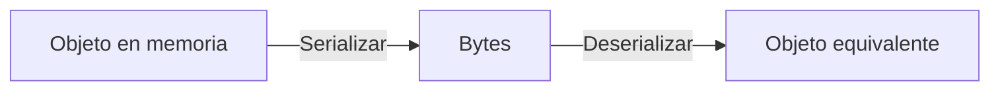
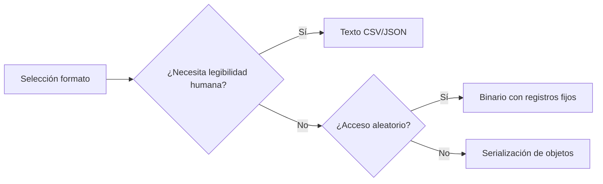

# Introducción a las Ciencias de la Computación - Entrada y salida estructurada

## 8.3 Manejo de archivos: De texto (bytes y caracteres); de registros; de objetos; de acceso directo: binario.

---

### 1. Archivos de Texto: Bytes vs Caracteres

#### 1.1 Codificación y Decodificación

Proceso de conversión entre caracteres y bytes:

$$ \text{Carácter} \xrightarrow[\text{encoding}]{\text{decoding}} \text{Bytes} $$

**Ejemplo codificaciones comunes:**

- UTF-8: Variable length (1-4 bytes)
- ASCII: 1 byte por carácter
- ISO-8859-1: 1 byte, extensión ASCII

#### 1.2 Ejemplo Java: Lectura/Escritura Texto

```java
import java.nio.file.*;
import java.nio.charset.StandardCharsets;

public class TextFileExample {
    public static void main(String[] args) throws Exception {
        // Escritura con encoding específico
        Path path = Paths.get("ejemplo.txt");
        Files.write(path, "Hola mundo\n".getBytes(StandardCharsets.UTF_8));

        // Lectura con encoding
        String contenido = new String(Files.readAllBytes(path), StandardCharsets.UTF_8);
        System.out.println(contenido);
    }
}
```

### 2. Archivos de Registros

#### 2.1 Estructura de Registros

Datos organizados en registros de tamaño fijo:

$$ \text{Registro} = \langle \text{campo}_1, \text{campo}_2, \dots, \text{campo}_n \rangle $$

#### 2.2 Ejemplo: Registro de Estudiante

```java
public class StudentRecord {
    private final int id;           // 4 bytes
    private final String name;      // 50 bytes (25 chars UTF-16)
    private final double grade;     // 8 bytes

    public static final int RECORD_SIZE = 62; // 4 + 50 + 8

    // Constructor, getters, serialización...
}
```

### 3. Archivos de Objetos (Serialización)

#### 3.1 Serialización Binaria

Conversión de objetos a flujo de bytes:



#### 3.2 Ejemplo Java: ObjectOutputStream

```java
import java.io.*;

public class ObjectSerialization {
    public static void saveObject(Serializable obj, String filename) throws IOException {
        try (ObjectOutputStream oos = new ObjectOutputStream(
             new FileOutputStream(filename))) {
            oos.writeObject(obj);
        }
    }

    public static Object loadObject(String filename)
            throws IOException, ClassNotFoundException {
        try (ObjectInputStream ois = new ObjectInputStream(
             new FileInputStream(filename))) {
            return ois.readObject();
        }
    }
}
```

### 4. Acceso Directo Binario

#### 4.1 RandomAccessFile

Acceso aleatorio a cualquier posición del archivo:

$$ \text{Posición} = \text{índice} \times \text{tamaño}_{\text{registro}} $$

#### 4.2 Ejemplo: Base de Datos Simple

```java
public class StudentDatabase {
    private final RandomAccessFile file;

    public StudentDatabase(String filename) throws IOException {
        file = new RandomAccessFile(filename, "rw");
    }

    public void writeRecord(int index, StudentRecord record) throws IOException {
        file.seek(index * StudentRecord.RECORD_SIZE);
        file.writeInt(record.getId());
        file.writeChars(record.getName());
        file.writeDouble(record.getGrade());
    }

    public StudentRecord readRecord(int index) throws IOException {
        file.seek(index * StudentRecord.RECORD_SIZE);
        int id = file.readInt();
        String name = readFixedString(25);
        double grade = file.readDouble();
        return new StudentRecord(id, name, grade);
    }
}
```

### 5. Comparativa de Métodos

#### 5.1 Ventajas y Desventajas

| Tipo Archivo  | Ventajas                        | Desventajas                     |
| ------------- | ------------------------------- | ------------------------------- |
| **Texto**     | Legible, portable               | Mayor tamaño, parsing necesario |
| **Registros** | Acceso rápido, tamaño fijo      | Estructura rígida               |
| **Objetos**   | Fácil uso, complejidad manejada | No portable entre lenguajes     |
| **Binario**   | Eficiente, compacto             | No legible, difícil debug       |

#### 5.2 Diagrama de Decisiones



### 6. Ejercicios Prácticos

1. Implementa un sistema de agenda usando:
   - Texto CSV para exportación
   - Binario para almacenamiento rápido
2. Crea un serializador custom para objetos complejos
3. Benchmark: Compara performance texto vs binario para 10,000 registros

### Ver también

- **8.2** Mecanismos de archivos — los mecanismos para cada tipo de archivo.
- **9.1** Hilos — el acceso concurrente a archivos requiere sincronización.

### Referencias

- Eckel, B. (2006). _Thinking in Java_ (4.ª ed.). Prentice Hall. Cap. 18.
- Tanenbaum, A. S. (2014). _Modern Operating Systems_ (4.ª ed.). Pearson. Cap. 4.
