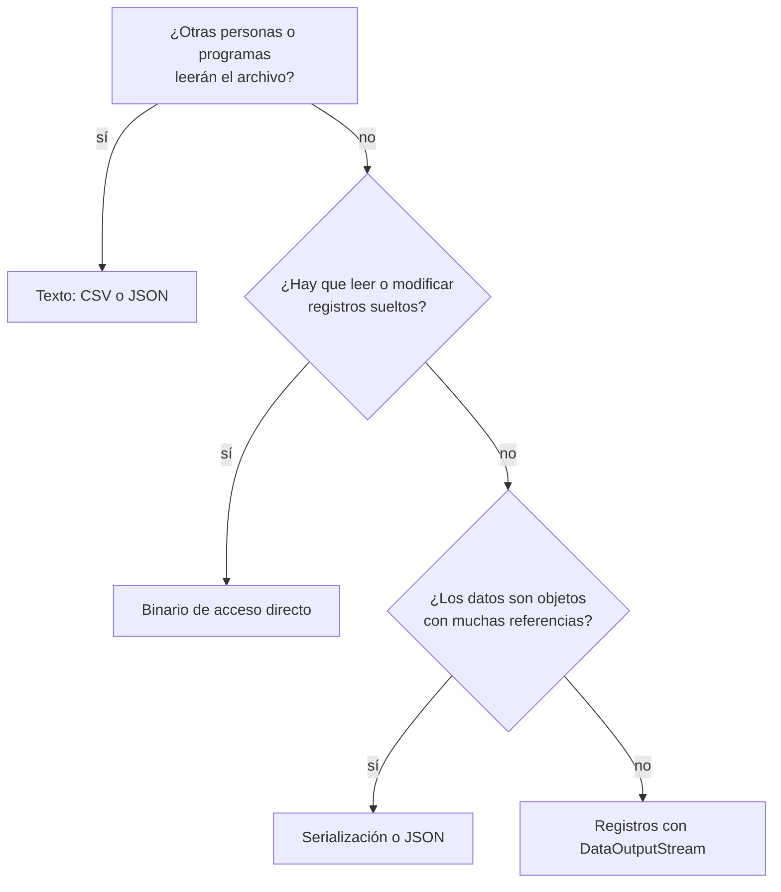

# Introducción a las Ciencias de la Computación - Entrada y salida estructurada

## 8.3 Manejo de archivos: De texto (bytes y caracteres); de registros; de objetos; de acceso directo: binario.

---

Una vez que se sabe abrir, leer y escribir archivos (subtema 8.2), queda la pregunta principal: **cómo organizar los datos dentro del archivo** para poder recuperarlos. Esta página recorre las cuatro organizaciones clásicas con un mismo ejemplo, un registro de alumnos con número de cuenta, nombre y promedio, para comparar sus ventajas: archivos de texto, archivos de registros con tipos primitivos, archivos de objetos serializados y archivos binarios de acceso directo.

Todos los ejemplos usan este `record`:

```java
public record Alumno(int cuenta, String nombre, double promedio) implements java.io.Serializable {}
```

### 1. Archivos de texto

#### 1.1 Flujos de bytes y de caracteres

Un archivo de texto puede leerse como bytes o como caracteres; la diferencia está en si se interpreta la codificación:

```java
import java.io.*;
import java.nio.charset.StandardCharsets;
import java.nio.file.*;

public class BytesYCaracteres {
    public static void main(String[] args) throws IOException {
        Path p = Files.createTempFile("texto", ".txt");
        Files.writeString(p, "año", StandardCharsets.UTF_8);

        try (InputStream in = Files.newInputStream(p)) {             // bytes
            int b;
            while ((b = in.read()) != -1) System.out.printf("%02X ", b);
            System.out.println();                                     // 61 C3 B1 6F
        }
        try (Reader in = Files.newBufferedReader(p, StandardCharsets.UTF_8)) {   // caracteres
            int c;
            while ((c = in.read()) != -1) System.out.print((char) c + " ");
            System.out.println();                                     // a ñ o
        }
        String malLeido = Files.readString(p, StandardCharsets.ISO_8859_1);
        System.out.println(malLeido);                                 // año
        Files.delete(p);
    }
}
```

El archivo tiene 4 bytes pero 3 caracteres. Leerlo con la codificación equivocada produce texto corrupto sin ningún error: la codificación debe acordarse junto con el formato.

#### 1.2 Texto con estructura: CSV

Un formato de texto estructurado común es **CSV**: una línea por registro y los campos separados por comas. Escribirlo es sencillo; al leerlo hay que **validar** cada línea, porque un archivo de texto puede editarse a mano y contener errores:

```java
import java.io.*;
import java.nio.file.*;
import java.util.*;

public class AlumnosCsv {
    record Alumno(int cuenta, String nombre, double promedio) {}

    static void guardar(Path p, List<Alumno> alumnos) throws IOException {
        try (PrintWriter out = new PrintWriter(Files.newBufferedWriter(p))) {
            out.println("cuenta,nombre,promedio");                    // encabezado
            for (Alumno a : alumnos) {
                out.printf(Locale.ROOT, "%d,%s,%.2f%n", a.cuenta(), a.nombre(), a.promedio());
            }
        }
    }

    static List<Alumno> cargar(Path p) throws IOException {
        List<Alumno> lista = new ArrayList<>();
        try (BufferedReader in = Files.newBufferedReader(p)) {
            String linea = in.readLine();                             // se salta el encabezado
            int num = 1;
            while ((linea = in.readLine()) != null) {
                num++;
                String[] c = linea.split(",");
                if (c.length != 3) {
                    System.err.println("Línea " + num + " ignorada: " + c.length + " campos");
                    continue;
                }
                try {
                    lista.add(new Alumno(Integer.parseInt(c[0].strip()), c[1].strip(),
                                         Double.parseDouble(c[2].strip())));
                } catch (NumberFormatException e) {
                    System.err.println("Línea " + num + " ignorada: " + e.getMessage());
                }
            }
        }
        return lista;
    }

    public static void main(String[] args) throws IOException {
        Path p = Files.createTempFile("alumnos", ".csv");
        guardar(p, List.of(new Alumno(2024001, "Ana López", 9.5),
                           new Alumno(2024002, "Luis Pérez", 7.25)));
        Files.writeString(p, "2024003,Marta Ruiz,ocho\n", StandardOpenOption.APPEND);
        System.out.print(Files.readString(p));
        System.out.println(cargar(p));
        Files.delete(p);
    }
}
```

Dos detalles: `Locale.ROOT` garantiza que el punto decimal se escriba como punto aunque la configuración regional use coma, y este `split` simple falla si un nombre contiene comas, caso que el CSV completo resuelve encerrando los campos entre comillas.

### 2. Archivos de registros con tipos primitivos

`DataOutputStream` y `DataInputStream` escriben y leen los tipos primitivos en su **representación binaria**, independiente de la plataforma: un `int` siempre ocupa 4 bytes, un `double` 8, en orden de bytes *big-endian*. Las cadenas se escriben con `writeUTF`, que antepone su longitud.

```java
import java.io.*;
import java.nio.file.*;

public class AlumnosData {
    public static void main(String[] args) throws IOException {
        Path p = Files.createTempFile("alumnos", ".dat");
        try (DataOutputStream out = new DataOutputStream(
                new BufferedOutputStream(Files.newOutputStream(p)))) {
            out.writeInt(2);                                    // cuántos registros siguen
            out.writeInt(2024001); out.writeUTF("Ana López");  out.writeDouble(9.5);
            out.writeInt(2024002); out.writeUTF("Luis Pérez"); out.writeDouble(7.25);
        }
        System.out.println("Tamaño: " + Files.size(p) + " bytes");

        try (DataInputStream in = new DataInputStream(
                new BufferedInputStream(Files.newInputStream(p)))) {
            int n = in.readInt();
            for (int i = 0; i < n; i++) {
                int cuenta = in.readInt();                      // mismo orden que al escribir
                String nombre = in.readUTF();
                double promedio = in.readDouble();
                System.out.println(cuenta + " " + nombre + " " + promedio);
            }
        }
        Files.delete(p);
    }
}
```

```text
Tamaño: 53 bytes
2024001 Ana López 9.5
2024002 Luis Pérez 7.25
```

El archivo **no contiene** la descripción de su estructura: hay que leer los campos exactamente en el mismo orden y con los mismos tipos con que se escribieron. Leer un `double` donde había un `int` no produce un error, sino un valor sin sentido. Por eso estos formatos se documentan con cuidado y a menudo empiezan con un **número mágico** y una versión que identifican el formato.

### 3. Archivos de objetos

La **serialización** de Java convierte un objeto, junto con todos los objetos a los que hace referencia, en una secuencia de bytes, y la deserialización reconstruye una copia equivalente. Basta que la clase implemente la interfaz marcadora `Serializable`:

```java
import java.io.*;
import java.nio.file.*;
import java.util.*;

public class AlumnosObjetos {
    static class Grupo implements Serializable {
        private static final long serialVersionUID = 1L;          // versión del formato
        String clave;
        List<Alumno> alumnos = new ArrayList<>();
        transient int consultas;                                  // no se guarda
        Grupo(String clave) { this.clave = clave; }
    }

    record Alumno(int cuenta, String nombre, double promedio) implements Serializable {}

    public static void main(String[] args) throws IOException, ClassNotFoundException {
        Grupo g = new Grupo("CC-1001");
        g.alumnos.add(new Alumno(2024001, "Ana López", 9.5));
        g.alumnos.add(new Alumno(2024002, "Luis Pérez", 7.25));
        g.consultas = 42;

        Path p = Files.createTempFile("grupo", ".ser");
        try (ObjectOutputStream out = new ObjectOutputStream(Files.newOutputStream(p))) {
            out.writeObject(g);                                   // guarda el grafo completo
        }
        try (ObjectInputStream in = new ObjectInputStream(Files.newInputStream(p))) {
            Grupo copia = (Grupo) in.readObject();
            System.out.println(copia.clave + " " + copia.alumnos);
            System.out.println("consultas = " + copia.consultas);   // 0: era transient
            System.out.println("¿Mismo objeto? " + (copia == g));    // false: es una copia
        }
        Files.delete(p);
    }
}
```

- Los atributos marcados `transient` no se guardan y al leer toman su valor por omisión.
- `serialVersionUID` identifica la versión de la clase; si la clase cambia de manera incompatible y no se actualiza, los archivos antiguos no podrán leerse, o se leerán mal.
- La serialización de Java es cómoda pero tiene serias desventajas: el formato solo lo entiende Java, es frágil ante cambios en las clases y **deserializar datos de una fuente no confiable es un riesgo de seguridad**, porque puede ejecutar código del atacante. Para intercambiar datos entre programas se prefieren formatos como JSON con bibliotecas como Jackson o Gson.

### 4. Archivos binarios de acceso directo

Si todos los registros tienen el **mismo tamaño** $t$, el registro $i$ empieza en el byte $i \cdot t$ y se puede leer o modificar sin recorrer los anteriores. `RandomAccessFile` permite colocarse en cualquier posición con `seek` y leer o escribir ahí.

Para que el tamaño sea fijo, las cadenas se guardan con una longitud máxima, rellenando con espacios. Con un nombre de 20 caracteres de 2 bytes cada uno, un registro mide:

$$
t = \underbrace{4}_{\texttt{int}} + \underbrace{20 \cdot 2}_{\text{nombre}} + \underbrace{8}_{\texttt{double}} = 52 \text{ bytes.}
$$

```java
import java.io.*;
import java.nio.file.*;

public class AlumnosDirecto implements AutoCloseable {
    static final int LARGO_NOMBRE = 20;
    static final int TAM = 4 + 2 * LARGO_NOMBRE + 8;              // 52 bytes por registro

    private final RandomAccessFile archivo;

    AlumnosDirecto(Path p) throws IOException { archivo = new RandomAccessFile(p.toFile(), "rw"); }

    long cantidad() throws IOException { return archivo.length() / TAM; }

    void escribir(long i, int cuenta, String nombre, double promedio) throws IOException {
        archivo.seek(i * TAM);
        archivo.writeInt(cuenta);
        StringBuilder sb = new StringBuilder(nombre);
        sb.setLength(LARGO_NOMBRE);                                // recorta o rellena
        archivo.writeChars(sb.toString().replace('\0', ' '));
        archivo.writeDouble(promedio);
    }

    String leer(long i) throws IOException {
        if (i < 0 || i >= cantidad()) throw new IndexOutOfBoundsException("Registro " + i);
        archivo.seek(i * TAM);
        int cuenta = archivo.readInt();
        char[] nombre = new char[LARGO_NOMBRE];
        for (int k = 0; k < LARGO_NOMBRE; k++) nombre[k] = archivo.readChar();
        double promedio = archivo.readDouble();
        return cuenta + " " + new String(nombre).strip() + " " + promedio;
    }

    void cambiarPromedio(long i, double nuevo) throws IOException {
        archivo.seek(i * TAM + 4 + 2 * LARGO_NOMBRE);              // directo al campo
        archivo.writeDouble(nuevo);
    }

    @Override public void close() throws IOException { archivo.close(); }

    public static void main(String[] args) throws IOException {
        Path p = Files.createTempFile("alumnos", ".bin");
        try (AlumnosDirecto db = new AlumnosDirecto(p)) {
            db.escribir(0, 2024001, "Ana López", 9.5);
            db.escribir(1, 2024002, "Luis Pérez", 7.25);
            db.escribir(2, 2024003, "Marta Ruiz", 8.0);
            System.out.println(db.cantidad() + " registros, " + Files.size(p) + " bytes");
            System.out.println(db.leer(1));
            db.cambiarPromedio(1, 8.75);                            // sin tocar los demás
            System.out.println(db.leer(1));
        }
        Files.delete(p);
    }
}
```

```text
3 registros, 156 bytes
2024002 Luis Pérez 7.25
2024002 Luis Pérez 8.75
```

Este es, en miniatura, el principio con el que funcionan las bases de datos: registros de tamaño fijo en páginas del disco, a los que se llega directamente. Para **buscar** por un campo, como el número de cuenta, sin recorrer todo el archivo, se agrega un **índice**: una estructura, típicamente un árbol B, que asocia cada clave con la posición de su registro.

### 5. Comparación

| Organización          | Legible | Tamaño    | Acceso     | Portabilidad          | Uso típico                         |
| --------------------- | ------- | --------- | ---------- | --------------------- | ---------------------------------- |
| texto, como CSV o JSON | sí     | mayor     | secuencial | alta                  | intercambio, configuración, bitácoras |
| registros con `DataOutputStream` | no | compacto | secuencial | alta si se documenta | formatos propios eficientes   |
| objetos serializados  | no      | variable  | secuencial | solo Java             | caché temporal entre ejecuciones   |
| binario de acceso directo | no  | fijo por registro | directo | alta si se documenta | bases de datos, índices        |



> **Conexión con CC.** El diseño de formatos de archivo es un problema de representación de datos que reaparece en muchas áreas: los sistemas de bases de datos organizan registros en páginas e índices, los protocolos de red definen formatos binarios para sus mensajes, y formatos como PNG, ZIP o los ejecutables de cada sistema operativo especifican byte por byte su estructura, empezando siempre con un número mágico que los identifica.

### Ejercicios propuestos

1. Agregue a `AlumnosCsv` el manejo de nombres con comas: al escribir, encierre entre comillas los campos que contengan comas, y al leer, interprételos correctamente.
2. Modifique `AlumnosData` para que el archivo empiece con el número mágico `0xCAFE` y una versión, y que la lectura rechace archivos que no lo tengan.
3. Agregue a la clase `Grupo` un atributo nuevo, cambie `serialVersionUID` y verifique qué ocurre al leer un archivo guardado con la versión anterior.
4. Agregue a `AlumnosDirecto` un método `buscar(int cuenta)` que recorra el archivo, y otro que, suponiendo que los registros están ordenados por cuenta, use **búsqueda binaria** con `seek`. Compare cuántos registros lee cada uno en un archivo de 100 000 registros.
5. Implemente el borrado lógico en `AlumnosDirecto`: agregue un campo `boolean activo` a cada registro, ajuste `TAM` y haga que los registros borrados se reutilicen al insertar.
6. Mida el tiempo y el tamaño de guardar 100 000 alumnos en CSV, con `DataOutputStream` y serializados. Explique las diferencias.

### Ver también

- **1.5** Representación digital de la información — enteros, punto flotante y caracteres en binario.
- **4.5** Arreglos — el cálculo de posiciones $i \cdot t$ es el mismo que en un arreglo.
- **7.4** Recomendaciones generales — validación de datos externos.
- **8.1** Conceptos generales — codificaciones, flujos y acceso directo.
- **8.2** Mecanismos para el uso de archivos de disco.
- **Estructuras de Datos** (Sem. 2) — búsqueda binaria y árboles para índices.

### Referencias

- Oracle. _The Java Tutorials: Basic I/O_, secciones _Data Streams_, _Object Streams_ y _Random Access Files_.
- Bloch, J. (2018). _Effective Java_ (3.ª ed.). Addison-Wesley. Cap. 12: Serialization.
- Garcia-Molina, H., Ullman, J. D., & Widom, J. (2009). _Database Systems: The Complete Book_ (2.ª ed.). Pearson. Cap. 13: Secondary Storage Management.
