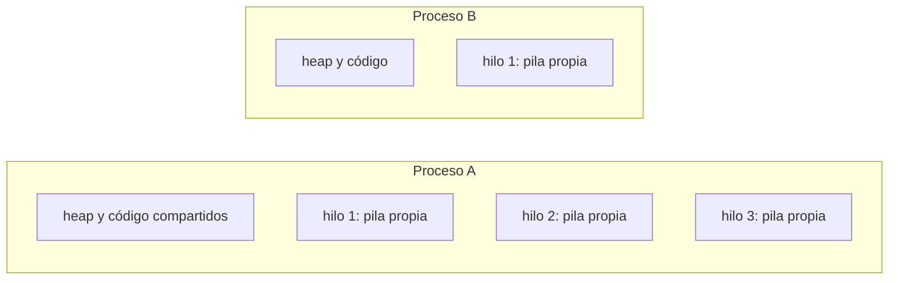
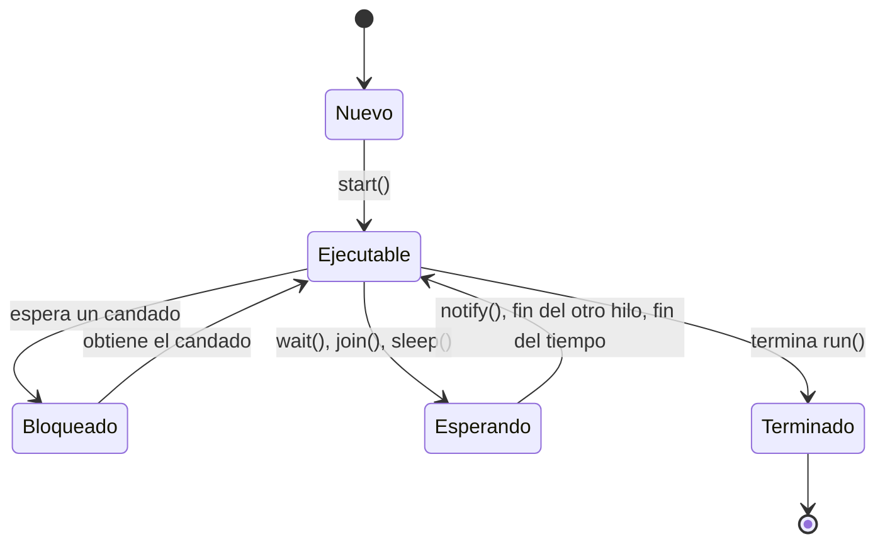

# Introducción a las Ciencias de la Computación - Hilos de ejecución y multi-proceso (threads)

## 9.1 Conceptos generales.

---

Hasta ahora todos los programas han sido **secuenciales**: una instrucción después de otra, siguiendo un único camino de ejecución. Pero una computadora moderna tiene varios núcleos capaces de ejecutar instrucciones al mismo tiempo, y muchos programas necesitan hacer varias cosas a la vez: un navegador descarga imágenes mientras responde al ratón, un servidor atiende a miles de clientes, un videojuego simula la física mientras dibuja la pantalla. Los **hilos de ejecución** permiten que un programa tenga varios caminos de ejecución simultáneos. Esta página presenta los conceptos básicos: qué son los procesos y los hilos, en qué se distinguen la concurrencia y el paralelismo, cómo reparte el sistema operativo el procesador y qué problemas nuevos aparecen cuando varios hilos comparten memoria.

### 1. Procesos e hilos

Un **proceso** es un programa en ejecución. El sistema operativo le asigna recursos propios y aislados: su espacio de memoria, sus archivos abiertos, su identificador. Dos procesos no pueden leer la memoria uno del otro; para comunicarse deben usar mecanismos del sistema operativo, como archivos, tuberías o conexiones de red.

Un **hilo** (*thread*) es una secuencia de ejecución **dentro** de un proceso. Todo proceso tiene al menos un hilo, y puede crear más. Los hilos de un mismo proceso **comparten** la memoria del proceso, es decir, el heap y el área de métodos, pero cada uno tiene su propia pila de ejecución y su propio contador de programa (subtema 6.3).



| Característica         | Procesos                              | Hilos del mismo proceso                 |
| ---------------------- | ------------------------------------- | --------------------------------------- |
| memoria                | separada                              | compartida                              |
| comunicación           | mecanismos del sistema operativo      | directa, a través de objetos comunes    |
| costo de creación      | alto                                  | bajo                                    |
| aislamiento ante fallas | si uno falla, los demás siguen       | un error grave puede derribar el proceso |

Por eso los navegadores modernos usan un **proceso** por pestaña, para que una página defectuosa no derribe a las demás, y **hilos** dentro de cada pestaña, para que las tareas de una página se comuniquen fácilmente.

### 2. Concurrencia y paralelismo

- **Concurrencia:** varias tareas están **en curso** al mismo tiempo, aunque en cada instante quizá solo una avance. Es una propiedad de la **estructura** del programa.
- **Paralelismo:** varias tareas se **ejecutan** literalmente al mismo tiempo, en núcleos distintos. Es una propiedad de la **ejecución**.

```text
Concurrencia en un núcleo:   A A B B A C C B A C ...   (se alternan)
Paralelismo en tres núcleos: núcleo 1: A A A A A
                             núcleo 2: B B B B B
                             núcleo 3: C C C C C
```

Un programa concurrente puede ejecutarse en un solo núcleo, alternando, o en varios, en paralelo. Los hilos sirven para ambas cosas:

- **Responder mientras se espera:** mientras un hilo espera datos del disco o de la red, otro puede seguir trabajando o atendiendo al usuario. Esto mejora aun con un solo núcleo.
- **Acelerar cálculos:** dividir un trabajo grande entre varios núcleos.

### 3. El planificador

En una computadora suele haber muchos más hilos listos para ejecutarse que núcleos. El **planificador** del sistema operativo decide en cada momento qué hilo ocupa cada núcleo. Normalmente asigna a cada hilo un **quantum** de tiempo, de algunos milisegundos; al terminarlo, o cuando el hilo se bloquea esperando algo, lo suspende y pone a otro. Cambiar de hilo requiere guardar sus registros y cargar los del siguiente, un **cambio de contexto** que tiene un costo.

La consecuencia más importante para el programador es que **el orden en que se intercalan los hilos no está determinado**: depende de la carga de la máquina, del número de núcleos y de decisiones del planificador. Dos ejecuciones del mismo programa pueden intercalar los hilos de forma distinta.

### 4. Estados de un hilo



En Java, el estado de un hilo se consulta con `getState()`. El estado *ejecutable* incluye tanto al hilo que está corriendo en un núcleo como al que está listo esperando su turno.

### 5. Un primer ejemplo

```java
public class PrimerHilo {
    public static void main(String[] args) throws InterruptedException {
        Thread t = new Thread(() -> {
            for (int i = 1; i <= 3; i++) {
                System.out.println("  hilo secundario: paso " + i);
            }
        });
        t.start();                                    // a partir de aquí hay dos hilos
        for (int i = 1; i <= 3; i++) {
            System.out.println("hilo principal: paso " + i);
        }
        t.join();                                     // espera a que termine t
        System.out.println("ambos terminaron");
    }
}
```

Una posible salida:

```text
hilo principal: paso 1
  hilo secundario: paso 1
hilo principal: paso 2
hilo principal: paso 3
  hilo secundario: paso 2
  hilo secundario: paso 3
ambos terminaron
```

Al ejecutarlo varias veces, las líneas de los dos hilos aparecen intercaladas de formas distintas. Lo único garantizado es el orden **dentro** de cada hilo y que la última línea aparece al final, gracias a `join`.

### 6. El problema de la memoria compartida

Que los hilos compartan objetos es lo que los hace útiles y también lo que los hace peligrosos. Una instrucción tan simple como `contador++` no es indivisible: consiste en **leer** el valor, **sumarle** uno y **escribir** el resultado. Si dos hilos la ejecutan a la vez puede ocurrir:

| Paso | Hilo A                  | Hilo B                  | `contador` |
| ---- | ----------------------- | ----------------------- | ---------- |
| 1    | lee 5                   |                         | 5          |
| 2    |                         | lee 5                   | 5          |
| 3    | calcula 6 y escribe     |                         | 6          |
| 4    |                         | calcula 6 y escribe     | 6          |

Se hicieron dos incrementos pero el contador solo aumentó en uno. A esto se le llama **condición de carrera**: el resultado depende del orden en que se intercalan los hilos. Son errores especialmente difíciles porque pueden aparecer una vez en un millón de ejecuciones. El subtema 9.3 estudia cómo evitarlas mediante **sincronización**.

### 7. Cuánto se puede acelerar: la ley de Amdahl

Si una fracción $p$ del trabajo se puede repartir entre $n$ núcleos y el resto, $1 - p$, tiene que hacerse secuencialmente, el tiempo mejora a lo más en un factor de

$$
S(n) = \frac{1}{(1 - p) + \dfrac{p}{n}}.
$$

Cuando $n$ crece, $S(n)$ se acerca a $\frac{1}{1 - p}$. Con $p = 0.9$, aunque se tengan mil núcleos, la aceleración no puede pasar de 10. La parte secuencial, junto con el costo de crear y coordinar hilos, limita lo que se gana; por eso paralelizar solo conviene para trabajos suficientemente grandes y divisibles.

| Núcleos $n$ | $S(n)$ con $p = 0.5$ | $S(n)$ con $p = 0.9$ | $S(n)$ con $p = 0.99$ |
| ----------- | -------------------- | -------------------- | --------------------- |
| 2           | 1.33                 | 1.82                 | 1.98                  |
| 4           | 1.60                 | 3.08                 | 3.88                  |
| 16          | 1.88                 | 6.40                 | 13.91                 |
| 1000        | 2.00                 | 9.91                 | 90.99                 |

> **Conexión con CC.** La concurrencia atraviesa toda la disciplina: los sistemas operativos la implementan y la administran, las arquitecturas multinúcleo la hacen necesaria para aprovechar el hardware, las bases de datos la controlan con transacciones, y los sistemas distribuidos la extienden a muchas computadoras que se comunican por la red. Las condiciones de carrera y los bloqueos mutuos son también un problema clásico de la verificación formal de programas.

### Ejercicios propuestos

1. Ejecute `PrimerHilo` diez veces y anote las distintas intercalaciones que observe. ¿Cuántas intercalaciones posibles hay en teoría para dos hilos de tres pasos cada uno?
2. Clasifique como concurrencia sin paralelismo, paralelismo o ninguno: (1) un editor que revisa la ortografía mientras el usuario escribe, en una computadora de un núcleo; (2) un programa que suma un arreglo enorme dividiéndolo entre 8 núcleos; (3) un programa que lee un archivo y después lo procesa.
3. Rehaga la tabla de la sección 6 para tres hilos que incrementan el contador una vez cada uno. ¿Cuáles son los valores finales posibles si empieza en 0?
4. Un programa tarda 100 segundos, de los cuales 20 son de lectura secuencial de un archivo y el resto se puede paralelizar. ¿Cuánto tardaría con 4 núcleos? ¿Y con un número ilimitado?
5. Investigue cuántos procesos e hilos tiene en ejecución su computadora en este momento. En Linux puede usar `ps -eLf | wc -l` y en Windows el Administrador de tareas.

### Ver también

- **1.3** Arquitecturas modernas con multiprocesadores — el hardware que ejecuta los hilos.
- **6.1** La memoria durante la ejecución de aplicaciones — qué zonas comparten los hilos.
- **6.3** La pila de ejecución — una pila por hilo.
- **9.2** Mecanismos del lenguaje para hilos de ejecución.
- **9.3** Sincronización de hilos de ejecución.
- **Sistemas Operativos 3** (Sem. 6) — procesos, planificación y concurrencia.

### Referencias

- Goetz, B., et al. (2006). _Java Concurrency in Practice_. Addison-Wesley. Cap. 1.
- Silberschatz, A., Galvin, P. B., & Gagne, G. (2018). _Operating System Concepts_ (10.ª ed.). Wiley. Cap. 3 y 4.
- Amdahl, G. M. (1967). Validity of the single processor approach to achieving large scale computing capabilities. _AFIPS Conference Proceedings_, 30, 483–485.
