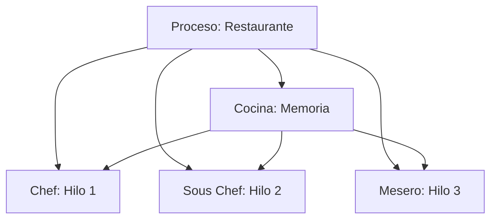
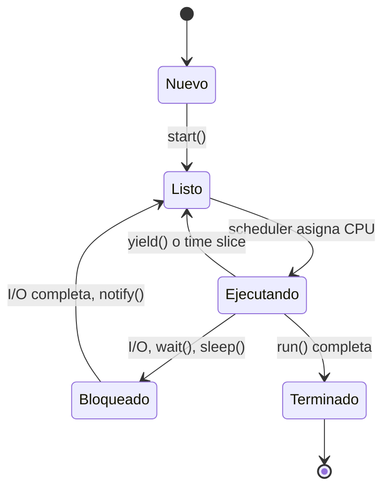
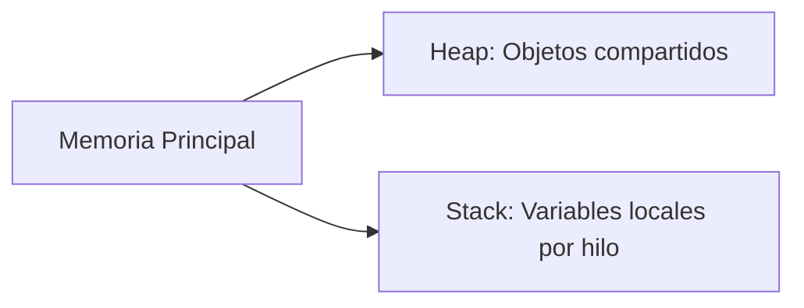

# Introducción a las Ciencias de la Computación - Hilos de ejecución y multi-proceso (threads)

## 9.1 Conceptos generales.

---

### 1. Definiciones Fundamentales

#### 1.1 Proceso vs Hilo

- **Proceso**: Instancia de programa en ejecución con su propio espacio de memoria
- **Hilo (Thread)**: Unidad básica de ejecución dentro de un proceso, comparte memoria

$$ \text{Proceso} = \langle \text{EspacioMemoria}, \text{Recursos}, \sum \text{Hilos} \rangle $$

#### 1.2 Analogía Clásica



### 2. Modelos de Concurrencia

#### 2.1 Hilos de Núcleo (Kernel Threads)

Manejados directamente por el sistema operativo:

- **Ventaja**: Real paralelismo en multi-core
- **Desventaja**: Overhead de cambios de contexto

#### 2.2 Hilos de Usuario (User Threads)

Manejados por la máquina virtual o runtime:

- **Ventaja**: Más ligeros, rápido switching
- **Desventaja**: No aprovechan multi-core directamente

#### 2.3 Ejemplo Java: Creación de Hilos

```java
// Extendiendo Thread
class MiHilo extends Thread {
    public void run() {
        System.out.println("Hilo ejecutando: " + Thread.currentThread().getName());
    }
}

// Implementando Runnable
class MiTarea implements Runnable {
    public void run() {
        System.out.println("Tarea ejecutando: " + Thread.currentThread().getName());
    }
}

// Uso
public class Main {
    public static void main(String[] args) {
        Thread hilo1 = new MiHilo();
        Thread hilo2 = new Thread(new MiTarea());

        hilo1.start();  // Inicia ejecución paralela
        hilo2.start();
    }
}
```

### 3. Estados de un Hilo

#### 3.1 Diagrama de Estados



#### 3.2 Transiciones Comunes

- **start()**: Nuevo → Listo
- **sleep(millis)**: Ejecutando → Bloqueado → Listo
- **wait()**: Ejecutando → Bloqueado (libera monitor)
- **notify()**: Bloqueado → Listo

### 4. Memoria Compartida y Variables

#### 4.1 Modelo de Memoria Java



#### 4.2 Problema de Visibilidad

Sin sincronización, cambios pueden no ser visibles entre hilos:

```java
public class VisibilityProblem {
    private static boolean flag = false;

    public static void main(String[] args) {
        new Thread(() -> {
            while (!flag) {}  // Puede loop infinito
            System.out.println("Flag cambiado");
        }).start();

        try { Thread.sleep(1000); } catch (InterruptedException e) {}
        flag = true;  // Cambio puede no ser visible
    }
}
```

### 5. Beneficios y Costos

#### 5.1 Ventajas de los Hilos

- **Responsividad**: UI no se bloquea con tareas largas
- **Rendimiento**: Paralelismo en multi-core
- **Eficiencia**: Menos overhead que procesos

#### 5.2 Desventajas y Riesgos

- **Race conditions**: Resultados dependen de timing
- **Deadlocks**: Hilos bloqueados mutuamente
- **Complexidad**: Debugging difícil

### 6. Ejercicios Prácticos

1. Crea un programa que lance 5 hilos que impriman su ID con delay aleatorio

2. Explica por qué este código tiene race condition:

```java
private static int counter = 0;
public static void main(String[] args) {
    for (int i = 0; i < 1000; i++) {
        new Thread(() -> counter++).start();
    }
}
```

3. Dibuja el diagrama de estados para un hilo que hace: start → sleep → wait → notify → terminar

### Ver también

- **6.1** Memoria durante la ejecución — los hilos comparten el heap pero tienen pila propia.
- **9.2** Mecanismos del lenguaje — implementación concreta de hilos.
- **9.3** Sincronización — problema fundamental de los hilos.

### Referencias

- Goetz, B. et al. (2006). _Java Concurrency in Practice_. Addison-Wesley. Cap. 1.
- Tanenbaum, A. S. (2014). _Modern Operating Systems_ (4.ª ed.). Pearson. Cap. 2.
