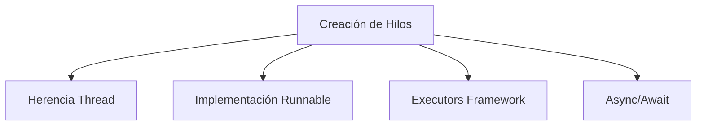
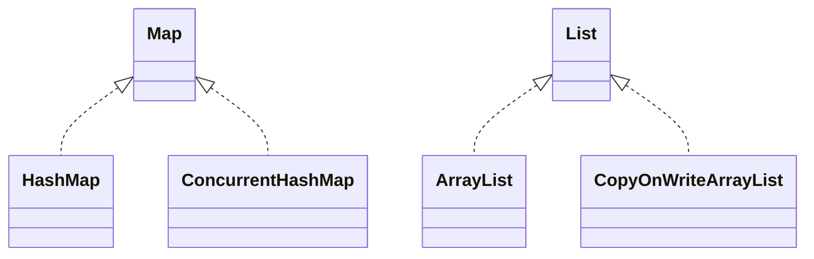

# Introducción a las Ciencias de la Computación - Hilos de ejecución y multi-proceso (threads)

## 9.2 Mecanismos del lenguaje para hilos de ejecución

---

### 1. Creación y Gestión de Hilos

#### 1.1 Mecanismos Básicos de Creación

Los lenguajes proporcionan diferentes abstracciones para crear y gestionar hilos:



#### 1.2 Ejemplo Java: Thread y Runnable

```java
// Método 1: Extendiendo Thread
class MiHilo extends Thread {
    @Override
    public void run() {
        System.out.println("Hilo heredado: " + getName());
    }
}

// Método 2: Implementando Runnable
class MiTarea implements Runnable {
    @Override
    public void run() {
        System.out.println("Tarea Runnable: " + Thread.currentThread().getName());
    }
}

// Uso
public class Main {
    public static void main(String[] args) {
        Thread hilo1 = new MiHilo();
        Thread hilo2 = new Thread(new MiTarea());
        Thread hilo3 = new Thread(() ->
            System.out.println("Lambda Runnable: " + Thread.currentThread().getName()));

        hilo1.start();
        hilo2.start();
        hilo3.start();
    }
}
```

### 2. Sincronización y Bloqueos

#### 2.1 Palabra Clave `synchronized`

Proporciona exclusión mutua a nivel de método o bloque:

$$ \text{SecciónCrítica} = \{ \text{código protegido por synchronized} \} $$

#### 2.2 Ejemplo de Sincronización

```java
public class ContadorSeguro {
    private int count = 0;

    public synchronized void incrementar() {
        count++;  // Operación atómica
    }

    public synchronized int getCount() {
        return count;
    }
}

// Uso con múltiples hilos
public class TestContador {
    public static void main(String[] args) throws InterruptedException {
        ContadorSeguro contador = new ContadorSeguro();

        Thread t1 = new Thread(() -> {
            for (int i = 0; i < 1000; i++) contador.incrementar();
        });

        Thread t2 = new Thread(() -> {
            for (int i = 0; i < 1000; i++) contador.incrementar();
        });

        t1.start();
        t2.start();
        t1.join();
        t2.join();

        System.out.println("Count final: " + contador.getCount());  // 2000
    }
}
```

### 3. Colecciones Concurrentes

#### 3.1 Estructuras Thread-Safe

Java proporciona versiones concurrentes de colecciones:



#### 3.2 Ejemplo ConcurrentHashMap

```java
import java.util.concurrent.*;

public class EjemploConcurrentMap {
    public static void main(String[] args) {
        ConcurrentMap<String, Integer> map = new ConcurrentHashMap<>();

        // Múltiples hilos pueden acceder concurrentemente
        ExecutorService executor = Executors.newFixedThreadPool(10);

        for (int i = 0; i < 100; i++) {
            final int key = i;
            executor.submit(() -> {
                map.put("key" + key, key);
            });
        }

        executor.shutdown();
        System.out.println("Tamaño del mapa: " + map.size());
    }
}
```

### 4. Executors y Thread Pools

#### 4.1 Gestión Efficiente de Hilos

Los Executors manejan pooling y reuso de hilos:

$$ \text{Eficiencia} = \frac{\text{Tareas}}{\text{HilosCreados}} \propto \text{Reutilización} $$

#### 4.2 Ejemplo ExecutorService

```java
import java.util.concurrent.*;

public class EjemploExecutor {
    public static void main(String[] args) {
        // Thread pool con 4 hilos
        ExecutorService executor = Executors.newFixedThreadPool(4);

        // Submit tareas
        for (int i = 0; i < 10; i++) {
            final int taskId = i;
            executor.submit(() -> {
                System.out.println("Tarea " + taskId + " ejecutada por " +
                                  Thread.currentThread().getName());
            });
        }

        executor.shutdown();  // No acepta nuevas tareas
        try {
            executor.awaitTermination(1, TimeUnit.MINUTES);  // Espera finalización
        } catch (InterruptedException e) {
            Thread.currentThread().interrupt();
        }
    }
}
```

### 5. Variables Atómicas y Volátiles

#### 5.1 Atomic Classes

Operaciones atómicas sin bloqueo:

```java
import java.util.concurrent.atomic.*;

public class EjemploAtomic {
    private AtomicInteger counter = new AtomicInteger(0);

    public void increment() {
        counter.incrementAndGet();  // Atómico sin synchronized
    }

    public int getValue() {
        return counter.get();
    }
}
```

#### 5.2 Palabra Volatile

Garantiza visibilidad de cambios entre hilos:

```java
public class EjemploVolatile {
    private volatile boolean running = true;

    public void stop() {
        running = false;  // Cambio visible inmediatamente
    }

    public void run() {
        while (running) {
            // Trabajar
        }
    }
}
```

### 6. Ejercicios Prácticos

1. Implementa un producer-consumer usando BlockingQueue
2. Crea un thread pool que procese archivos concurrentemente
3. Explica la diferencia entre volatile y synchronized

### Ver también

- **9.1** Conceptos de hilos — la teoría que se implementa aquí.
- **9.3** Sincronización — la implementación genera la necesidad de sincronizar.
- **6.3** Pila de ejecución — cada hilo tiene su propia pila.

### Referencias

- Goetz, B. et al. (2006). _Java Concurrency in Practice_. Addison-Wesley. Cap. 2.
- Eckel, B. (2006). _Thinking in Java_ (4.ª ed.). Prentice Hall. Cap. 21.
