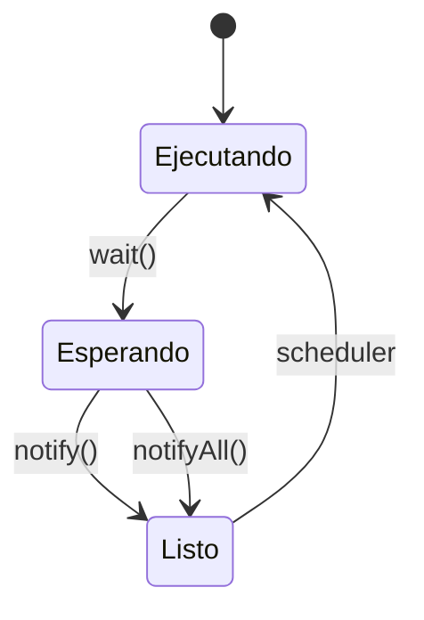
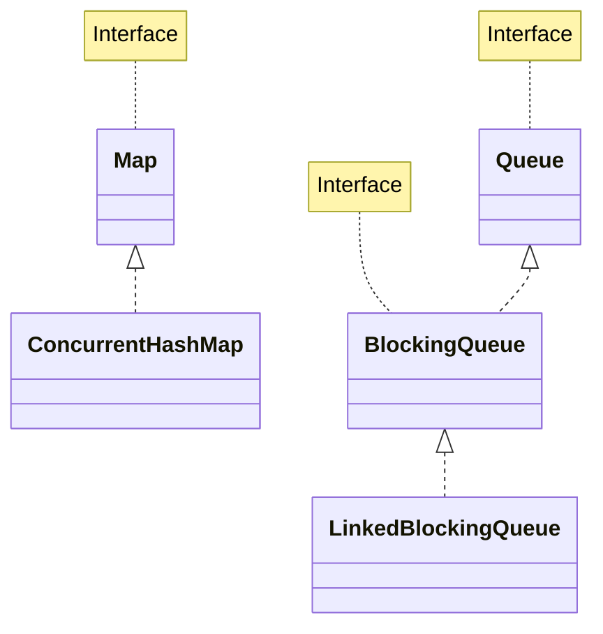

# Introducción a las Ciencias de la Computación - Hilos de ejecución y multi-proceso (threads)

## 9.3 Sincronización de hilos de ejecución.

---

### 1. Conceptos Fundamentales de Sincronización

#### 1.1 Problema de Sección Crítica

Región de código donde múltiples hilos acceden a recursos compartidos:

$$ \text{SecciónCrítica} = \{ \text{código que accede a recursos compartidos} \} $$

#### 1.2 Condiciones para Sincronización Correcta

1. **Exclusión mutua**: Solo un hilo en la sección crítica
2. **Progreso**: Si ningún hilo está en SC, algún hilo debe poder entrar
3. **Espera acotada**: Tiempo de espera debe ser finito

### 2. Mecanismos de Sincronización en Java

#### 2.1 Palabra clave `synchronized`

Proporciona exclusión mutua a nivel de método o bloque:

```java
public class ContadorSincronizado {
    private int count = 0;

    // Sincronización a nivel de método
    public synchronized void incrementar() {
        count++;
    }

    // Sincronización a nivel de bloque
    public void decrementar() {
        synchronized(this) {
            count--;
        }
    }

    public synchronized int getCount() {
        return count;
    }
}
```

#### 2.2 Bloqueos Explícitos con `ReentrantLock`

```java
import java.util.concurrent.locks.*;

public class ContadorConLock {
    private int count = 0;
    private final ReentrantLock lock = new ReentrantLock();

    public void incrementar() {
        lock.lock();
        try {
            count++;
        } finally {
            lock.unlock();
        }
    }
}
```

### 3. Comunicación entre Hilos

#### 3.1 Wait/Notify Mechanism

```java
public class BufferSincronizado {
    private final List<Integer> buffer = new ArrayList<>();
    private final int capacidad;

    public BufferSincronizado(int capacidad) {
        this.capacidad = capacidad;
    }

    public synchronized void producir(int valor) throws InterruptedException {
        while (buffer.size() == capacidad) {
            wait();  // Espera hasta que haya espacio
        }
        buffer.add(valor);
        notifyAll();  // Notifica a consumidores
    }

    public synchronized int consumir() throws InterruptedException {
        while (buffer.isEmpty()) {
            wait();  // Espera hasta que haya datos
        }
        int valor = buffer.remove(0);
        notifyAll();  // Notifica a productores
        return valor;
    }
}
```

#### 3.2 Diagrama de Estados Wait/Notify



### 4. Variables Atómicas

#### 4.1 Clases del paquete `java.util.concurrent.atomic`

```java
import java.util.concurrent.atomic.*;

public class ContadorAtomico {
    private AtomicInteger count = new AtomicInteger(0);

    public void incrementar() {
        count.incrementAndGet();  // Operación atómica
    }

    public int getCount() {
        return count.get();
    }
}
```

#### 4.2 Comparación de Rendimiento

$$ Tiempo_{synchronized} > Tiempo_{atomic} > Tiempo_{no-synchronized} $$

### 5. Colecciones Concurrentes

#### 5.1 Estructuras Thread-Safe

```java
import java.util.concurrent.*;

public class EjemploColeccionesConcurrentes {
    public static void main(String[] args) {
        // Map concurrente
        ConcurrentMap<String, Integer> map = new ConcurrentHashMap<>();

        // Cola bloqueante
        BlockingQueue<Integer> cola = new LinkedBlockingQueue<>();

        // Lista concurrente
        CopyOnWriteArrayList<String> lista = new CopyOnWriteArrayList<>();
    }
}
```

#### 5.2 Diagrama de Relaciones



### 6. Patrones de Sincronización

#### 6.1 Semáforos

```java
import java.util.concurrent.Semaphore;

public class ControlAcceso {
    private final Semaphore semaforo;

    public ControlAcceso(int permisos) {
        semaforo = new Semaphore(permisos);
    }

    public void acceder() throws InterruptedException {
        semaforo.acquire();
        try {
            // Acceder al recurso
        } finally {
            semaforo.release();
        }
    }
}
```

#### 6.2 Barreras Cíclicas

```java
import java.util.concurrent.CyclicBarrier;

public class ProcesamientoParallel {
    private final CyclicBarrier barrera;

    public ProcesamientoParallel(int nHilos) {
        barrera = new CyclicBarrier(nHilos, () ->
            System.out.println("Todos los hilos terminaron"));
    }

    public void procesar() throws Exception {
        // Trabajo del hilo
        barrera.await();  // Espera a los demás
    }
}
```

### 7. Ejercicios Prácticos

1. Implementa el problema del productor-consumidor con BufferSincronizado
2. Crea un sistema de login que limite 3 intentos concurrentes usando Semaphore
3. Explica la diferencia entre notify() y notifyAll()

### Ver también

- **9.2** Mecanismos de hilos — los hilos que se sincronizan aquí.
- **9.4** Terminación — la terminación correcta depende de una buena sincronización.
- **Estructuras de Datos 7.1** (Sem. 2) — las estructuras de datos compartidas por hilos.

### Referencias

- Goetz, B. et al. (2006). _Java Concurrency in Practice_. Addison-Wesley. Cap. 2-3.
- Tanenbaum, A. S. (2014). _Modern Operating Systems_ (4.ª ed.). Pearson. Cap. 2.
