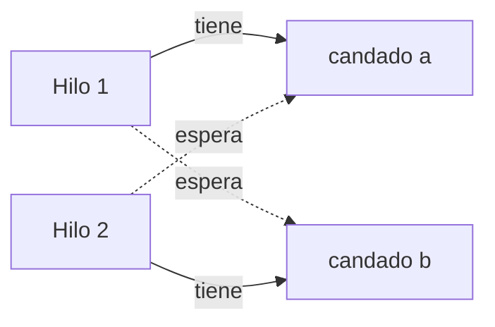

# Introducción a las Ciencias de la Computación - Hilos de ejecución y multi-proceso (threads)

## 9.3 Sincronización de hilos de ejecución.

---

Cuando varios hilos comparten datos que alguno de ellos modifica, el resultado puede depender del orden imprevisible en que se intercalan: es una **condición de carrera** (subtema 9.1). **Sincronizar** es restringir las intercalaciones posibles para que solo ocurran las correctas. Hay dos necesidades distintas: la **exclusión mutua**, que impide que dos hilos ejecuten a la vez ciertas partes del código, y la **coordinación**, que permite que un hilo espere a que otro haga algo. Esta página presenta los mecanismos de Java para ambas y los errores típicos que provoca sincronizar mal.

### 1. Una condición de carrera real

```java
public class Carrera {
    static int contador = 0;

    public static void main(String[] args) throws InterruptedException {
        Runnable incrementar = () -> { for (int i = 0; i < 100_000; i++) contador++; };
        Thread a = new Thread(incrementar), b = new Thread(incrementar);
        a.start(); b.start();
        a.join(); b.join();
        System.out.println(contador);           // debería ser 200000
    }
}
```

En una máquina con varios núcleos la salida suele ser un número menor y distinto en cada ejecución, como `137512`. Los incrementos perdidos son exactamente los de la tabla del subtema 9.1: ambos hilos leen el mismo valor y escriben el mismo resultado.

La parte del código que accede al dato compartido, aquí `contador++`, es una **sección crítica**: debe ejecutarla un solo hilo a la vez.

### 2. Exclusión mutua con `synchronized`

En Java cada objeto tiene asociado un **candado** (*lock* o monitor). Un bloque `synchronized` adquiere el candado de un objeto al entrar y lo libera al salir, aunque salga por una excepción. Si otro hilo ya lo tiene, el hilo que intenta entrar se **bloquea** hasta que se libere:

```java
public class ContadorSeguro {
    private int valor = 0;

    public synchronized void incrementar() { valor++; }     // usa el candado de this
    public synchronized int getValor() { return valor; }

    public static void main(String[] args) throws InterruptedException {
        ContadorSeguro c = new ContadorSeguro();
        Runnable tarea = () -> { for (int i = 0; i < 100_000; i++) c.incrementar(); };
        Thread a = new Thread(tarea), b = new Thread(tarea);
        a.start(); b.start();
        a.join(); b.join();
        System.out.println(c.getValor());                    // 200000, siempre
    }
}
```

Un método `synchronized` equivale a envolver su cuerpo en `synchronized (this) { ... }`; uno `static synchronized` usa el candado de la clase. También se puede sincronizar solo una parte del método, con un objeto de candado privado:

```java
private final Object candado = new Object();
private final List<String> registro = new ArrayList<>();

public void agregar(String linea) {
    String formateada = LocalTime.now() + " " + linea;      // fuera: no toca datos compartidos
    synchronized (candado) {
        registro.add(formateada);                            // dentro: sección crítica mínima
    }
}
```

**Reglas.** Todos los accesos a un dato compartido y modificable, **tanto lecturas como escrituras**, deben protegerse con el **mismo** candado. Las secciones críticas deben ser lo más cortas posible, porque mientras un hilo está dentro los demás esperan.

### 3. Visibilidad y `volatile`

Hay un segundo problema, más sutil que la atomicidad: por optimización, cada núcleo puede mantener copias de las variables en su caché o en registros, y el compilador puede reordenar instrucciones. Sin sincronización, **no hay garantía de que un hilo vea los cambios hechos por otro**. Este programa puede no terminar nunca:

```java
static boolean listo = false;                 // sin volatile

// hilo 1
while (!listo) { }                            // puede leer siempre una copia vieja

// hilo 2
listo = true;
```

Liberar un candado y adquirirlo después, `join`, y escribir y leer una variable **`volatile`** establecen una relación de **sucede antes**: todo lo que un hilo escribió antes es visible para el otro. Declarar `static volatile boolean listo` corrige el ejemplo.

`volatile` garantiza **visibilidad**, pero **no atomicidad**: `contador++` sobre una variable `volatile` sigue teniendo la condición de carrera. Sirve para banderas y para valores que un hilo escribe y otros solo leen.

### 4. Variables atómicas

El paquete `java.util.concurrent.atomic` ofrece clases como `AtomicInteger` y `AtomicLong`, cuyas operaciones compuestas son indivisibles sin usar candados, gracias a instrucciones especiales del procesador como *compare-and-swap*:

```java
AtomicInteger contador = new AtomicInteger();
contador.incrementAndGet();                   // contador++ atómico
contador.addAndGet(5);
contador.updateAndGet(x -> Math.max(x, 10));  // actualización arbitraria, atómica
```

Para un contador o un acumulador simples, son la opción más eficiente y sencilla.

### 5. Coordinación: productor y consumidor

Un patrón muy común: unos hilos **producen** datos y otros los **consumen**, comunicándose a través de una cola de capacidad limitada. Los productores deben esperar si la cola está llena y los consumidores si está vacía.

**Con `wait` y `notifyAll`.** Dentro de un bloque `synchronized`, `wait()` libera el candado y suspende al hilo hasta que otro llame a `notifyAll()` sobre el mismo objeto:

```java
import java.util.ArrayDeque;
import java.util.Queue;

public class BufferAcotado<T> {
    private final Queue<T> cola = new ArrayDeque<>();
    private final int capacidad;

    public BufferAcotado(int capacidad) { this.capacidad = capacidad; }

    public synchronized void poner(T x) throws InterruptedException {
        while (cola.size() == capacidad) wait();       // while, no if: volver a verificar
        cola.add(x);
        notifyAll();                                   // despierta a quien espera datos
    }

    public synchronized T tomar() throws InterruptedException {
        while (cola.isEmpty()) wait();
        T x = cola.remove();
        notifyAll();                                   // despierta a quien espera espacio
        return x;
    }

    public static void main(String[] args) throws InterruptedException {
        BufferAcotado<Integer> buffer = new BufferAcotado<>(3);
        Thread productor = new Thread(() -> {
            try { for (int i = 1; i <= 10; i++) buffer.poner(i); buffer.poner(-1); }
            catch (InterruptedException e) { Thread.currentThread().interrupt(); }
        });
        Thread consumidor = new Thread(() -> {
            try {
                int suma = 0;
                for (int x = buffer.tomar(); x != -1; x = buffer.tomar()) suma += x;
                System.out.println("Suma consumida: " + suma);   // 55
            } catch (InterruptedException e) { Thread.currentThread().interrupt(); }
        });
        productor.start(); consumidor.start();
        productor.join(); consumidor.join();
    }
}
```

La condición se verifica en un `while` porque al despertar otro hilo pudo haber cambiado el estado, y porque la especificación permite despertares espurios. El valor `-1` es una **píldora venenosa**: una marca acordada para avisar al consumidor que no habrá más datos.

**Con la biblioteca.** En la práctica no hace falta programar esto: `BlockingQueue`, con implementaciones como `ArrayBlockingQueue` y `LinkedBlockingQueue`, ya ofrece `put` y `take` con exactamente este comportamiento.

### 6. Otras herramientas de `java.util.concurrent`

| Herramienta                        | Para qué sirve                                                         |
| ---------------------------------- | ---------------------------------------------------------------------- |
| `ReentrantLock`                    | candado explícito con `lock()` y `unlock()`; permite intentar con tiempo límite |
| `ReadWriteLock`                    | muchos lectores a la vez o un solo escritor                             |
| `Semaphore`                        | limitar a $k$ el número de hilos que usan un recurso                    |
| `CountDownLatch`                   | esperar a que ocurran $n$ eventos                                       |
| `ConcurrentHashMap`                | diccionario seguro para muchos hilos, con operaciones atómicas como `merge` |
| `CopyOnWriteArrayList`             | lista para muchas lecturas y pocas modificaciones                       |

Con `ReentrantLock` el candado se libera siempre en un `finally`:

```java
lock.lock();
try {
    // sección crítica
} finally {
    lock.unlock();
}
```

Las colecciones comunes como `ArrayList` y `HashMap` **no** son seguras para hilos: modificarlas desde varios hilos puede corromperlas. Hay que protegerlas con un candado o usar las versiones concurrentes.

### 7. Bloqueo mutuo

Un **bloqueo mutuo** (*deadlock*) ocurre cuando cada hilo de un grupo espera un candado que tiene otro del grupo, y ninguno puede avanzar:

```java
// hilo 1: transferir(a, b)          // hilo 2: transferir(b, a)
synchronized (a) {                    synchronized (b) {
    synchronized (b) { ... }              synchronized (a) { ... }
}                                     }
```

Si el hilo 1 toma `a` y el hilo 2 toma `b` al mismo tiempo, cada uno espera para siempre el candado del otro.



Un bloqueo mutuo requiere un **ciclo de esperas**. La forma más común de evitarlo es imponer un **orden global** a los candados y adquirirlos siempre en ese orden, por ejemplo, primero la cuenta con el número menor:

```java
void transferir(Cuenta origen, Cuenta destino, double monto) {
    Cuenta primera = origen.numero() < destino.numero() ? origen : destino;
    Cuenta segunda = (primera == origen) ? destino : origen;
    synchronized (primera) {
        synchronized (segunda) {
            origen.retirar(monto);
            destino.depositar(monto);
        }
    }
}
```

### 8. La mejor sincronización es no necesitarla

Muchos problemas desaparecen si se evita compartir datos modificables:

- **Objetos inmutables**, como `String` o los `record` con atributos inmutables: pueden compartirse libremente porque nadie los modifica.
- **Confinamiento:** cada hilo trabaja con sus propios datos, como en `SumaParalela` del subtema 9.2, y los resultados se combinan al final.
- **Comunicación por mensajes:** los hilos se pasan datos a través de una `BlockingQueue` en lugar de compartir estructuras.

> **Conexión con CC.** Los problemas de esta página son los problemas clásicos de la concurrencia que se estudian en Sistemas Operativos: la sección crítica, el productor y consumidor, los lectores y escritores, y la cena de los filósofos, que ilustra el bloqueo mutuo. Las condiciones necesarias para un bloqueo mutuo fueron caracterizadas por Coffman en 1971, y los semáforos fueron introducidos por Dijkstra en 1965.

### Ejercicios propuestos

1. Ejecute `Carrera` diez veces y anote los resultados. Corríjala de tres maneras: con `synchronized`, con `AtomicInteger` y con un `ReentrantLock`. Compare los tiempos.
2. ¿Por qué no basta con declarar `contador` como `volatile` en `Carrera`? Compruébelo.
3. Reescriba el productor y consumidor usando `ArrayBlockingQueue` y dos consumidores. ¿Cuántas píldoras venenosas necesita?
4. Escriba un programa que provoque un bloqueo mutuo con dos hilos y dos candados. Use `jstack` (subtema 9.5) para observarlo, y luego corríjalo ordenando los candados.
5. Cuente la frecuencia de las palabras de varios archivos en paralelo, un hilo por archivo, usando un `ConcurrentHashMap` y su método `merge`.
6. Explique por qué en `BufferAcotado` se usa `notifyAll` y no `notify`. Construya un escenario con dos productores y dos consumidores en que `notify` provoque que todos queden esperando.

### Ver también

- **6.2** El heap y la recolección de basura — los objetos compartidos viven en el heap.
- **9.1** Conceptos generales — condiciones de carrera.
- **9.2** Mecanismos del lenguaje para hilos de ejecución.
- **9.4** Terminación de ejecución — interrupción de hilos que esperan.
- **9.5** Depuración en hilos de ejecución — detectar bloqueos mutuos.
- **Sistemas Operativos 3** (Sem. 6) — sincronización y bloqueos mutuos.

### Referencias

- Goetz, B., et al. (2006). _Java Concurrency in Practice_. Addison-Wesley. Cap. 2, 3, 5 y 10.
- Herlihy, M., & Shavit, N. (2012). _The Art of Multiprocessor Programming_ (ed. rev.). Morgan Kaufmann.
- Dijkstra, E. W. (1965). Cooperating sequential processes. Technical Report EWD-123.
