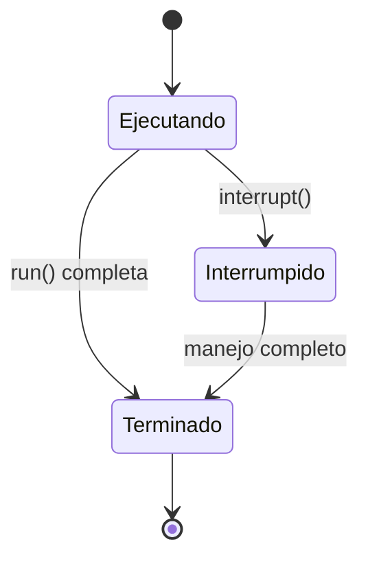
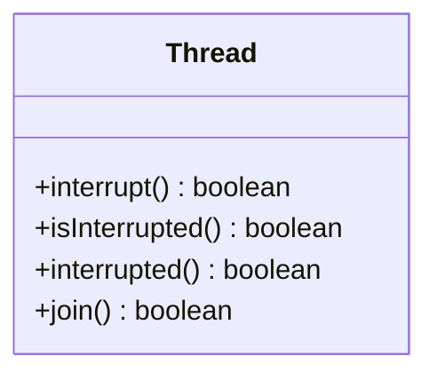

# Introducción a las Ciencias de la Computación - Hilos de ejecución y multi-proceso (threads)

## 9.4 Terminación de ejecución.

---

### 1. Mecanismos de Terminación de Hilos

#### 1.1 Finalización Natural vs Forzada

Un hilo puede terminar de dos formas principales:

$$ \text{Terminación} = \begin{cases} \text{Natural} & \text{run() completa} \\\ \text{Forzada} & \text{interrupción o banderas} \end{cases} $$

#### 1.2 Estados de Terminación



### 2. Finalización Natural

#### 2.1 Cuando run() Completa

El hilo termina automáticamente al finalizar su método run():

```java
public class HiloNatural extends Thread {
    @Override
    public void run() {
        for (int i = 0; i < 5; i++) {
            System.out.println("Ejecutando: " + i);
        }
        // Hilo termina naturalmente aquí
    }
}

// Uso
public class Main {
    public static void main(String[] args) {
        HiloNatural hilo = new HiloNatural();
        hilo.start();
        System.out.println("Hilo iniciado, terminará naturalmente");
    }
}
```

### 3. Interrupción de Hilos

#### 3.1 Mecanismo de Interrupción Cooperativa

Java usa un approach cooperativo mediante banderas de interrupción:

```java
public class HiloInterrumpible implements Runnable {
    @Override
    public void run() {
        while (!Thread.currentThread().isInterrupted()) {
            try {
                System.out.println("Trabajando...");
                Thread.sleep(1000);
            } catch (InterruptedException e) {
                // Restablece el estado de interrupción
                Thread.currentThread().interrupt();
                System.out.println("Hilo interrumpido durante sleep");
                break;
            }
        }
        System.out.println("Hilo terminando limpiamente");
    }
}
```

#### 3.2 Métodos de Interrupción



### 4. Patrón de Bandera Volátil

#### 4.1 Control Manual con Bandera

Útil cuando el hilo no realiza operaciones bloqueantes:

```java
public class HiloControlado implements Runnable {
    private volatile boolean ejecutando = true;

    public void detener() {
        ejecutando = false;
    }

    @Override
    public void run() {
        while (ejecutando) {
            System.out.println("Ejecutando tarea...");
            // Trabajo sin operaciones bloqueantes
        }
        System.out.println("Hilo detenido por bandera");
    }
}

// Uso
public class Main {
    public static void main(String[] args) throws InterruptedException {
        HiloControlado tarea = new HiloControlado();
        Thread hilo = new Thread(tarea);
        hilo.start();

        Thread.sleep(3000);
        tarea.detener();  // Solicita detención
        hilo.join();      // Espera terminación
    }
}
```

### 5. ExecutorService y Shutdown

#### 5.1 Terminación Controlada de Thread Pools

```java
import java.util.concurrent.*;

public class EjemploExecutor {
    public static void main(String[] args) {
        ExecutorService executor = Executors.newFixedThreadPool(2);

        // Enviar tareas
        for (int i = 0; i < 5; i++) {
            executor.submit(() -> {
                while (!Thread.currentThread().isInterrupted()) {
                    System.out.println("Trabajando: " + Thread.currentThread().getName());
                    try {
                        Thread.sleep(500);
                    } catch (InterruptedException e) {
                        Thread.currentThread().interrupt();
                    }
                }
            });
        }

        // Apagado ordenado
        executor.shutdown();  // No acepta nuevas tareas
        try {
            if (!executor.awaitTermination(3, TimeUnit.SECONDS)) {
                executor.shutdownNow();  // Interrumpe tareas activas
            }
        } catch (InterruptedException e) {
            executor.shutdownNow();
            Thread.currentThread().interrupt();
        }
    }
}
```

### 6. Manejo de Recursos en Terminación

#### 6.1 Finally y Try-with-Resources

```java
public class HiloConRecursos implements Runnable {
    @Override
    public void run() {
        try (FileWriter writer = new FileWriter("salida.txt")) {
            while (!Thread.currentThread().isInterrupted()) {
                writer.write("Datos\n");
                Thread.sleep(1000);
            }
        } catch (InterruptedException e) {
            System.out.println("Hilo interrumpido, cerrando recursos");
            Thread.currentThread().interrupt();
        } catch (IOException e) {
            System.err.println("Error de E/S: " + e.getMessage());
        }
    }
}
```

### 7. Ejercicios Prácticos

1. Implementa un hilo que procese datos y pueda ser detenido limpiamente
2. Crea un ThreadPool que espere la terminación de todas las tareas
3. Explica por qué Thread.stop() está deprecado y es peligroso

### Ver también

- **9.3** Sincronización — la terminación correcta requiere sincronización previa.
- **9.5** Depuración — problemas en la terminación de hilos son difíciles de depurar.

### Referencias

- Goetz, B. et al. (2006). _Java Concurrency in Practice_. Addison-Wesley. Cap. 7.
- Eckel, B. (2006). _Thinking in Java_ (4.ª ed.). Prentice Hall. Cap. 21.
