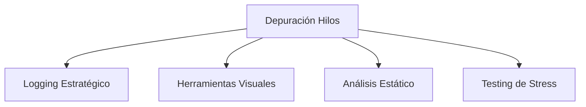
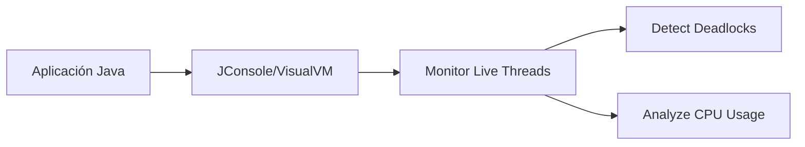
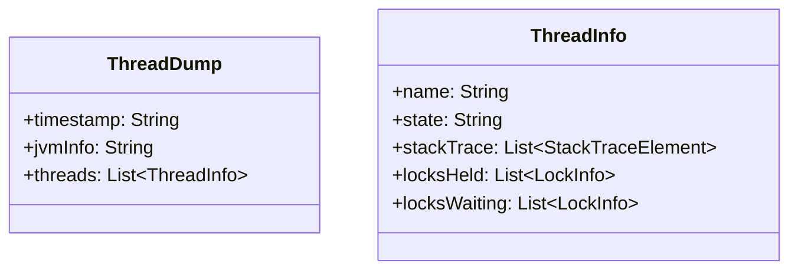

# Introducción a las Ciencias de la Computación - Hilos de ejecución y multi-proceso (threads)

## 9.5 Depuración en hilos de ejecución

---

### 1. Desafíos Únicos de Depuración en Concurrencia

#### 1.1 Problemas No-Deterministas

Los errores en hilos suelen ser:

- **Heisenbugs**: Desaparecen al depurar
- **Race conditions**: Dependen del timing de ejecución
- **Deadlocks**: Bloqueos mutuos difíciles de reproducir

$$ \text{ProbabilidadError} = f(\text{Timing}, \text{Scheduling}, \text{EstadoSistema}) $$

#### 1.2 Herramientas Especializadas



### 2. Técnicas de Logging para Depuración

#### 2.1 Logging con Información de Hilo

```java
import java.time.Instant;

public class ThreadLogger {
    public static void log(String message) {
        Thread thread = Thread.currentThread();
        System.out.printf("%s [%s] %s: %s\n",
            Instant.now(),
            thread.getName(),
            thread.getState(),
            message);
    }
}

// Uso en código concurrente
public class TareaConcurrente implements Runnable {
    @Override
    public void run() {
        ThreadLogger.log("Iniciando ejecución");
        try {
            Thread.sleep(1000);
            ThreadLogger.log("Tarea completada");
        } catch (InterruptedException e) {
            ThreadLogger.log("Interrumpida: " + e.getMessage());
            Thread.currentThread().interrupt();
        }
    }
}
```

#### 2.2 Formatos de Log Útiles

- **Timestamp**: Para ordenar eventos entre hilos
- **Thread ID/Name**: Identificar origen
- **Thread State**: Estado en momento del log

### 3. Herramientas de Depuración Visual

#### 3.1 JConsole y VisualVM

Monitorean en tiempo real:

- Estados de hilos
- Contenciones (deadlocks)
- Uso de CPU por hilo



#### 3.2 Uso de jstack para Thread Dumps

```bash
# Generar thread dump
jstack <pid>

# Generar múltiples dumps
for i in {1..5}; do jstack <pid> > thread_dump_$i.txt; sleep 2; done
```

### 4. Análisis de Thread Dumps

#### 4.1 Estructura de un Thread Dump



#### 4.2 Identificando Deadlocks

Ejemplo de deadlock en dump:

- Thread-1 waiting for lock 0x000000076ab666c8
- which is held by Thread-2
- Thread-2 waiting for lock 0x000000076ab666f0
- which is held by Thread-1

### 5. Estrategias de Depuración Práctica

#### 5.1 Testing de Stress y Carga

```java
public class StressTest {
    public static void main(String[] args) {
        ExecutorService executor = Executors.newFixedThreadPool(100);

        for (int i = 0; i < 1000; i++) {
            executor.submit(() -> {
                // Código concurrente a testear
                procesarTransaccion();
            });
        }

        executor.shutdown();
        try {
            executor.awaitTermination(1, TimeUnit.MINUTES);
        } catch (InterruptedException e) {
            Thread.currentThread().interrupt();
        }
    }
}
```

#### 5.2 Timeouts y Debug Points

```java
public class DebuggableTask implements Runnable {
    private final CountDownLatch latch = new CountDownLatch(1);

    @Override
    public void run() {
        try {
            // Punto de depuración artificial
            latch.await(5, TimeUnit.SECONDS); // Timeout para evitar bloqueos
            ejecutarLogicaNegocio();
        } catch (InterruptedException e) {
            Thread.currentThread().interrupt();
        }
    }

    public void continueExecution() {
        latch.countDown(); // Libera desde debugger
    }
}
```

### 6. Prevención de Problemas Comunes

#### 6.1 Checklist de Depuración

- Verificar sincronización en recursos compartidos
- Revisar timeouts en operaciones bloqueantes
- Confirmar proper cleanup de recursos
- Validar manejo de interrupciones

#### 6.2 Patrones Anti-Debug

- **Sleep aleatorio**: Introduce variabilidad de timing
- **Thread.yield()**: Permite cambios de contexto
- **Randomización**: Para exponer race conditions

### 7. Ejercicios Prácticos

1. Genera un thread dump de una aplicación simple y analiza los estados
2. Implementa logging estratégico en un producer-consumer
3. Crea un test de stress que revele una race condition

### Ver también

- **9.1–9.4** Todo el tema de hilos — síntesis de la depuración aplicada a los hilos.
- **7.3** Manejo de errores — los errores de concurrencia son un tipo particular de excepción.

### Referencias

- Goetz, B. et al. (2006). _Java Concurrency in Practice_. Addison-Wesley. Cap. 12.
- Martin, R. C. (2008). _Clean Code_. Prentice Hall. Cap. 13.
