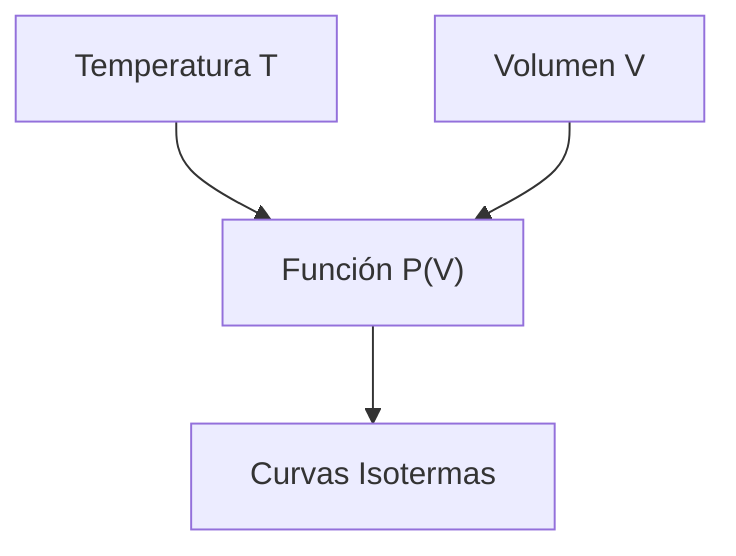

# Matemáticas para Ciencias Aplicadas I - Funciones gráficas

## 1.1 Funciones. Ejemplos: densidad, presión, velocidad, etc.

---

### 1. Concepto de Función en Ciencias

#### 1.1 Definición Matemática

Una función $f$ es una relación que asigna a cada elemento $x$ de un conjunto $A$ exactamente un elemento $y$ de un conjunto $B$:

$$ f: A \rightarrow B \quad \text{ donde } \quad y = f(x) $$

#### 1.2 Variables en Ciencias

- **Variable independiente**: Causa o input ( ej: tiempo $t$, volumen $V$ )
- **Variable dependiente**: Efecto o output ( ej: presión $P$, densidad $\rho$ )

### 2. Funciones Físicas Fundamentales

#### 2.1 Densidad $\rho$ en Función del Volumen

Para una masa fija $m$, la densidad varía con el volumen:

$$ \rho(V) = \frac{m}{V} $$

```python
import numpy as np
import matplotlib.pyplot as plt

# Función densidad
def densidad(volumen, masa=10):
    return masa / volumen

V = np.linspace(1, 10, 100)
rho = densidad(V)

plt.figure(figsize=(8, 5))
plt.plot(V, rho, 'b-', label='ρ(V) = m/V')
plt.xlabel('Volumen (m³)')
plt.ylabel('Densidad (kg/m³)')
plt.title('Densidad vs Volumen (m=10kg)')
plt.grid(True)
plt.legend()
plt.show()
```

### 3. Función de Presión en Fluidos

#### 3.1 Presión Hidrostática

La presión en un fluido en función de la profundidad $h$:

$$ P(h) = P_0 + \rho g h $$

Donde:

- $P_0$: presión atmosférica
- $\rho$: densidad del fluido
- $g$: gravedad

#### 3.2 Diagrama de Presión


### 4. Funciones de Movimiento

#### 4.1 Velocidad en Función del Tiempo

Para movimiento uniformemente acelerado:

$$ v(t) = v_0 + a t $$

#### 4.2 Posición en Función del Tiempo

$$ x(t) = x_0 + v_0 t + \frac{1}{2} a t^2 $$

```python
# Movimiento uniformemente acelerado
def velocidad(t, v0=0, a=9.8):
    return v0 + a * t

def posicion(t, x0=0, v0=0, a=9.8):
    return x0 + v0 * t + 0.5 * a * t**2

t = np.linspace(0, 5, 100)
v = velocidad(t)
x = posicion(t)

# Gráficas múltiples
fig, (ax1, ax2) = plt.subplots(2, 1, figsize=(8, 8))
ax1.plot(t, v, 'r-', label='v(t) = v₀ + at')
ax1.set_ylabel('Velocidad (m/s)')
ax1.legend()
ax1.grid(True)

ax2.plot(t, x, 'g-', label='x(t) = x₀ + v₀t + ½at²')
ax2.set_xlabel('Tiempo (s)')
ax2.set_ylabel('Posición (m)')
ax2.legend()
ax2.grid(True)
plt.show()
```

### 5. Funciones en Termodinámica

#### 5.1 Ley de los Gases Ideales

Presión en función de volumen y temperatura:

$$ P(V, T) = \frac{n R T}{V} $$

#### 5.2 Diagrama PV



### 6. Clasificación de Funciones Científicas

#### 6.1 Tipos Comunes

| Tipo Función    | Forma Matemática  | Ejemplo Físico                                  |
| --------------- | ----------------- | ----------------------------------------------- |
| **Lineal**      | $y = mx + b$      | Ley de Hooke $F = kx$                           |
| **Potencia**    | $y = kx^n$        | Gravitación $F = G\frac{m_1 m_2}{r^2}$          |
| **Exponencial** | $y = ae^{bx}$     | Decaimiento radiactivo $N = N_0 e^{-\lambda t}$ |
| **Logarítmica** | $y = a \ln x + b$ | Escala Richter $M = \log_{10}(A)$               |

### 7. Ejercicios Prácticos

1. Grafica la presión $P(V)$ para un gas ideal con $n=1$, $R=8.314$, $T=300K$
2. Deriva la función aceleración $a(t)$ desde $v(t) = 5 + 3t$
3. Explica por qué la densidad $\rho(V)$ es una función hiperbólica

### Ver también

- **1.2** Coordenadas — sistemas de representación de funciones.
- **2.1** Razón de cambio — la derivada como tasa de cambio de estas funciones.
- **Álgebra Superior I 2.2** — funciones como relaciones especiales.

### Referencias

- Stewart, J. (2016). _Cálculo de una variable_ (8.ª ed.). Cengage Learning.
- Simmons, G. F. (2012). _Cálculo con geometría analítica_ (2.ª ed.). McGraw-Hill.
- Thomas, G. B. et al. (2014). _Cálculo_ (13.ª ed.). Pearson.
