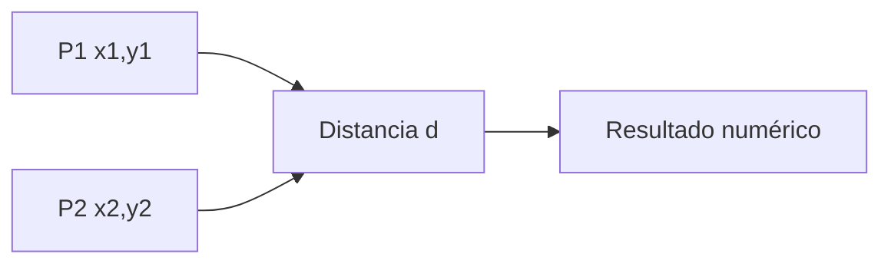
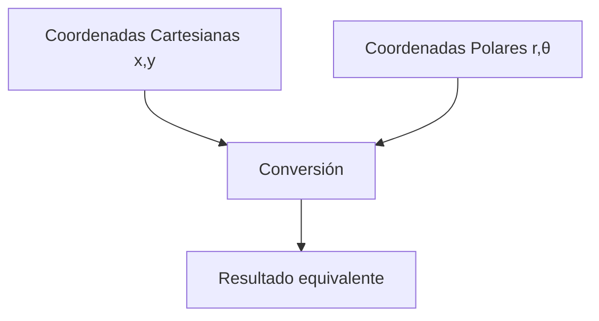

# Matemáticas para Ciencias Aplicadas I - Funciones gráficas

## 1.2 Coordenadas. Distancia y ángulo

---

### 1. Sistemas de Coordenadas

#### 1.1 Coordenadas Cartesianas

Sistema de referencia formado por dos ejes perpendiculares:

- **Eje X**: Abscisa (horizontal)
- **Eje Y**: Ordenada (vertical)

Un punto $P$ se representa como $(x, y)$

#### 1.2 Coordenadas Polares

Sistema alternativo usando distancia y ángulo:

- $r$: Distancia desde el origen
- $\theta$: Ángulo desde el eje X

Un punto $P$ se representa como $(r, \theta)$

**Conversión entre sistemas:**

$$ x = r \cos \theta $$ $$ y = r \sin \theta $$ $$ r = \sqrt{x^2 + y^2} $$ $$ \theta = \arctan\left(\frac{y}{x}\right) $$

### 2. Distancia entre Dos Puntos

#### 2.1 Fórmula de Distancia Euclidiana

Para dos puntos $P_1(x_1, y_1)$ y $P_2(x_2, y_2)$:

$$ d = \sqrt{(x_2 - x_1)^2 + (y_2 - y_1)^2} $$

#### 2.2 Implementación en Python

```python
import math

def distancia(x1, y1, x2, y2):
    return math.sqrt((x2 - x1)**2 + (y2 - y1)**2)

# Ejemplo
p1 = (3, 4)
p2 = (7, 1)
d = distancia(p1[0], p1[1], p2[0], p2[1])
print(f"Distancia entre {p1} y {p2}: {d:.2f}")
```

#### 2.3 Diagrama de Distancia



### 3. Ángulo entre Puntos y Vectores

#### 3.1 Ángulo entre Dos Puntos

El ángulo $\theta$ que forma el vector $\overrightarrow{P_1P_2}$ con el eje X:

$$ \theta = \arctan\left(\frac{y_2 - y_1}{x_2 - x_1}\right) $$

#### 3.2 Ángulo entre Dos Vectores

Para vectores $\vec{u} = (u_x, u_y)$ y $\vec{v} = (v_x, v_y)$:

$$ \theta = \arccos\left(\frac{\vec{u} \cdot \vec{v}}{|\vec{u}| |\vec{v}|}\right) $$

Donde el producto punto es:

$$ \vec{u} \cdot \vec{v} = u_x v_x + u_y v_y $$

#### 3.3 Código para Cálculo de Ángulos

```python
import numpy as np

def angulo_entre_vectores(u, v):
    """Calcula el ángulo entre dos vectores en radianes"""
    producto_punto = np.dot(u, v)
    magnitud_u = np.linalg.norm(u)
    magnitud_v = np.linalg.norm(v)
    cos_theta = producto_punto / (magnitud_u * magnitud_v)
    return np.arccos(cos_theta)

# Ejemplo
vector1 = np.array([1, 0])
vector2 = np.array([0, 1])
angulo = angulo_entre_vectores(vector1, vector2)
print(f"Ángulo entre [1,0] y [0,1]: {np.degrees(angulo):.1f}°")
```

### 4. Aplicaciones en Ciencias

#### 4.1 Física: Movimiento de Proyectiles

**Coordenadas en función del tiempo:**

$$ x(t) = v_{0x} t $$ $$ y(t) = v_{0y} t - \frac{1}{2} g t^2 $$

**Distancia recorrida:**

$$ d(t) = \sqrt{x(t)^2 + y(t)^2} $$

#### 4.2 Ingeniería: Análisis de Fuerzas

Para dos fuerzas $\vec{F_1}$ y $\vec{F_2}$:

- Magnitud resultante: $|\vec{F_1} + \vec{F_2}|$
- Ángulo de la resultante: $\theta = \arctan(\frac{F_{1y} + F_{2y}}{F_{1x} + F_{2x}})$

### 5. Visualización de Coordenadas

#### 5.1 Diagrama de Conversión Coordenadas



#### 5.2 Gráfico de Puntos y Distancias

```python
import matplotlib.pyplot as plt

# Puntos ejemplo
puntos = [(2, 3), (5, 7), (-1, 4), (3, -2)]

plt.figure(figsize=(8, 6))
for i, (x, y) in enumerate(puntos):
    plt.plot(x, y, 'o', markersize=8, label=f'P{i+1} ({x},{y})')

# Líneas al origen
for x, y in puntos:
    plt.plot([0, x], [0, y], 'gray', linestyle='--', alpha=0.7)

plt.axhline(0, color='black', linewidth=0.5)
plt.axvline(0, color='black', linewidth=0.5)
plt.grid(True)
plt.legend()
plt.xlabel('Eje X')
plt.ylabel('Eje Y')
plt.title('Sistema de Coordenadas Cartesianas')
plt.axis('equal')
plt.show()
```

### 6. Ejercicios Prácticos

1. Calcula la distancia entre los puntos $( -2, 5 )$ y $( 3, -1 )$
2. Convierte el punto polar $( r=5, \theta=30° )$ a coordenadas cartesianas
3. Encuentra el ángulo entre los vectores $\vec{a} = (3, 4)$ y $\vec{b} = (-2, 6)$

### Ver también

- **1.1** Funciones — se grafican en los sistemas de coordenadas vistos aquí.
- **1.3** Representación gráfica de funciones.
- **Álgebra Superior I 4.1** — $\mathbb{R}^2$ como plano cartesiano.

### Referencias

- Stewart, J. (2016). _Cálculo de una variable_ (8.ª ed.). Cengage Learning.
- Simmons, G. F. (2012). _Cálculo con geometría analítica_ (2.ª ed.). McGraw-Hill.
- Thomas, G. B. et al. (2014). _Cálculo_ (13.ª ed.). Pearson.
