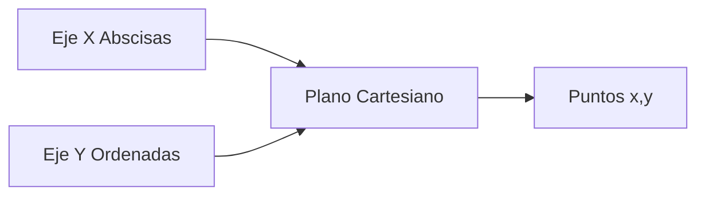
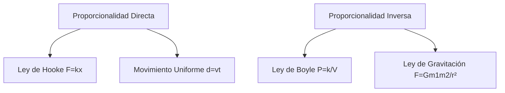

# Matemáticas para Ciencias Aplicadas I - Funciones gráficas

## 1.3 Representación gráfica de funciones. Ecuación de una recta. Proporcionalidad.

---

### 1. Concepto de Función y su Representación Gráfica

#### 1.1 Definición de Función

Una función $f$ es una relación que asigna a cada elemento $x$ de un conjunto $A$ exactamente un elemento $y$ de un conjunto $B$:

$$ f: A \rightarrow B \quad \text{ donde } \quad y = f(x) $$

#### 1.2 Sistema de Coordenadas Cartesianas



### 2. Ecuación de una Recta

#### 2.1 Forma Pendiente-Ordenada al Origen

La ecuación general de una recta es:

$$ y = mx + b $$

Donde:

- $m$: Pendiente (inclinación de la recta)
- $b$: Ordenada al origen (punto donde corta el eje Y)

#### 2.2 Cálculo de la Pendiente

Para dos puntos $(x_1, y_1)$ y $(x_2, y_2)$:

$$ m = \frac{y_2 - y_1}{x_2 - x_1} $$

#### 2.3 Ejemplo de Código Python

```python
import matplotlib.pyplot as plt
import numpy as np

# Definir función lineal
def recta(x, m, b):
    return m * x + b

# Parámetros
m = 2    # Pendiente
b = -1   # Ordenada al origen

# Generar puntos
x = np.linspace(-5, 5, 100)
y = recta(x, m, b)

# Graficar
plt.figure(figsize=(8, 6))
plt.plot(x, y, label=f'y = {m}x + {b}', color='blue')
plt.axhline(0, color='black', linewidth=0.5)
plt.axvline(0, color='black', linewidth=0.5)
plt.grid(True, alpha=0.3)
plt.xlabel('x')
plt.ylabel('y')
plt.title('Representación de una Función Lineal')
plt.legend()
plt.show()
```

### 3. Proporcionalidad

#### 3.1 Proporcionalidad Directa

Cuando dos magnitudes están relacionadas por:

$$ y = kx $$

Donde $k$ es la constante de proporcionalidad.

**Características:**

- La gráfica pasa por el origen (0,0)
- Pendiente constante $k$

#### 3.2 Proporcionalidad Inversa

Cuando dos magnitudes están relacionadas por:

$$ y = \frac{k}{x} $$

**Características:**

- Gráfica en forma de hipérbola
- Asíntotas en los ejes coordenados

#### 3.3 Ejemplo de Proporcionalidad Directa e Inversa

```python
# Proporcionalidad directa e inversa
x = np.linspace(0.1, 10, 100)
y_directa = 2 * x       # y = 2x
y_inversa = 5 / x       # y = 5/x

plt.figure(figsize=(10, 5))

# Proporcionalidad directa
plt.subplot(1, 2, 1)
plt.plot(x, y_directa, 'r-', label='y = 2x')
plt.title('Proporcionalidad Directa')
plt.grid(True)

# Proporcionalidad inversa
plt.subplot(1, 2, 2)
plt.plot(x, y_inversa, 'b-', label='y = 5/x')
plt.title('Proporcionalidad Inversa')
plt.grid(True)

plt.tight_layout()
plt.show()
```

### 4. Formas de la Ecuación de la Recta

#### 4.1 Forma General

$$ Ax + By + C = 0 $$

#### 4.2 Forma Punto-Pendiente

Dado un punto $(x_1, y_1)$ y la pendiente $m$:

$$ y - y_1 = m(x - x_1) $$

#### 4.3 Forma Segmentaria

$$ \frac{x}{a} + \frac{y}{b} = 1 $$

Donde $a$ y $b$ son los puntos donde corta los ejes X e Y respectivamente.

### 5. Aplicaciones en Ciencias

#### 5.1 Ley de Hooke (Física)

**Proporcionalidad directa:**

$$ F = kx $$  
Donde $F$ es la fuerza, $k$ la constante elástica y $x$ el estiramiento.

#### 5.2 Ley de Boyle (Química)

**Proporcionalidad inversa:**

$$ P = \frac{k}{V} $$  
Donde $P$ es la presión, $V$ el volumen y $k$ constante.

#### 5.3 Diagrama de Aplicaciones



### 6. Ejercicios Prácticos

1. Encuentra la ecuación de la recta que pasa por los puntos $(2, 3)$ y $(4, 7)$
2. Gráfica las funciones $y = 3x$ y $y = \frac{6}{x}$ en el mismo sistema de coordenadas
3. Determina si las siguientes relaciones son de proporcionalidad directa o inversa:
   - El costo de gasolina y la cantidad de litros comprados
   - La velocidad de un automóvil y el tiempo para recorrer una distancia fija

### Ver también

- **1.2** Coordenadas — base de la representación gráfica.
- **1.4** Cónicas — curvas especiales graficadas en el mismo sistema.
- **2.4** Tangente a una curva — la recta tangente como límite.

### Referencias

- Stewart, J. (2016). _Cálculo de una variable_ (8.ª ed.). Cengage Learning.
- Simmons, G. F. (2012). _Cálculo con geometría analítica_ (2.ª ed.). McGraw-Hill.
- Thomas, G. B. et al. (2014). _Cálculo_ (13.ª ed.). Pearson.
