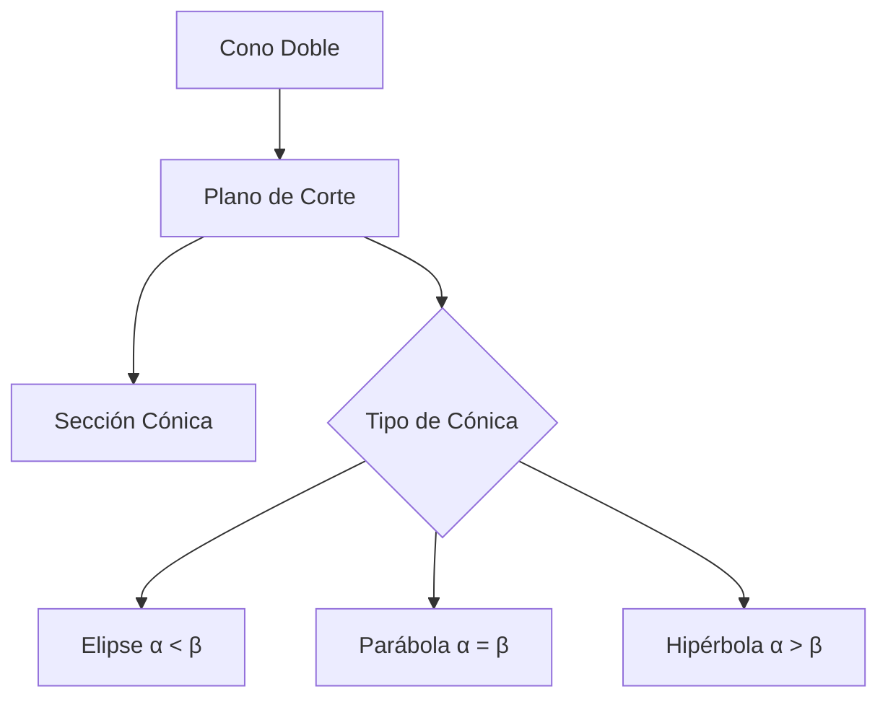
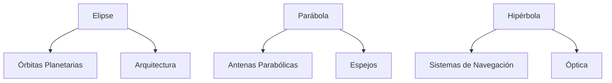

# Matemáticas para Ciencias Aplicadas I - Funciones gráficas

## 1.4 Cónicas: elipse, hipérbola, parábola.

---

### 1. Introducción a las Cónicas

#### 1.1 Definición Geométrica

Las cónicas son curvas obtenidas al intersectar un plano con un cono circular recto de dos hojas.



#### 1.2 Ecuación General de Cónicas

$$ Ax^2 + Bxy + Cy^2 + Dx + Ey + F = 0 $$

El discriminante $B^2 - 4AC$ determina el tipo:

- $B^2 - 4AC < 0$: Elipse (o círculo)
- $B^2 - 4AC = 0$: Parábola
- $B^2 - 4AC > 0$: Hipérbola

### 2. Elipse

#### 2.1 Definición y Ecuación Canónica

Lugar geométrico de puntos cuya suma de distancias a dos focos es constante:

$$ \frac{(x-h)^2}{a^2} + \frac{(y-k)^2}{b^2} = 1 $$

Donde:

- $(h,k)$: Centro
- $a$: Semieje mayor
- $b$: Semieje menor
- $c = \sqrt{a^2 - b^2}$: Distancia focal

#### 2.2 Ejemplo de Código Python

```python
import numpy as np
import matplotlib.pyplot as plt

# Parámetros elipse
h, k = 2, 3      # Centro
a, b = 5, 3      # Semiejes

# Generar puntos
theta = np.linspace(0, 2*np.pi, 100)
x = h + a * np.cos(theta)
y = k + b * np.sin(theta)

# Graficar
plt.figure(figsize=(8, 6))
plt.plot(x, y, 'b-', label='Elipse')
plt.plot(h, k, 'ro', label='Centro')
plt.grid(True)
plt.axis('equal')
plt.legend()
plt.title(f'Elipse: (x-{h})²/{a}² + (y-{k})²/{b}² = 1')
plt.show()
```

### 3. Hipérbola

#### 3.1 Definición y Ecuación Canónica

Lugar geométrico de puntos cuya diferencia de distancias a dos focos es constante:

$$ \frac{(x-h)^2}{a^2} - \frac{(y-k)^2}{b^2} = 1 $$

Donde:

- $(h,k)$: Centro
- $a$: Semieje real
- $b$: Semieje imaginario
- $c = \sqrt{a^2 + b^2}$: Distancia focal
- Asíntotas: $y - k = \pm \frac{b}{a}(x - h)$

#### 3.2 Ejemplo de Código Python

```python
# Parámetros hipérbola horizontal
h, k = 0, 0      # Centro
a, b = 2, 3      # Semiejes

# Rama derecha
x_right = np.linspace(h + a + 0.1, h + 10, 100)
y1_right = k + b * np.sqrt((x_right - h)**2 / a**2 - 1)
y2_right = k - b * np.sqrt((x_right - h)**2 / a**2 - 1)

# Rama izquierda
x_left = np.linspace(h - 10, h - a - 0.1, 100)
y1_left = k + b * np.sqrt((x_left - h)**2 / a**2 - 1)
y2_left = k - b * np.sqrt((x_left - h)**2 / a**2 - 1)

# Asíntotas
x_asint = np.linspace(-10, 10, 100)
y_asint1 = k + (b/a) * (x_asint - h)
y_asint2 = k - (b/a) * (x_asint - h)

plt.figure(figsize=(8, 6))
plt.plot(x_right, y1_right, 'b-')
plt.plot(x_right, y2_right, 'b-')
plt.plot(x_left, y1_left, 'b-')
plt.plot(x_left, y2_left, 'b-')
plt.plot(x_asint, y_asint1, 'r--', alpha=0.5, label='Asíntotas')
plt.plot(x_asint, y_asint2, 'r--', alpha=0.5)
plt.grid(True)
plt.axis('equal')
plt.legend()
plt.title(f'Hipérbola: (x-{h})²/{a}² - (y-{k})²/{b}² = 1')
plt.show()
```

### 4. Parábola

#### 4.1 Definición y Ecuación Canónica

Lugar geométrico de puntos equidistantes de un foco y una directriz:

**Eje vertical:**  

$$ (x-h)^2 = 4p(y-k) $$

**Eje horizontal:**

$$ (y-k)^2 = 4p(x-h) $$

Donde:

- $(h,k)$: Vértice
- $p$: Distancia focal (positiva si abre arriba/derecha)

#### 4.2 Ejemplo de Código Python

```python
# Parábola con eje vertical
h, k = 1, 2      # Vértice
p = 0.5          # Distancia focal

x = np.linspace(h - 3, h + 3, 100)
y = k + (x - h)**2 / (4*p)

# Directriz
y_directriz = k - p

plt.figure(figsize=(8, 6))
plt.plot(x, y, 'b-', label='Parábola')
plt.axhline(y_directriz, color='r', linestyle='--', label='Directriz')
plt.plot(h, k + p, 'go', label='Foco')
plt.plot(h, k, 'ro', label='Vértice')
plt.grid(True)
plt.axis('equal')
plt.legend()
plt.title(f'Parábola: (x-{h})² = {4*p}(y-{k})')
plt.show()
```

### 5. Aplicaciones en Ciencias

#### 5.1 Órbitas Planetarias (Elipses)

**Leyes de Kepler:**

- Primera ley: Los planetas orbitan en elipses con el Sol en un foco

#### 5.2 Espejos y Antenas (Parábolas)

**Propiedad reflectora:**

- Rayos paralelos al eje se reflejan hacia el foco

#### 5.3 Navegación (Hipérbolas)

**Sistemas de localización:**

- LORAN y GPS usan propiedades hiperbólicas

#### 5.4 Diagrama de Aplicaciones



### 6. Ejercicios Prácticos

1. Grafica la elipse $\frac{(x-2)^2}{9} + \frac{(y+1)^2}{4} = 1$
2. Encuentra los focos y asíntotas de la hipérbola $\frac{x^2}{16} - \frac{y^2}{9} = 1$
3. Determina la ecuación de la parábola con vértice en $(1, -2)$ y foco en $(1, 0)$

### Ver también

- **1.3** Ecuación de una recta — caso degenerado de las cónicas.
- **2.4** Tangente a una curva — tangentes a cónicas.
- **Matemáticas CC II 1.1** (Sem. 2) — espacio euclidiano y distancias.

### Referencias

- Stewart, J. (2016). _Cálculo de una variable_ (8.ª ed.). Cengage Learning.
- Simmons, G. F. (2012). _Cálculo con geometría analítica_ (2.ª ed.). McGraw-Hill.
- Thomas, G. B. et al. (2014). _Cálculo_ (13.ª ed.). Pearson.
