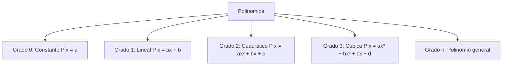
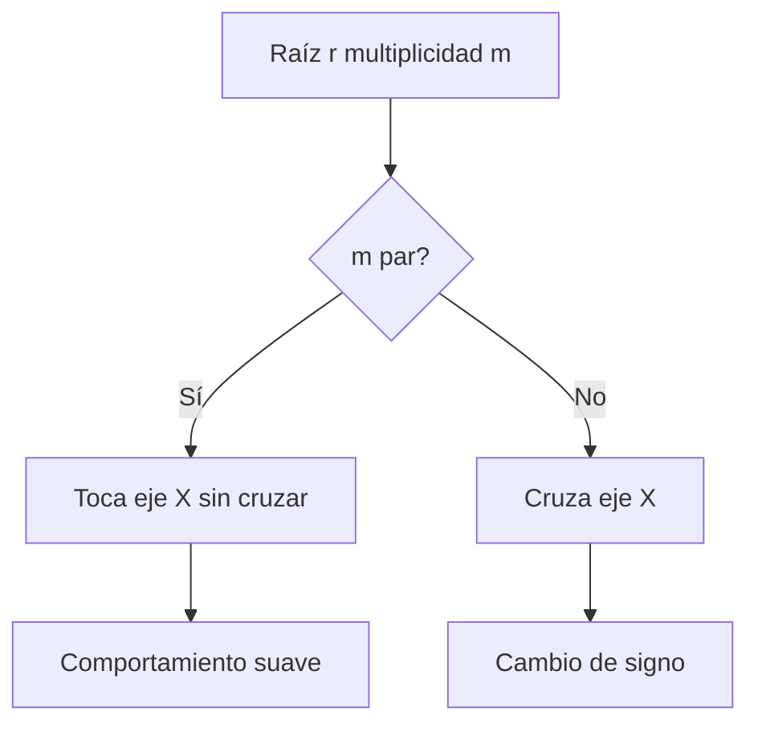

# Matemáticas para Ciencias Aplicadas I - Funciones gráficas

## 1.5 Polinomios y sus gráficas

---

### 1. Definición y Características de Polinomios

#### 1.1 Forma General

Un polinomio de grado $n$ en la variable $x$ tiene la forma:

$$ P(x) = a_nx^n + a_{n-1}x^{n-1} + \cdots + a_1x + a_0 $$

Donde:

- $a_n, a_{n-1}, \ldots, a_0$: Coeficientes (números reales)
- $a_n \neq 0$: Coeficiente principal
- $n$: Grado del polinomio (entero no negativo)

#### 1.2 Clasificación por Grado



### 2. Propiedades Fundamentales

#### 2.1 Comportamiento en los Extremos

Depende del grado y coeficiente principal:

$$ \lim_{x \to \infty} P(x) = \begin{cases} +\infty & \text{si } a_n > 0 \\\ -\infty & \text{si } a_n < 0 \end{cases} \quad \lim_{x \to -\infty} P(x) = \begin{cases} +\infty & \text{si } a_n > 0 \text{ y } n \text{ par} \\\ -\infty & \text{si } a_n > 0 \text{ y } n \text{ impar} \\\ +\infty & \text{si } a_n < 0 \text{ y } n \text{ impar} \\\ -\infty & \text{si } a_n < 0 \text{ y } n \text{ par} \end{cases} $$

#### 2.2 Raíces y Factorización

Si $P(r) = 0$, entonces $r$ es raíz y $(x - r)$ es factor:

$$ P(x) = a_n(x - r_1)(x - r_2)\cdots(x - r_n) $$

### 3. Gráficas de Polinomios por Grado

#### 3.1 Polinomio Constante (Grado 0)

```python
import numpy as np
import matplotlib.pyplot as plt

# Polinomio constante: P(x) = 3
x = np.linspace(-5, 5, 100)
y = np.full_like(x, 3)  # Todos los valores son 3

plt.figure(figsize=(8, 5))
plt.plot(x, y, 'b-', linewidth=2, label='P(x) = 3')
plt.axhline(0, color='black', linewidth=0.5)
plt.axvline(0, color='black', linewidth=0.5)
plt.grid(True, alpha=0.3)
plt.legend()
plt.title('Polinomio Constante')
plt.show()
```

#### 3.2 Polinomio Lineal (Grado 1)

```python
# Polinomio lineal: P(x) = 2x - 1
x = np.linspace(-5, 5, 100)
y = 2*x - 1

plt.figure(figsize=(8, 5))
plt.plot(x, y, 'r-', linewidth=2, label='P(x) = 2x - 1')
plt.axhline(0, color='black', linewidth=0.5)
plt.axvline(0, color='black', linewidth=0.5)
plt.grid(True, alpha=0.3)
plt.legend()
plt.title('Polinomio Lineal')
plt.show()
```

#### 3.3 Polinomio Cuadrático (Grado 2)

```python
# Polinomio cuadrático: P(x) = x² - 4x + 3
x = np.linspace(-2, 6, 100)
y = x**2 - 4*x + 3

plt.figure(figsize=(8, 5))
plt.plot(x, y, 'g-', linewidth=2, label='P(x) = x² - 4x + 3')
plt.axhline(0, color='black', linewidth=0.5)
plt.axvline(0, color='black', linewidth=0.5)
plt.grid(True, alpha=0.3)
plt.legend()
plt.title('Polinomio Cuadrático')
plt.show()
```

#### 3.4 Polinomio Cúbico (Grado 3)

```python
# Polinomio cúbico: P(x) = x³ - 3x² - x + 3
x = np.linspace(-3, 5, 100)
y = x**3 - 3*x**2 - x + 3

plt.figure(figsize=(8, 5))
plt.plot(x, y, 'm-', linewidth=2, label='P(x) = x³ - 3x² - x + 3')
plt.axhline(0, color='black', linewidth=0.5)
plt.axvline(0, color='black', linewidth=0.5)
plt.grid(True, alpha=0.3)
plt.legend()
plt.title('Polinomio Cúbico')
plt.show()
```

### 4. Análisis de Gráficas Polinómicas

#### 4.1 Puntos Críticos

- **Raíces**: Puntos donde $P(x) = 0$ (corta eje X)
- **Máximos y mínimos**: Donde $P'(x) = 0$
- **Puntos de inflexión**: Donde $P''(x) = 0$

#### 4.2 Comportamiento Local

Cerca de una raíz $r$ de multiplicidad $m$:

- Si $m$ es impar: La gráfica cruza el eje X
- Si $m$ es par: La gráfica toca el eje X pero no cruza

#### 4.3 Diagrama de Comportamiento



### 5. Aplicaciones en Ciencias

#### 5.1 Física: Movimiento de Proyectiles

**Trayectoria parabólica:**

$$ y(x) = x\tan\theta - \frac{g}{2v_0^2\cos^2\theta}x^2 $$

#### 5.2 Economía: Funciones de Costo

**Polinomio cúbico típico:**

$$ C(x) = ax^3 + bx^2 + cx + d $$

#### 5.3 Ingeniería: Diseño de Curvas

**Polinomios de interpolación:**

- Splines cúbicos para diseño de superficies

### 6. Ejercicios Prácticos

1. Grafica el polinomio $P(x) = x^3 - 6x^2 + 11x - 6$ y encuentra sus raíces
2. Determina el comportamiento en los extremos de $P(x) = -2x^4 + 3x^2 - 1$
3. Analiza la multiplicidad de raíces en $P(x) = (x-1)^3(x+2)^2$

### Ver también

- **1.1** Funciones — los polinomios son el tipo de función más elemental.
- **1.3** Representación gráfica — gráficas de polinomios.
- **Álgebra Superior II 4.1** (Sem. 2) — polinomios con coeficientes en un campo.

### Referencias

- Stewart, J. (2016). _Cálculo de una variable_ (8.ª ed.). Cengage Learning.
- Simmons, G. F. (2012). _Cálculo con geometría analítica_ (2.ª ed.). McGraw-Hill.
- Thomas, G. B. et al. (2014). _Cálculo_ (13.ª ed.). Pearson.
