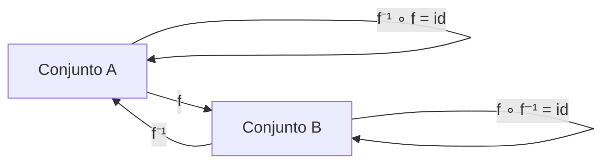
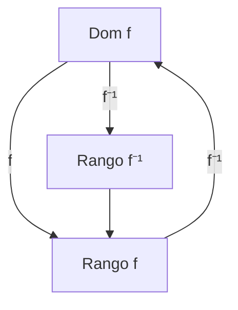

# Matemáticas para Ciencias Aplicadas I - Funciones gráficas

## 1.6 Función inversa. Gráfica de una función y su inversa.

---

### 1. Concepto de Función Inversa

#### 1.1 Definición Formal

Dada una función $f: A \rightarrow B$ biyectiva, existe una función inversa $f^{-1}: B \rightarrow A$ tal que:

$$ f^{-1}(f(x)) = x \quad \forall x \in A $$

$$ f(f^{-1}(y)) = y \quad \forall y \in B $$

#### 1.2 Condición de Existencia

Una función tiene inversa si y solo si es **biyectiva**:

- **Inyectiva**: $f(x_1) = f(x_2) \Rightarrow x_1 = x_2$
- **Sobreyectiva**: $\forall y \in B, \exists x \in A \text{ tal que } f(x) = y$

#### 1.3 Diagrama de Relación



### 2. Método para Encontrar la Inversa

#### 2.1 Procedimiento Algebraico

1. Escribir $y = f(x)$
2. Intercambiar $x$ e $y$
3. Despejar $y$
4. Escribir $f^{-1}(x)$

#### 2.2 Ejemplo: Función Lineal

Dada $f(x) = 2x + 3$:

$$ y = 2x + 3 $$ $$ x = 2y + 3 $$ $$ x - 3 = 2y $$ $$ y = \frac{x - 3}{2} $$ $$ f^{-1}(x) = \frac{x - 3}{2} $$

#### 2.3 Ejemplo: Función Cuadrática (restringida)

Dada $f(x) = x^2$ para $x \geq 0$:

$$ y = x^2 $$ $$ x = y^2 $$ $$ y = \sqrt{x} $$ $$ f^{-1}(x) = \sqrt{x} $$

### 3. Gráficas de Funciones y sus Inversas

#### 3.1 Propiedad de Simetría

Las gráficas de $f$ y $f^{-1}$ son simétricas respecto a la recta $y = x$.

#### 3.2 Código Python para Visualización

```python
import numpy as np
import matplotlib.pyplot as plt

# Función original y su inversa
def f(x):
    return 2*x + 3

def f_inv(x):
    return (x - 3)/2

# Generar datos
x = np.linspace(-5, 5, 100)
y_f = f(x)
y_inv = f_inv(x)

# Graficar
plt.figure(figsize=(8, 8))
plt.plot(x, y_f, 'b-', label='f(x) = 2x + 3', linewidth=2)
plt.plot(x, y_inv, 'r-', label='f⁻¹(x) = (x-3)/2', linewidth=2)
plt.plot(x, x, 'g--', label='y = x', linewidth=1, alpha=0.7)

# Configuración del gráfico
plt.axhline(0, color='black', linewidth=0.5)
plt.axvline(0, color='black', linewidth=0.5)
plt.grid(True, alpha=0.3)
plt.axis('equal')
plt.legend()
plt.title('Función y su Inversa')
plt.xlabel('x')
plt.ylabel('y')
plt.show()
```

### 4. Propiedades de las Funciones Inversas

#### 4.1 Propiedades Algebraicas

- $(f^{-1})^{-1} = f$
- $(f \circ g)^{-1} = g^{-1} \circ f^{-1}$
- $(f^{-1})'(y) = \frac{1}{f'(x)}$ donde $y = f(x)$

#### 4.2 Dominio y Rango

$$ \text{Dominio}(f^{-1}) = \text{Rango}(f) $$ $$ \text{Rango}(f^{-1}) = \text{Dominio}(f) $$

#### 4.3 Diagrama de Dominios y Rangos



### 5. Funciones Trigonométricas Inversas

#### 5.1 Restricción de Dominios

Para que sean funciones, se restringen los dominios:

- $\arcsin(x): [-1, 1] \rightarrow [-\frac{\pi}{2}, \frac{\pi}{2}]$
- $\arccos(x): [-1, 1] \rightarrow [0, \pi]$
- $\arctan(x): \mathbb{R} \rightarrow (-\frac{\pi}{2}, \frac{\pi}{2})$

#### 5.2 Ejemplo: Arcoseno

```python
# Función seno y arcoseno
x_sin = np.linspace(-np.pi/2, np.pi/2, 100)
y_sin = np.sin(x_sin)

x_arcsin = np.linspace(-1, 1, 100)
y_arcsin = np.arcsin(x_arcsin)

plt.figure(figsize=(10, 5))

# Seno y arcoseno
plt.subplot(1, 2, 1)
plt.plot(x_sin, y_sin, 'b-', label='sin(x)')
plt.plot(y_arcsin, x_arcsin, 'r-', label='arcsin(x)')
plt.plot(x_sin, x_sin, 'g--', alpha=0.5)
plt.legend()
plt.title('Seno y Arcoseno')

# Misma gráfica con ejes intercambiados
plt.subplot(1, 2, 2)
plt.plot(y_sin, x_sin, 'r-', label='arcsin(x)')
plt.plot(x_sin, y_sin, 'b-', label='sin(x)')
plt.plot(x_sin, x_sin, 'g--', alpha=0.5)
plt.legend()
plt.title('Ejes Intercambiados')

plt.tight_layout()
plt.show()
```

### 6. Aplicaciones en Ciencias

#### 6.1 Conversión de Unidades

- Celsius a Fahrenheit: $F = \frac{9}{5}C + 32$
- Fahrenheit a Celsius: $C = \frac{5}{9}(F - 32)$

#### 6.2 Criptografía

- Funciones inversas en algoritmos de encriptación/desencriptación

#### 6.3 Física e Ingeniería

- Relaciones inversas en leyes físicas (ej: resistencia vs conductividad)

### 7. Ejercicios Prácticos

1. Encuentra la inversa de $f(x) = \frac{2x + 1}{x - 3}$
2. Grafica $f(x) = e^x$ y $f^{-1}(x) = \ln(x)$ mostrando la simetría
3. Verifica que $\arcsin(\sin(\frac{\pi}{3})) = \frac{\pi}{3}$ pero $\arcsin(\sin(\frac{2\pi}{3})) \neq \frac{2\pi}{3}$

### Ver también

- **1.1** Funciones — concepto de función inversa.
- **Álgebra Superior I 2.3** — composición e inversa de funciones.
- **4.2** Regla de la cadena — derivada de la función inversa.

### Referencias

- Stewart, J. (2016). _Cálculo de una variable_ (8.ª ed.). Cengage Learning.
- Simmons, G. F. (2012). _Cálculo con geometría analítica_ (2.ª ed.). McGraw-Hill.
- Thomas, G. B. et al. (2014). _Cálculo_ (13.ª ed.). Pearson.
