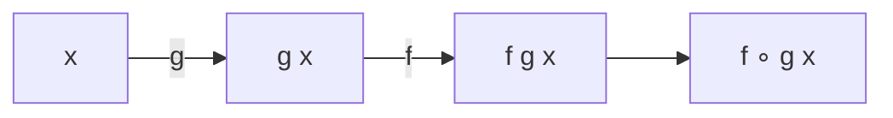
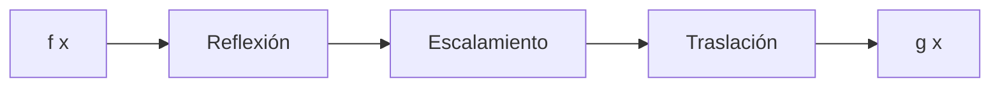

# Matemáticas para Ciencias Aplicadas I - Funciones gráficas

## 1.7 Composición de funciones. Transformación de gráficas de funciones.

---

### 1. Composición de Funciones

#### 1.1 Definición Formal

Dadas dos funciones $f$ y $g$, la composición $f \circ g$ se define como:

$$ (f \circ g)(x) = f(g(x)) $$

El dominio de $f \circ g$ son los $x$ en el dominio de $g$ tales que $g(x)$ está en el dominio de $f$.

#### 1.2 Diagrama de Composición



#### 1.3 Ejemplo Algebraico

Sean $f(x) = x^2 + 1$ y $g(x) = 2x - 3$:

$$ (f \circ g)(x) = f(g(x)) = f(2x - 3) = (2x - 3)^2 + 1 = 4x^2 - 12x + 10 $$

$$ (g \circ f)(x) = g(f(x)) = g(x^2 + 1) = 2(x^2 + 1) - 3 = 2x^2 - 1 $$

### 2. Transformaciones de Gráficas

#### 2.1 Traslaciones

- **Vertical**: $y = f(x) + k$
  - $k > 0$: desplaza arriba
  - $k < 0$: desplaza abajo

- **Horizontal**: $y = f(x - h)$
  - $h > 0$: desplaza derecha
  - $h < 0$: desplaza izquierda

#### 2.2 Escalamientos y Reflexiones

- **Escalamiento vertical**: $y = a f(x)$
  - $|a| > 1$: estiramiento vertical
  - $0 < |a| < 1$: compresión vertical
  - $a < 0$: reflexión sobre eje X

- **Escalamiento horizontal**: $y = f(b x)$
  - $|b| > 1$: compresión horizontal
  - $0 < |b| < 1$: estiramiento horizontal
  - $b < 0$: reflexión sobre eje Y

### 3. Visualización de Transformaciones

#### 3.1 Código Python para Transformaciones

```python
import numpy as np
import matplotlib.pyplot as plt

# Función base
def f(x):
    return np.sin(x)

x = np.linspace(-2*np.pi, 2*np.pi, 400)
y_base = f(x)

# Transformaciones
y_vertical = f(x) + 1           # Traslación vertical
y_horizontal = f(x - np.pi/2)   # Traslación horizontal
y_scale = 2 * f(x)              # Escalamiento vertical
y_reflect = -f(x)               # Reflexión vertical

plt.figure(figsize=(12, 8))

plt.subplot(2, 2, 1)
plt.plot(x, y_base, 'k-', label='f(x) = sin(x)')
plt.plot(x, y_vertical, 'r-', label='f(x) + 1')
plt.legend()
plt.title('Traslación Vertical')

plt.subplot(2, 2, 2)
plt.plot(x, y_base, 'k-', label='f(x) = sin(x)')
plt.plot(x, y_horizontal, 'b-', label='f(x - π/2)')
plt.legend()
plt.title('Traslación Horizontal')

plt.subplot(2, 2, 3)
plt.plot(x, y_base, 'k-', label='f(x) = sin(x)')
plt.plot(x, y_scale, 'g-', label='2f(x)')
plt.legend()
plt.title('Escalamiento Vertical')

plt.subplot(2, 2, 4)
plt.plot(x, y_base, 'k-', label='f(x) = sin(x)')
plt.plot(x, y_reflect, 'm-', label='-f(x)')
plt.legend()
plt.title('Reflexión Vertical')

plt.tight_layout()
plt.show()
```

### 4. Combinación de Transformaciones

#### 4.1 Orden de Transformaciones

El orden afecta el resultado final:

1. Reflexiones
2. Escalamientos
3. Traslaciones

#### 4.2 Ejemplo Complejo

Transformación de $f(x) = \sqrt{x}$ a $g(x) = -2\sqrt{x - 3} + 1$:

1. Traslación horizontal: $\sqrt{x - 3}$
2. Escalamiento vertical: $2\sqrt{x - 3}$
3. Reflexión vertical: $-2\sqrt{x - 3}$
4. Traslación vertical: $-2\sqrt{x - 3} + 1$

#### 4.3 Diagrama de Transformaciones Múltiples



### 5. Composición vs Transformación

#### 5.1 Relación entre Conceptos

Las transformaciones pueden expresarse como composiciones:

- $f(x) + k = (f + g)(x)$ donde $g(x) = k$
- $f(x - h) = (f \circ T)(x)$ donde $T(x) = x - h$

#### 5.2 Ejemplo de Composición como Transformación

```python
# Composición como transformación
def T(x):
    return x - 1  # Traslación horizontal

def f(x):
    return x**2   # Función base

x = np.linspace(-3, 3, 100)
y_direct = (x - 1)**2        # Transformación directa
y_compose = f(T(x))          # Composición f(T(x))

plt.figure(figsize=(8, 5))
plt.plot(x, y_direct, 'r-', label='(x-1)²')
plt.plot(x, y_compose, 'b--', label='f(T(x))')
plt.legend()
plt.title('Equivalencia: Transformación vs Composición')
plt.grid(True)
plt.show()
```

### 6. Aplicaciones en Ciencias

#### 6.1 Procesamiento de Señales

- Transformaciones de funciones para análisis de Fourier
- Composiciones para filtrado de señales

#### 6.2 Gráficos por Computadora

- Transformaciones geométricas en animaciones
- Composiciones de transformaciones 3D

#### 6.3 Física e Ingeniería

- Cambios de sistema de coordenadas
- Transformación de unidades y escalas

### 7. Ejercicios Prácticos

1. Dadas $f(x) = \sqrt{x}$ y $g(x) = x^2 + 1$, encuentra $(f \circ g)(x)$ y $(g \circ f)(x)$
2. Describe las transformaciones para convertir $y = x^2$ en $y = -2(x + 3)^2 - 1$
3. Grafica la secuencia de transformaciones para $f(x) = \cos(x)$ hasta obtener $g(x) = 3\cos(2x - \pi) + 1$

### Ver también

- **1.16** Función inversa — caso especial de composición.
- **Álgebra Superior I 2.3** — composición de funciones abstractas.
- **2.6** Propiedades de la derivada — regla de la cadena como derivada de composición.

### Referencias

- Stewart, J. (2016). _Cálculo de una variable_ (8.ª ed.). Cengage Learning.
- Simmons, G. F. (2012). _Cálculo con geometría analítica_ (2.ª ed.). McGraw-Hill.
- Thomas, G. B. et al. (2014). _Cálculo_ (13.ª ed.). Pearson.
