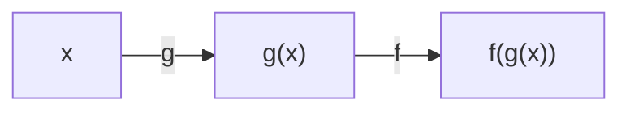

# Matemáticas para Ciencias Aplicadas I - Funciones gráficas

## 1.7 Composición de funciones. Transformación de gráficas de funciones.

---

Las funciones complicadas suelen construirse encadenando funciones sencillas: $\sqrt{1 + x^2}$ es "elevar al cuadrado, sumar uno y sacar raíz". Esta operación de encadenar se llama **composición**, y saber descomponer una función en piezas simples es indispensable para derivarla, con la regla de la cadena del subtema 4.2. Un caso particular muy útil es componer una función con operaciones lineales: así se obtienen traslaciones, cambios de escala y reflexiones de su gráfica, lo que permite dibujar sin esfuerzo toda una familia de funciones a partir de una sola.

### 1. Composición

Dadas dos funciones $f$ y $g$, la **composición** $f \circ g$, que se lee *$f$ compuesta con $g$* o *$f$ después de $g$*, es

$$
(f \circ g)(x) = f(g(x)).
$$

Primero se aplica $g$ y al resultado se le aplica $f$. El dominio de $f \circ g$ son los $x$ del dominio de $g$ tales que $g(x)$ está en el dominio de $f$.



**Ejemplo.** Sean $f(x) = \sqrt{x}$ y $g(x) = 4 - x^2$.

- $(f \circ g)(x) = \sqrt{4 - x^2}$, con dominio $[-2, 2]$, porque se necesita $4 - x^2 \geq 0$. Su gráfica es la semicircunferencia superior de radio 2.
- $(g \circ f)(x) = 4 - (\sqrt{x})^2 = 4 - x$, pero con dominio $[0, \infty)$, heredado de $f$, aunque la fórmula simplificada no lo muestre.

**Propiedades.**

- La composición **no es conmutativa**: en general $f \circ g \neq g \circ f$. Con $f(x) = x^2$ y $g(x) = x + 1$: $(f \circ g)(x) = (x + 1)^2$ y $(g \circ f)(x) = x^2 + 1$.
- Es **asociativa**: $(f \circ g) \circ h = f \circ (g \circ h)$, así que se puede escribir $f \circ g \circ h$ sin paréntesis.
- La función identidad $\operatorname{id}(x) = x$ es neutra: $f \circ \operatorname{id} = \operatorname{id} \circ f = f$.
- Si $f$ es inyectiva, $f^{-1} \circ f = \operatorname{id}$ en el dominio de $f$ (subtema 1.6).
- La composición de funciones crecientes es creciente, y la de una creciente con una decreciente es decreciente.

### 2. Descomponer una función

Para derivar o analizar una función conviene reconocerla como composición de funciones conocidas:

| Función                      | Descomposición $f(g(x))$                                    |
| ---------------------------- | ----------------------------------------------------------- |
| $(3x^2 + 1)^5$               | $g(x) = 3x^2 + 1$, $f(u) = u^5$                             |
| $e^{-x^2}$                   | $g(x) = -x^2$, $f(u) = e^u$                                 |
| $\sin(\omega t + \varphi)$   | $g(t) = \omega t + \varphi$, $f(u) = \sin u$                |
| $\ln(\cos x)$                | $g(x) = \cos x$, $f(u) = \ln u$                             |
| $\sqrt{1 + \sin^2 x}$        | $h(x) = \sin x$, $g(u) = 1 + u^2$, $f(v) = \sqrt{v}$        |

La variable intermedia $u = g(x)$ suele tener un significado físico. En $T(t) = 20 + 5 \sin\!\big(\frac{2\pi}{24}(t - 9)\big)$, que modela la temperatura a lo largo del día, $u$ es la fase del ciclo diario.

### 3. Traslaciones

Sea $c > 0$.

| Nueva función    | Efecto en la gráfica de $f$             |
| ---------------- | --------------------------------------- |
| $f(x) + c$       | se desplaza $c$ unidades hacia arriba   |
| $f(x) - c$       | se desplaza $c$ unidades hacia abajo    |
| $f(x - c)$       | se desplaza $c$ unidades a la **derecha** |
| $f(x + c)$       | se desplaza $c$ unidades a la **izquierda** |

El sentido de los desplazamientos horizontales suele confundir: $f(x - 3)$ toma en $x$ el valor que $f$ tomaba en $x - 3$, es decir, **3 unidades antes**; lo que ocurría en $x = 0$ ahora ocurre en $x = 3$. Por ejemplo, el vértice de $y = (x - 3)^2$ está en $x = 3$.

### 4. Cambios de escala y reflexiones

Sea $a > 1$.

| Nueva función    | Efecto en la gráfica de $f$                               |
| ---------------- | --------------------------------------------------------- |
| $a f(x)$         | se estira verticalmente por un factor $a$                 |
| $\frac{1}{a} f(x)$ | se comprime verticalmente por un factor $a$             |
| $f(ax)$          | se **comprime** horizontalmente por un factor $a$         |
| $f(\frac{x}{a})$ | se **estira** horizontalmente por un factor $a$           |
| $-f(x)$          | se refleja respecto al eje $x$                            |
| $f(-x)$          | se refleja respecto al eje $y$                            |

Por ejemplo, $\sin(2x)$ oscila el doble de rápido que $\sin x$: su periodo es $\pi$ en lugar de $2\pi$.

**Valor absoluto.** $|f(x)|$ refleja hacia arriba las partes de la gráfica que están debajo del eje $x$. En cambio, $f(|x|)$ descarta la parte con $x < 0$ y la reemplaza por el reflejo de la parte con $x > 0$.

### 5. Combinar transformaciones

Una función de la forma

$$
y = A \, f\big(B(x - h)\big) + k, \qquad A, B \neq 0,
$$

se obtiene de $f$ aplicando, **en este orden**:

1. un cambio de escala horizontal por el factor $\frac{1}{|B|}$, reflejando respecto al eje $y$ si $B < 0$.
2. una traslación horizontal de $h$ unidades;
3. un cambio de escala vertical por el factor $|A|$, reflejando respecto al eje $x$ si $A < 0$.
4. una traslación vertical de $k$ unidades.

El orden importa. $f(2x - 6) = f(2(x - 3))$ es $f$ comprimida a la mitad y luego trasladada 3 unidades a la derecha, no 6: conviene siempre factorizar el coeficiente de $x$ antes de leer la traslación.

**Ejemplo: oscilaciones.** Toda función sinusoidal se escribe como

$$
y(t) = A \sin\!\big(\omega (t - t_0)\big) + C,
$$

donde $|A|$ es la **amplitud**, $C$ el **valor medio**, $T = \frac{2\pi}{\omega}$ el **periodo** y $t_0$ el **desfase**. En el modelo de temperatura de la sección 2, la temperatura oscila entre $15$ y $25\,^\circ\text{C}$ alrededor de un valor medio de $20\,^\circ\text{C}$, con periodo de 24 horas, y alcanza su máximo cuando el argumento vale $\frac{\pi}{2}$, es decir, en $t = 9 + 6 = 15$: a las tres de la tarde.

**Ejemplo: completar el cuadrado.** $y = 2x^2 - 12x + 13 = 2(x - 3)^2 - 5$ es la parábola $y = x^2$ estirada verticalmente por 2, trasladada 3 unidades a la derecha y 5 hacia abajo. Su vértice es $(3, -5)$.

### 6. Cambio de unidades como composición

Cambiar las unidades de la variable independiente es componer con una función lineal. Si $v(t)$ es la velocidad en m/s con $t$ en segundos, la misma velocidad con $\tau$ en minutos es $v(60\tau)$: un cambio de escala horizontal. Si además se quiere en km/h, se multiplica por $3.6$: un cambio de escala vertical. Las gráficas son la misma curva dibujada en ejes con otras unidades.

### 7. Verificación con la computadora

```python
import numpy as np

def compone(*fs):
    """compone(f, g, h)(x) = f(g(h(x)))"""
    def resultado(x):
        for f in reversed(fs):
            x = f(x)
        return x
    return resultado

f = np.sqrt
g = lambda x: 4 - x**2
x = np.array([-2.0, -1.0, 0.0, 1.0, 2.0])
print("f∘g:", np.round(compone(f, g)(x), 4))

# A f(B(x - h)) + k aplicado a f = sin: comparar con la fórmula expandida
A, B, h, k = 5, 2 * np.pi / 24, 9, 20
T = lambda t: A * np.sin(B * (t - h)) + k
t = np.arange(0, 24, 4)
print("T(t):", np.round(T(t), 2))
print("máximo en t =", t[np.argmax(T(t))])
```

```text
f∘g: [0.     1.7321 2.     1.7321 0.    ]
T(t): [16.46 15.17 18.71 23.54 24.83 21.29]
máximo en t = 16
```

El muestreo cada 4 horas no incluye las 15 h, donde está el máximo exacto: el valor más alto de la tabla, 24.83 a las 16 h, es solo el mayor de los puntos muestreados. Esto ilustra un riesgo real al estudiar funciones solo mediante tablas de valores. Con `t = np.arange(0, 24, 1)` se obtiene el máximo de 25 en $t = 15$.

> **Conexión con CC.** La composición es la operación fundamental de la **programación funcional**: los programas se construyen componiendo funciones pequeñas, y lenguajes como Haskell tienen un operador para ello. Las **tuberías** de Unix, `cmd1 | cmd2`, y las cadenas de operaciones sobre flujos de Java, como `filter` seguido de `map`, son composiciones. En graficación por computadora, mover, escalar y rotar una figura son transformaciones que se componen multiplicando matrices.

### Ejercicios propuestos

1. Con $f(x) = \frac{1}{x}$ y $g(x) = x^2 - 1$, calcule $f \circ g$, $g \circ f$ y $f \circ f$ con sus dominios.
2. Descomponga como composición de funciones más simples:
   - $\cos^3(2x + 1)$
   - $\frac{1}{\sqrt{x^2 + 9}}$
   - $10^{\sin x}$
3. A partir de la gráfica de $y = \sqrt{x}$, esboce sin calcular puntos las gráficas de $y = \sqrt{x - 2} + 1$, $y = -2\sqrt{x}$, $y = \sqrt{-x}$ y $y = \sqrt{3 - x}$.
4. Describa las transformaciones que llevan $y = x^2$ a $y = -3x^2 - 6x + 2$ y encuentre el vértice.
5. La marea en un puerto alcanza su máximo de 4.2 m a las 2:00 y su mínimo de 0.6 m a las 8:12. Modele la altura como función sinusoidal del tiempo y prediga la altura a las 12:00.
6. Explique por qué la gráfica de $y = |x^2 - 4|$ tiene un "pico" en $x = \pm 2$, y esboce las gráficas de $y = |\sin x|$ y $y = \sin|x|$.
7. Si $f$ y $g$ son impares, ¿qué se puede decir de $f \circ g$? ¿Y si $f$ es par y $g$ impar?

### Ver también

- **1.3** Representación gráfica de funciones — simetrías par e impar.
- **1.5** Polinomios y sus gráficas — completar el cuadrado.
- **1.6** Función inversa — $f^{-1} \circ f$ como identidad.
- **4.2** Regla de la cadena — la derivada de una composición.
- **4.6** Funciones trigonométricas — amplitud, periodo y fase.
- **Álgebra Superior I 2.3** — composición de funciones.

### Referencias

- Stewart, J. (2016). _Cálculo de una variable: trascendentes tempranas_ (8.ª ed.). Cengage Learning. Sección 1.3.
- Stewart, J., Redlin, L., & Watson, S. (2012). _Precálculo_ (6.ª ed.). Cengage Learning. Secciones 2.6 y 2.7.
- Bird, R. (1998). _Introduction to Functional Programming using Haskell_ (2.ª ed.). Prentice Hall. Cap. 1.
