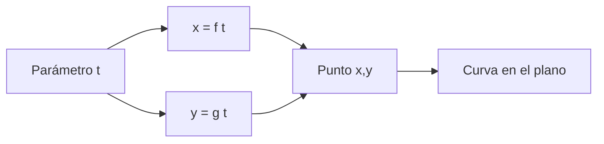
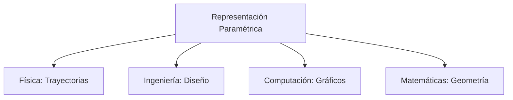

# Matemáticas para Ciencias Aplicadas I - Funciones gráficas

## 1.8 Curvas y su representación paramétrica.

---

### 1. Concepto de Representación Paramétrica

#### 1.1 Definición Formal

Una curva en el plano puede representarse mediante ecuaciones paramétricas:

$$ x = f(t), y = g(t) $$

Donde $t$ es el parámetro que varía en un intervalo $[a, b]$.

#### 1.2 Ventajas de la Representación Paramétrica

- Describe curvas que no son funciones (círculos, elipses)
- Captura la dirección y orientación de la curva
- Útil para describir movimiento y trayectorias

#### 1.3 Diagrama de Representación



### 2. Ecuaciones Paramétricas de Curvas Comunes

#### 2.1 Círculo

Para un círculo de radio $r$ centrado en $(h, k)$:

$$ x = h + r \cos(t), y = k + r \sin(t), t \in [0, 2\pi] $$

#### 2.2 Elipse

Para una elipse con centro $(h, k)$ y semiejes $a$, $b$:

$$ x = h + a \cos(t), y = k + b \sin(t), t \in [0, 2\pi] $$

#### 2.3 Línea Recta

Para una línea que pasa por $(x_0, y_0)$ con dirección $(a, b)$:

$$ x = x_0 + a t, y = y_0 + b t, t \in \mathbb{R} $$

### 3. Visualización de Curvas Paramétricas

#### 3.1 Código Python para Círculo Paramétrico

```python
import numpy as np
import matplotlib.pyplot as plt

# Parámetros del círculo
h, k = 2, 3  # Centro
r = 4        # Radio

# Generar parámetro t
t = np.linspace(0, 2*np.pi, 100)

# Ecuaciones paramétricas
x = h + r * np.cos(t)
y = k + r * np.sin(t)

# Graficar
plt.figure(figsize=(8, 8))
plt.plot(x, y, 'b-', linewidth=2, label=f'Círculo: (x-{h})² + (y-{k})² = {r}²')
plt.plot(h, k, 'ro', markersize=8, label='Centro')
plt.axhline(0, color='black', linewidth=0.5)
plt.axvline(0, color='black', linewidth=0.5)
plt.grid(True, alpha=0.3)
plt.axis('equal')
plt.legend()
plt.title('Curva Paramétrica: Círculo')
plt.xlabel('x')
plt.ylabel('y')
plt.show()
```

#### 3.2 Código para Elipse Paramétrica

```python
# Parámetros de la elipse
h, k = 1, 2  # Centro
a, b = 5, 3  # Semiejes

t = np.linspace(0, 2*np.pi, 100)
x = h + a * np.cos(t)
y = k + b * np.sin(t)

plt.figure(figsize=(8, 8))
plt.plot(x, y, 'g-', linewidth=2, label=f'Elipse: (x-{h})²/{a}² + (y-{k})²/{b}² = 1')
plt.plot(h, k, 'ro', markersize=8, label='Centro')
plt.axhline(0, color='black', linewidth=0.5)
plt.axvline(0, color='black', linewidth=0.5)
plt.grid(True, alpha=0.3)
plt.axis('equal')
plt.legend()
plt.title('Curva Paramétrica: Elipse')
plt.show()
```

### 4. Movimiento y Trayectorias

#### 4.1 Trayectoria Parabólica (Proyectil)

Ecuaciones paramétricas del movimiento:

$$ x = v_0 \cos(\theta) t, y = v_0 \sin(\theta) t - \frac{1}{2} g t^2 $$

#### 4.2 Cicloide

Curva trazada por un punto en un círculo que rueda:

$$ x = r(t - \sin(t)), y = r(1 - \cos(t)) $$

#### 4.3 Visualización de Trayectoria

```python
# Trayectoria de proyectil
v0 = 20       # Velocidad inicial
theta = 45    # Ángulo en grados
g = 9.8       # Gravedad

# Convertir ángulo a radianes
theta_rad = np.radians(theta)

# Parámetro t (tiempo)
t = np.linspace(0, 2*v0*np.sin(theta_rad)/g, 100)

# Ecuaciones paramétricas
x = v0 * np.cos(theta_rad) * t
y = v0 * np.sin(theta_rad) * t - 0.5 * g * t**2

plt.figure(figsize=(10, 6))
plt.plot(x, y, 'r-', linewidth=2, label='Trayectoria parabólica')
plt.xlabel('Distancia (m)')
plt.ylabel('Altura (m)')
plt.title('Movimiento de Proyectil')
plt.grid(True)
plt.legend()
plt.show()
```

### 5. Conversión entre Formas

#### 5.1 De Paramétrica a Cartesiana

Eliminar el parámetro $t$ para obtener relación entre $x$ e $y$.

**Ejemplo**: Para $x = 2\cos(t)$, $y = 3\sin(t)$:

$$ \cos(t) = \frac{x}{2}, \quad \sin(t) = \frac{y}{3} $$

$$ \left(\frac{x}{2}\right)^2 + \left(\frac{y}{3}\right)^2 = 1 $$

$$ \frac{x^2}{4} + \frac{y^2}{9} = 1 $$

#### 5.2 De Cartesiana a Paramétrica

Introducir un parámetro $t$ que relacione $x$ e $y$.

**Ejemplo**: Para $y = x^2$:

$$ x = t, y = t^2 $$

### 6. Aplicaciones en Ciencias e Ingeniería

#### 6.1 Física y Astronomía

- Trayectorias de planetas y cometas
- Movimiento de proyectiles y partículas

#### 6.2 Ingeniería y Diseño

- Diseño de curvas en carreteras y pistas
- Trayectorias de robots y brazos mecánicos

#### 6.3 Gráficos por Computadora

- Animación y representación de movimientos
- Diseño de superficies y formas complejas

#### 6.4 Diagrama de Aplicaciones



### 7. Ejercicios Prácticos

1. Encuentra las ecuaciones paramétricas de la hipérbola $\frac{x^2}{9} - \frac{y^2}{4} = 1$
2. Grafica la curva paramétrica $x = 2\cos(t)$, $y = 3\sin(2t)$ para $t \in [0, 2\pi]$
3. Convierte a forma cartesiana: $x = 1 + 2t$, $y = 3 - t$

### Ver también

- **1.2** Coordenadas — la parametrización genera curvas en el plano.
- **4.3** Curvas parametrizadas y derivadas — derivación de curvas paramétricas.
- **Matemáticas CC III 3.1** (Sem. 3) — curvas y orientación en el cálculo multivariable.

### Referencias

- Stewart, J. (2016). _Cálculo de una variable_ (8.ª ed.). Cengage Learning.
- Simmons, G. F. (2012). _Cálculo con geometría analítica_ (2.ª ed.). McGraw-Hill.
- Thomas, G. B. et al. (2014). _Cálculo_ (13.ª ed.). Pearson.
