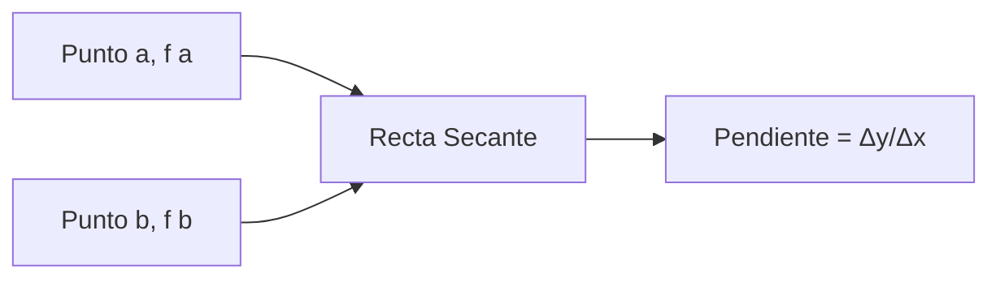

# Matemáticas para Ciencias Aplicadas I - Derivada de funciones reales de una variable real

## 2.1 Razón de cambio promedio

---

### 1. Concepto de Razón de Cambio Promedio

#### 1.1 Definición Formal

La razón de cambio promedio de una función $f(x)$ en el intervalo $[a, b]$ es:

$$ \text{Razón de cambio promedio} = \frac{f(b) - f(a)}{b - a} = \frac{\Delta y}{\Delta x} $$

#### 1.2 Interpretación Geométrica

Representa la **pendiente de la recta secante** que pasa por los puntos $(a, f(a))$ y $(b, f(b))$.

#### 1.3 Diagrama de Recta Secante



### 2. Fórmula y Notación

#### 2.1 Expresión General

Para una función $f(x)$ y un incremento $h$:

$$ \text{Razón de cambio promedio} = \frac{f(x + h) - f(x)}{h} $$

#### 2.2 Notación de Diferencia

Usando la notación de incrementos:

$$ \Delta x = h $$

$$ \Delta y = f(x + h) - f(x) $$

$$ \text{Razón de cambio} = \frac{\Delta y}{\Delta x} $$

### 3. Aplicaciones Prácticas

#### 3.1 Velocidad Promedio

En física, la velocidad promedio es una razón de cambio:

$$ v_{\text{prom}} = \frac{\Delta x}{\Delta t} = \frac{x(t_2) - x(t_1)}{t_2 - t_1} $$

#### 3.2 Tasa de Crecimiento

En biología o economía, la tasa de crecimiento promedio:

$$ \text{Tasa de crecimiento} = \frac{P(t_2) - P(t_1)}{t_2 - t_1} $$

#### 3.3 Ejemplo Numérico

Para $f(x) = x^2$ en el intervalo $[1, 3]$:

$$ \Delta x = 3 - 1 = 2 $$ $$ \Delta y = f(3) - f(1) = 9 - 1 = 8 $$ $$ \text{Razón de cambio} = \frac{8}{2} = 4 $$

### 4. Implementación Computacional

#### 4.1 Código Python para Cálculo

```python
def razon_cambio_promedio(f, a, b):
    """
    Calcula la razón de cambio promedio de f en [a, b]
    """
    delta_x = b - a
    delta_y = f(b) - f(a)
    return delta_y / delta_x

# Ejemplo con función cuadrática
def f(x):
    return x**2

# Calcular en diferentes intervalos
intervalos = [(1, 3), (2, 4), (0, 5)]
for a, b in intervalos:
    rc = razon_cambio_promedio(f, a, b)
    print(f"Intervalo [{a}, {b}]: Razón de cambio = {rc:.2f}")
```

#### 4.2 Visualización Gráfica

```python
import numpy as np
import matplotlib.pyplot as plt

def plot_razon_cambio(f, a, b):
    x = np.linspace(a-1, b+1, 100)
    y = f(x)

    # Puntos del intervalo
    x_pts = np.array([a, b])
    y_pts = f(x_pts)

    # Ecuación recta secante
    pendiente = (y_pts[1] - y_pts[0]) / (x_pts[1] - x_pts[0])
    recta_secante = pendiente * (x - a) + f(a)

    plt.figure(figsize=(10, 6))
    plt.plot(x, y, 'b-', label='f(x) = x²')
    plt.plot(x, recta_secante, 'r--', label=f'Recta secante (pendiente = {pendiente:.2f})')
    plt.plot(x_pts, y_pts, 'ro', markersize=8)
    plt.xlabel('x')
    plt.ylabel('f(x)')
    plt.title(f'Razón de cambio promedio en [{a}, {b}]')
    plt.legend()
    plt.grid(True)
    plt.show()

# Visualizar para [1, 3]

plot_razon_cambio(lambda x: x**2, 1, 3)
```

### 5. Relación con la Derivada

#### 5.1 Límite y Razón Instantánea

La derivada es el límite de la razón de cambio promedio cuando $h \to 0$:

$$ f'(x) = \lim_{h \to 0} \frac{f(x + h) - f(x)}{h} $$

#### 5.2 Interpretación como Aproximación

Para $h$ pequeño:

$$ f'(x) \approx \frac{f(x + h) - f(x)}{h} $$

#### 5.3 Diagrama de Convergencia


### 6. Ejercicios y Problemas

#### 6.1 Ejercicios de Cálculo

1. Calcula la razón de cambio promedio de $f(x) = 3x^2 - 2x + 1$ en $[0, 2]$
2. Encuentra la razón de cambio promedio de $g(x) = \sin(x)$ en $[0, \pi/2]$
3. Para $h(x) = e^x$, calcula la razón de cambio en $[1, 3]$

#### 6.2 Problemas de Aplicación

1. Un automóvil recorre 150 km en 2 horas. ¿Cuál es su velocidad promedio?
2. La población de una ciudad crece de 50,000 a 65,000 en 5 años. ¿Tasa de crecimiento anual promedio?
3. Un tanque se llena de 100 L a 300 L en 10 minutos. ¿Tasa de llenado promedio?

### Ver también

- **1.1** Funciones — la razón de cambio promedio es una propiedad de funciones.
- **2.2** Límites — el paso al límite de la razón de cambio da la derivada.
- **2.5** Derivada — razón de cambio instantánea.

### Referencias

- Stewart, J. (2016). _Cálculo de una variable_ (8.ª ed.). Cengage Learning.
- Simmons, G. F. (2012). _Cálculo con geometría analítica_ (2.ª ed.). McGraw-Hill.
- Thomas, G. B. et al. (2014). _Cálculo_ (13.ª ed.). Pearson.
