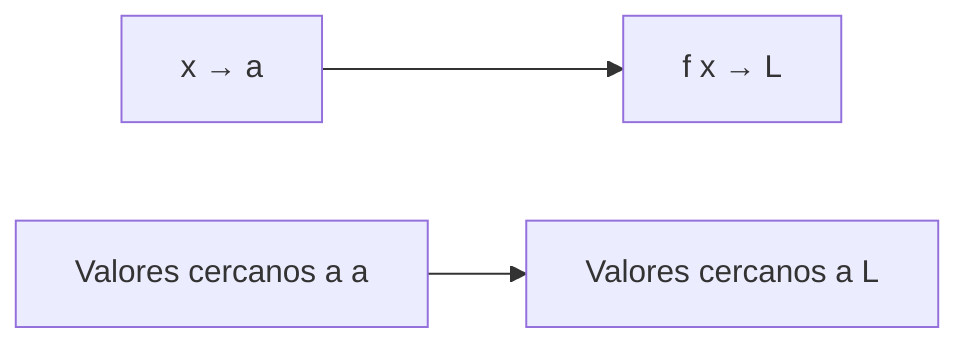
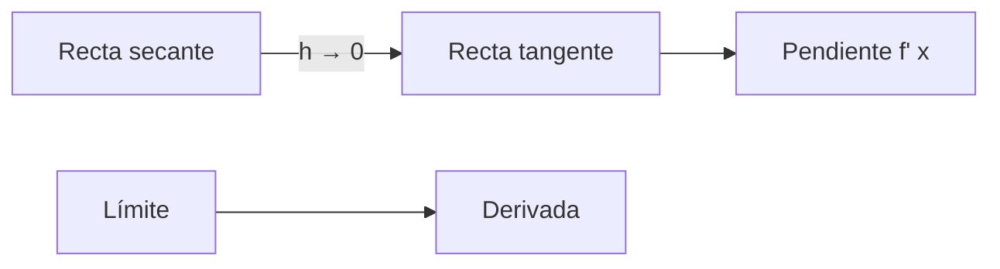

# Matemáticas para Ciencias Aplicadas I - Derivada de funciones reales de una variable real

## 2.2 Límites.

---

### 1. Concepto de Límite

#### 1.1 Definición Intuitiva

El límite de una función $f(x)$ cuando $x$ tiende a $a$ es el valor $L$ al que se aproxima $f(x)$ cuando $x$ se acerca arbitrariamente a $a$:

$$ \lim_{x \to a} f(x) = L $$

#### 1.2 Definición Formal (Épsilon-Delta)

Para todo $\epsilon > 0$, existe $\delta > 0$ tal que:

$$ 0 < |x - a| < \delta \Rightarrow |f(x) - L| < \epsilon $$

#### 1.3 Diagrama de Aproximación



### 2. Propiedades de los Límites

#### 2.1 Álgebra de Límites

Si $\lim_{x \to a} f(x) = L$ y $\lim_{x \to a} g(x) = M$, entonces:

- $\lim_{x \to a} [f(x) + g(x)] = L + M$
- $\lim_{x \to a} [f(x) - g(x)] = L - M$
- $\lim_{x \to a} [cf(x)] = cL$
- $\lim_{x \to a} [f(x)g(x)] = LM$
- $\lim_{x \to a} \frac{f(x)}{g(x)} = \frac{L}{M}$ si $M \neq 0$

#### 2.2 Límites Especiales

- $\lim_{x \to 0} \frac{\sin x}{x} = 1$
- $\lim_{x \to 0} \frac{1 - \cos x}{x} = 0$
- $\lim_{x \to \infty} \left(1 + \frac{1}{x}\right)^x = e$

### 3. Límites Laterales

#### 3.1 Límite por la Derecha

$$ \lim_{x \to a^+} f(x) = L $$  

Valor al que se aproxima $f(x)$ cuando $x$ se acerca a $a$ por valores mayores.

#### 3.2 Límite por la Izquierda

$$ \lim_{x \to a^-} f(x) = M$$  

Valor al que se aproxima $f(x)$ cuando $x$ se acerca a $a$ por valores menores.

#### 3.3 Existencia del Límite

El límite existe si y solo si ambos límites laterales existen y son iguales:  

$$ \lim_{x \to a} f(x) = L \iff \lim_{x \to a^+} f(x) = \lim_{x \to a^-} f(x) = L $$

### 4. Cálculo Práctico de Límites

#### 4.1 Sustitución Directa

Si $f$ es continua en $a$:  

$$ \lim_{x \to a} f(x) = f(a) $$

#### 4.2 Factorización y Simplificación

Para formas indeterminadas $\frac{0}{0}$:  

$$ \lim_{x \to 2} \frac{x^2 - 4}{x - 2} = \lim_{x \to 2} \frac{(x-2)(x+2)}{x-2} = \lim_{x \to 2} (x+2) = 4 $$

#### 4.3 Racionalización

Para límites con raíces:  

$$ \lim_{x \to 0} \frac{\sqrt{x+1} - 1}{x} = \lim_{x \to 0} \frac{(\sqrt{x+1} - 1)(\sqrt{x+1} + 1)}{x(\sqrt{x+1} + 1)} = \lim_{x \to 0} \frac{1}{\sqrt{x+1} + 1} = \frac{1}{2} $$

### 5. Implementación Computacional

#### 5.1 Código Python para Visualización

```python
import numpy as np
import matplotlib.pyplot as plt

def plot_limite(f, a, L, x_range=(-2, 2)):
    x = np.linspace(x_range[0], x_range[1], 1000)
    y = f(x)

    plt.figure(figsize=(10, 6))
    plt.plot(x, y, 'b-', label='f(x)')
    plt.axvline(x=a, color='r', linestyle='--', alpha=0.7, label=f'x = {a}')
    plt.axhline(y=L, color='g', linestyle='--', alpha=0.7, label=f'L = {L}')
    plt.plot(a, L, 'ko', markersize=8)

    # Punto removible si hay discontinuidad
    if np.isclose(f(a), L, atol=1e-6):
        plt.plot(a, f(a), 'go', markersize=8)
    else:
        plt.plot(a, f(a), 'ro', markersize=8)

    plt.xlabel('x')
    plt.ylabel('f(x)')
    plt.title(f'Límite: $\\lim_{{x \\to {a}}} f(x) = {L}$')
    plt.legend()
    plt.grid(True)
    plt.show()

# Ejemplo: límite de sin(x)/x en x=0
def f(x):
    return np.sin(x) / x

# Evitar división por cero
x_vals = np.linspace(-2*np.pi, 2*np.pi, 1000)
x_vals = x_vals[x_vals != 0]
y_vals = f(x_vals)

plot_limite(f, 0, 1, x_range=(-2*np.pi, 2*np.pi))
```

#### 5.2 Cálculo Numérico de Límites

```python
def calcular_limite(f, a, h=1e-6, tol=1e-8):
    """
    Calcula numéricamente el límite de f(x) cuando x → a
    """
    # Valores cercanos por izquierda y derecha
    x_izq = a - h
    x_der = a + h

    f_izq = f(x_izq)
    f_der = f(x_der)

    # Verificar si los límites laterales coinciden
    if np.isclose(f_izq, f_der, atol=tol):
        return (f_izq + f_der) / 2
    else:
        return None  # Límite no existe

# Ejemplo de uso
def g(x):
    return (x**2 - 1) / (x - 1)  # Discontinuidad removible en x=1

limite = calcular_limite(g, 1)
print(f"Límite cuando x → 1: {limite}")
```

### 6. Aplicaciones en Derivadas

#### 6.1 Límite y Derivada

La derivada se define como un límite:  

$$ f'(x) = \lim_{h \to 0} \frac{f(x + h) - f(x)}{h} $$

#### 6.2 Interpretación Geométrica

La derivada representa la pendiente de la recta tangente a la curva en un punto.

#### 6.3 Diagrama de Derivada como Límite



### 7. Ejercicios y Problemas

#### 7.1 Ejercicios de Cálculo

1. $\lim_{x \to 3} \frac{x^2 - 9}{x - 3}$
2. $\lim_{x \to 0} \frac{\tan x}{x}$
3. $\lim_{x \to \infty} \frac{2x^2 + 3x - 1}{x^2 - 4}$

#### 7.2 Problemas de Aplicación

1. Velocidad instantánea como límite de velocidad promedio
2. Tasa de cambio instantánea en crecimiento poblacional
3. Concentración límite en una reacción química

### Ver también

- **2.1** Razón de cambio — la derivada como límite de razones de cambio.
- **2.5** Derivada — definición formal como límite.
- **3.2** Integral definida — los límites también definen la integral.

### Referencias

- Stewart, J. (2016). _Cálculo de una variable_ (8.ª ed.). Cengage Learning.
- Simmons, G. F. (2012). _Cálculo con geometría analítica_ (2.ª ed.). McGraw-Hill.
- Thomas, G. B. et al. (2014). _Cálculo_ (13.ª ed.). Pearson.
