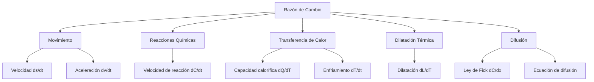

# Matemáticas para Ciencias Aplicadas I - Derivada de funciones reales de una variable real

## 2.3 Razón de cambio en la naturaleza

---

### 1. Concepto Fundamental de Razón de Cambio

#### 1.1 Definición Matemática

La razón de cambio instantánea se define como la derivada:

$$ \frac{df}{dt} = \lim_{\Delta t \to 0} \frac{\Delta f}{\Delta t} = \lim_{h \to 0} \frac{f(t + h) - f(t)}{h} $$

#### 1.2 Interpretación Física

Representa cómo cambia una cantidad física respecto al tiempo u otra variable.


### 2. Movimiento y Cinemática

#### 2.1 Velocidad Instantánea

Si $s(t)$ es la posición de un objeto:  
$$ v(t) = \frac{ds}{dt} $$

#### 2.2 Aceleración Instantánea

$$ a(t) = \frac{dv}{dt} = \frac{d^2s}{dt^2} $$

#### 2.3 Ejemplo: Caída Libre

Para un objeto en caída libre ( $g = 9.8 m/s^2$ ):

$$ s(t) = \frac{1}{2}gt^2 $$ $$ v(t) = \frac{ds}{dt} = gt $$ $$ a(t) = \frac{dv}{dt} = g $$

```python
import numpy as np
import matplotlib.pyplot as plt

# Caída libre
t = np.linspace(0, 5, 100)
g = 9.8
s = 0.5 * g * t**2
v = g * t
a = g * np.ones_like(t)

plt.figure(figsize=(12, 4))
plt.subplot(1, 3, 1)
plt.plot(t, s, 'b-')
plt.title('Posición s(t)')
plt.xlabel('Tiempo (s)')
plt.ylabel('Posición (m)')

plt.subplot(1, 3, 2)
plt.plot(t, v, 'r-')
plt.title('Velocidad v(t)')
plt.xlabel('Tiempo (s)')
plt.ylabel('Velocidad (m/s)')

plt.subplot(1, 3, 3)
plt.plot(t, a, 'g-')
plt.title('Aceleración a(t)')
plt.xlabel('Tiempo (s)')
plt.ylabel('Aceleración (m/s²)')

plt.tight_layout()
plt.show()
```

### 3. Velocidad de Reacción Química

#### 3.1 Ley de Velocidad

Para una reacción $aA + bB \rightarrow cC$:  
$$ v = -\frac{1}{a}\frac{d[A]}{dt} = -\frac{1}{b}\frac{d[B]}{dt} = \frac{1}{c}\frac{d[C]}{dt} $$

#### 3.2 Ejemplo: Reacción de Primer Orden

$$ \frac{d[A]}{dt} = -k[A] $$ $$ [A] = [A]_0 e^{-kt} $$

### 4. Capacidad Calorífica y Transferencia de Calor

#### 4.1 Capacidad Calorífica

Razón de cambio del calor respecto a la temperatura:

$$ C = \frac{dQ}{dT} $$

#### 4.2 Ley de Enfriamiento de Newton

$$ \frac{dT}{dt} = -k(T - T_{\text{ambiente}}) $$

```python
# Ley de Enfriamiento de Newton
def cooling_law(T, T_env, k):
    return -k * (T - T_env)

# Simulación
t = np.linspace(0, 100, 1000)
T0 = 100  # Temperatura inicial
T_env = 25  # Temperatura ambiente
k = 0.1  # Constante de enfriamiento

# Solución numérica
T = T_env + (T0 - T_env) * np.exp(-k * t)

plt.figure(figsize=(10, 6))
plt.plot(t, T, 'r-', label='Temperatura')
plt.axhline(T_env, color='b', linestyle='--', label='T ambiente')
plt.xlabel('Tiempo (min)')
plt.ylabel('Temperatura (°C)')
plt.title('Ley de Enfriamiento de Newton')
plt.legend()
plt.grid(True)
plt.show()
```

### 5. Dilatación Térmica

#### 5.1 Coeficiente de Dilatación Lineal

$$ \alpha = \frac{1}{L_0}\frac{dL}{dT} $$

#### 5.2 Dilatación de una Barra

$$ L(T) = L_0 (1 + \alpha \Delta T) $$ $$ \frac{dL}{dT} = L_0 \alpha $$

### 6. Difusión y Transporte

#### 6.1 Primera Ley de Fick

Flujo de difusión proporcional al gradiente de concentración:

$$ J = -D \frac{dC}{dx} $$

#### 6.2 Ecuación de Difusión

$$ \frac{\partial C}{\partial t} = D \frac{\partial^2 C}{\partial x^2} $$

### 7. Diagrama de Aplicaciones



### 8. Ejercicios y Problemas

#### 8.1 Problema de Movimiento

Un automóvil tiene posición $s(t) = 2t^3 - 15t^2 + 36t$ metros.  
Encuentra:  
a) Velocidad en $t = 2$ s  
b) Aceleración en $t = 3$ s  
c) ¿Cuándo se detiene el automóvil?

#### 8.2 Problema de Enfriamiento

Una taza de café a 90°C se enfría en una habitación a 20°C.  
Si después de 10 minutos está a 60°C, ¿cuál será la temperatura después de 20 minutos?

#### 8.3 Problema de Difusión

La concentración de un contaminante en un tubo sigue $C(x) = C_0 e^{-x/L}$.  
Encuentra el flujo de difusión en $x = 0$.

### Ver también

- **2.1** Razón de cambio promedio — versión discreta de la razón de cambio.
- **2.5** Derivada — formalización de la razón de cambio en la naturaleza.
- **1.1** Funciones físicas — densidad, presión, velocidad.

### Referencias

- Stewart, J. (2016). _Cálculo de una variable_ (8.ª ed.). Cengage Learning.
- Simmons, G. F. (2012). _Cálculo con geometría analítica_ (2.ª ed.). McGraw-Hill.
- Thomas, G. B. et al. (2014). _Cálculo_ (13.ª ed.). Pearson.
