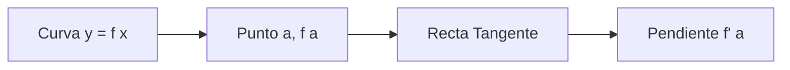
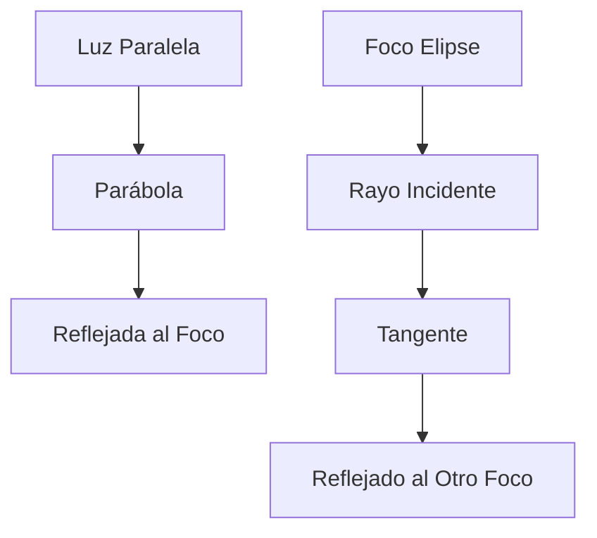

# Matemáticas para Ciencias Aplicadas I - Derivada de funciones reales de una variable real

## 2.4 Tangente a una curva. Cónicas.

---

### 1. Recta Tangente a una Curva

#### 1.1 Definición Geométrica

La recta tangente a una curva en un punto $P$ es la recta que mejor aproxima la curva en las proximidades de $P$.

#### 1.2 Definición Analítica

Para una función $f(x)$ derivable en $x = a$, la ecuación de la recta tangente es:

$$ y = f(a) + f'(a)(x - a) $$

Donde:

- $f(a)$: Valor de la función en el punto
- $f'(a)$: Pendiente de la tangente (derivada)

#### 1.3 Diagrama de Tangente



### 2. Derivada como Pendiente de la Tangente

#### 2.1 Interpretación Geométrica

La derivada $f'(a)$ representa la pendiente de la recta tangente a la curva en el punto $(a, f(a))$.

#### 2.2 Cálculo de la Pendiente

$$ f'(a) = \lim_{h \to 0} \frac{f(a + h) - f(a)}{h} $$

#### 2.3 Ejemplo: Tangente a una Parábola

Para $f(x) = x^2$ en $x = 1$:  
$$ f(1) = 1 $$ $$ f'(x) = 2x \Rightarrow f'(1) = 2 $$ $$ \text{Tangente: } y = 1 + 2(x - 1) = 2x - 1 $$

### 3. Implementación Computacional

#### 3.1 Código Python para Visualización

```python
import numpy as np
import matplotlib.pyplot as plt

def tangente(f, df, a, x_range=(-2, 2)):
    """
    Grafica la función y su recta tangente en x = a
    """
    x = np.linspace(x_range[0], x_range[1], 100)
    y_func = f(x)
    y_tang = f(a) + df(a) * (x - a)

    plt.figure(figsize=(10, 6))
    plt.plot(x, y_func, 'b-', label='f(x) = x²', linewidth=2)
    plt.plot(x, y_tang, 'r--', label=f'Tangente: y = {df(a):.1f}x + {f(a)-df(a)*a:.1f}', linewidth=2)
    plt.plot(a, f(a), 'ko', markersize=8, label=f'Punto ({a}, {f(a)})')
    plt.xlabel('x')
    plt.ylabel('y')
    plt.title(f'Recta Tangente a f(x) en x = {a}')
    plt.legend()
    plt.grid(True)
    plt.axis('equal')
    plt.show()

# Definir función y su derivada
def f(x):
    return x**2

def df(x):
    return 2*x

# Graficar tangente en x=1
tangente(f, df, 1)
```

### 4. Tangentes a Cónicas

#### 4.1 Elipse

Para la elipse $\frac{x^2}{a^2} + \frac{y^2}{b^2} = 1$, la tangente en $(x_0, y_0)$ es:

$$ \frac{x x_0}{a^2} + \frac{y y_0}{b^2} = 1 $$

#### 4.2 Hipérbola

Para la hipérbola $\frac{x^2}{a^2} - \frac{y^2}{b^2} = 1$, la tangente en $(x_0, y_0)$ es:

$$ \frac{x x_0}{a^2} - \frac{y y_0}{b^2} = 1 $$

#### 4.3 Parábola

Para la parábola $y^2 = 4px$, la tangente en $(x_0, y_0)$ es:

$$ y y_0 = 2p(x + x_0) $$

### 5. Aplicación: Tangentes a Cónicas

#### 5.1 Código para Tangente a Elipse

```python
def tangente_elipse(a, b, x0, y0, theta_range=(0, 2*np.pi)):
    """
    Grafica elipse y tangente en (x0, y0)
    """
    # Parametrización elipse
    theta = np.linspace(theta_range[0], theta_range[1], 100)
    x_ellipse = a * np.cos(theta)
    y_ellipse = b * np.sin(theta)

    # Tangente
    x_t = np.linspace(x0 - 2, x0 + 2, 100)
    y_t = (b**2 / y0) * (1 - (x0 * x_t) / a**2)  # Despejando y

    plt.figure(figsize=(8, 8))
    plt.plot(x_ellipse, y_ellipse, 'b-', label=f'Elipse: x²/{a}² + y²/{b}² = 1')
    plt.plot(x_t, y_t, 'r--', label='Recta tangente')
    plt.plot(x0, y0, 'ko', markersize=8, label=f'Punto ({x0}, {y0})')
    plt.xlabel('x')
    plt.ylabel('y')
    plt.title('Tangente a Elipse')
    plt.legend()
    plt.grid(True)
    plt.axis('equal')
    plt.show()

# Ejemplo: tangente en (2, 1.5) para elipse x²/4 + y²/9 = 1
tangente_elipse(2, 3, 2, 1.5)
```

### 6. Derivación Implícita para Cónicas

#### 6.1 Método de Derivación Implícita

Para encontrar la pendiente de la tangente a cónicas:

1. Derivar ambos lados de la ecuación respecto a $x$
2. Despejar $\frac{dy}{dx}$

#### 6.2 Ejemplo: Elipse

$$ \frac{x^2}{a^2} + \frac{y^2}{b^2} = 1 $$ $$ \frac{2x}{a^2} + \frac{2y}{b^2}\frac{dy}{dx} = 0 $$ $$ \frac{dy}{dx} = -\frac{b^2 x}{a^2 y} $$

### 7. Aplicaciones en Óptica y Física

#### 7.1 Propiedad Reflectora de la Parábola

Los rayos paralelos al eje se reflejan hacia el foco:

- La tangente en cualquier punto forma ángulos iguales con el radio vector y el eje

#### 7.2 Propiedad de las Elipses

La suma de distancias a los focos es constante:

- La tangente forma ángulos iguales con los radios vectores a los focos

#### 7.3 Diagrama de Propiedades Ópticas



### 8. Ejercicios y Problemas

#### 8.1 Ejercicios de Tangentes

1. Encuentra la ecuación de la tangente a $y = x^3 - 3x$ en $x = 2$
2. Halla la tangente a la elipse $\frac{x^2}{9} + \frac{y^2}{4} = 1$ en el punto $(2, \frac{2\sqrt{5}}{3})$
3. Demuestra que la tangente a la hipérbola $\frac{x^2}{a^2} - \frac{y^2}{b^2} = 1$ en $(x_0, y_0)$ es $\frac{x x_0}{a^2} - \frac{y y_0}{b^2} = 1$

#### 8.2 Problemas de Aplicación

1. Un espejo parabólico tiene ecuación $y^2 = 12x$. ¿En qué punto la tangente tiene pendiente 1?
2. Una partícula se mueve sobre la elipse $4x^2 + 9y^2 = 36$. Encuentra la pendiente cuando $x = 1$

### Ver también

- **1.4** Cónicas — la tangente a las cónicas como aplicación.
- **2.2** Límites — la tangente se define mediante límites.
- **2.5** Derivada — la pendiente de la tangente es la derivada.

### Referencias

- Stewart, J. (2016). _Cálculo de una variable_ (8.ª ed.). Cengage Learning.
- Simmons, G. F. (2012). _Cálculo con geometría analítica_ (2.ª ed.). McGraw-Hill.
- Thomas, G. B. et al. (2014). _Cálculo_ (13.ª ed.). Pearson.
