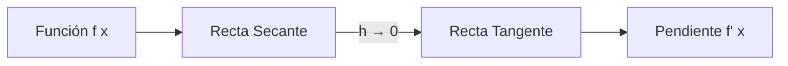
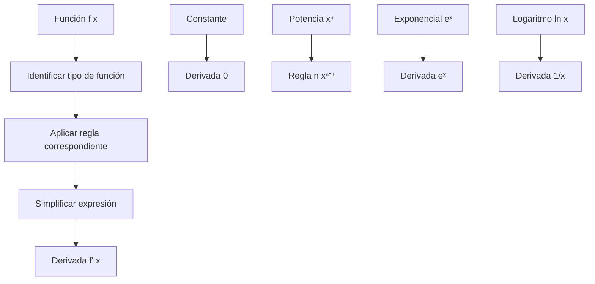

# Matemáticas para Ciencias Aplicadas I - Derivada de funciones reales de una variable real

## 2.5 Derivada. Cálculo de la derivada de algunas funciones simples.

---

### 1. Concepto de Derivada

#### 1.1 Definición Formal

La derivada de una función $f(x)$ en un punto $x = a$ se define como:

$$ f'(a) = \lim_{h \to 0} \frac{f(a + h) - f(a)}{h} $$

Si este límite existe, la función es derivable en $x = a$.

#### 1.2 Notaciones Comunes

- Notación de Lagrange: $f'(x)$
- Notación de Leibniz: $\frac{df}{dx}$ o $\frac{dy}{dx}$
- Notación de Newton: $\dot{y}$

#### 1.3 Interpretación Geométrica



### 2. Reglas Básicas de Derivación

#### 2.1 Derivada de una Constante

Si $f(x) = c$ (constante), entonces:  
$$ f'(x) = 0 $$

#### 2.2 Regla de la Potencia

Si $f(x) = x^n$, entonces:  
$$ f'(x) = n x^{n-1} $$

#### 2.3 Derivada de una Suma

Si $f(x) = g(x) + h(x)$, entonces:  
$$ f'(x) = g'(x) + h'(x) $$

#### 2.4 Derivada de Producto por Constante

Si $f(x) = c \cdot g(x)$, entonces:  
$$ f'(x) = c \cdot g'(x) $$

### 3. Derivadas de Funciones Elementales

#### 3.1 Función Lineal

$f(x) = mx + b$  
$$ f'(x) = m $$

#### 3.2 Función Cuadrática

$f(x) = ax^2 + bx + c$  
$$ f'(x) = 2ax + b $$

#### 3.3 Función Exponencial Natural

$f(x) = e^x$  
$$ f'(x) = e^x $$

#### 3.4 Función Logaritmo Natural

$f(x) = \ln x$  
$$ f'(x) = \frac{1}{x} $$

#### 3.5 Funciones Trigonométricas

- $\frac{d}{dx} \sin x = \cos x$
- $\frac{d}{dx} \cos x = -\sin x$
- $\frac{d}{dx} \tan x = \sec^2 x$

### 4. Implementación Computacional

#### 4.1 Código Python para Cálculo Simbólico

```python
import sympy as sp

# Definir variable simbólica
x = sp.symbols('x')

# Funciones ejemplo
funciones = [
    x**2,
    sp.sin(x),
    sp.exp(x),
    sp.ln(x),
    3*x**4 + 2*x**2 - 5
]

# Calcular derivadas
print("Derivadas de funciones simples:")
for func in funciones:
    derivada = sp.diff(func, x)
    print(f"d/dx({func}) = {derivada}")
```

#### 4.2 Cálculo Numérico de Derivadas

```python
import numpy as np

def derivada_numerica(f, x, h=1e-5):
    """
    Calcula la derivada numérica usando diferencia central
    """
    return (f(x + h) - f(x - h)) / (2 * h)

# Ejemplo: derivada de x^2 en x=2
def f(x):
    return x**2

x_val = 2
derivada = derivada_numerica(f, x_val)
print(f"f'(2) para f(x) = x²: {derivada:.4f}")
print(f"Valor exacto: {2*x_val}")
```

### 5. Proceso de Derivación Paso a Paso

#### 5.1 Ejemplo 1: Función Polinómica

$f(x) = 3x^4 - 2x^3 + 5x - 7$

$$ f'(x) = 3 \cdot 4x^{3} - 2 \cdot 3x^{2} + 5 \cdot 1 - 0 = 12x^3 - 6x^2 + 5 $$

#### 5.2 Ejemplo 2: Función con Raíz

$f(x) = \sqrt{x} = x^{1/2}$  
$$ f'(x) = \frac{1}{2}x^{-1/2} = \frac{1}{2\sqrt{x}} $$

#### 5.3 Ejemplo 3: Función Recíproca

$f(x) = \frac{1}{x} = x^{-1}$  
$$ f'(x) = -1 \cdot x^{-2} = -\frac{1}{x^2} $$

### 6. Tabla de Derivadas Comunes

| Función $f(x)$  | Derivada $f'(x)$ |
| --------------- | ---------------- |
| $c$ (constante) | $0$              |
| $x^n$           | $n x^{n-1}$      |
| $e^x$           | $e^x$            |
| $\ln x$         | $\frac{1}{x}$    |
| $\sin x$        | $\cos x$         |
| $\cos x$        | $-\sin x$        |
| $\tan x$        | $\sec^2 x$       |

### 7. Aplicaciones y Ejercicios

#### 7.1 Ejercicios de Cálculo

Calcula las derivadas de:

1. $f(x) = 4x^3 - 3x^2 + 2x - 1$
2. $g(x) = \sqrt[3]{x} + \frac{1}{x^2}$
3. $h(x) = 2e^x - 3\ln x$
4. $k(x) = \sin x + \cos x$

#### 7.2 Problemas de Aplicación

1. La posición de una partícula es $s(t) = t^3 - 6t^2 + 9t$. Encuentra su velocidad y aceleración.
2. El área de un círculo es $A(r) = \pi r^2$. Encuentra la tasa de cambio del área respecto al radio.
3. El volumen de un cubo es $V(l) = l^3$. Calcula cómo cambia el volumen cuando $l = 2$ cm.

### 8. Diagrama de Proceso de Derivación



### Ver también

- **2.2** Límites — la derivada es un límite.
- **2.4** Tangente a una curva — la derivada es la pendiente de la tangente.
- **2.6** Propiedades de la derivada — reglas de cálculo.

### Referencias

- Stewart, J. (2016). _Cálculo de una variable_ (8.ª ed.). Cengage Learning.
- Simmons, G. F. (2012). _Cálculo con geometría analítica_ (2.ª ed.). McGraw-Hill.
- Thomas, G. B. et al. (2014). _Cálculo_ (13.ª ed.). Pearson.
